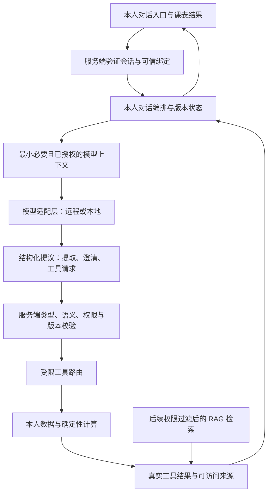

# Agent 对话与模型接入设计 v1

日期：2026-10-09。状态：**设计稿；本轮保留 Agent 对话主入口，但尚未接通模型，也没有实现对话编排或 RAG。** 本文件是对用户最新产品定位的补充，不以页面入口、文档或计算测试代替 Agent 验收。

## 1. 核心产品流程与当前边界

核心体验是学生通过 Agent 对话表达需求、澄清条件、获取推荐课表，再比较、锁定、调整、重新校验、保存和导出。原生表单、课表和学业账本是辅助查看与核对入口，不能因为 RAG、学校认证或真实数据尚未接入，就从产品设计中删除对话主入口。

目标流程为：**学校身份登录 → 服务端可信本人绑定 → 获授权的本人档案与学业上下文 → 对话表达目标和偏好 → Agent 调用受限检索与计算工具 → 有依据的方案及待确认项 → 多轮调整和重新校验 → 本人保存/导出。** 学生在学校官方系统完成实际选课，本项目不自动执行学校选课。

当前能够运行的是固定合成主体、本人 synthetic 工作区和确定性 P0/P1 工具。学校真实认证协议与应用接入、可信身份映射、本人档案/成绩/选课数据源、真实班次/周次/考试/校历仍待确认。学校登录成功也不表示已经有档案 API。Excel 和截图继续仅作字段参考，不规定真实用户必须上传。

页面保留的 Agent 入口应明确显示“模型尚未接入”，不能返回预编答案后声称模型已完成对话推荐；原生规划入口仍可运行已实现的合成计算。现有服务没有对话接口、模型适配器或检索管线，不能将这些能力写成当前已经实现。当前代码状态与验证证据以 [开发进度](开发进度.md) 为准。

## 2. 是否需要外部大模型 API

要实现由语言模型理解自然语言、澄清需求、组织工具调用和解释计算结果的 Agent，需要接入可实际调用的模型推理能力，**不要求必须购买或调用外部云模型 API**。可以使用经授权的远程模型服务，也可以使用本地部署的模型；两者通过服务端模型适配层对接同一受限工具和校验流程。

| 方式 | 在本项目中的位置 | 需要确认的事项 |
| --- | --- | --- |
| 远程模型 API | 服务端向已配置模型服务发送经授权且最小化的对话上下文 | 用户选择和调用授权、接口格式、模型能力、费用、超时、数据传输及处理条件；不能默认把本人真实学业资料外传 |
| 本地模型或本地推理服务 | 服务端调用本机推理入口，沿用相同输出契约 | 本机资源、模型与协议、结构化输出和工具编排能力，需要实际验证；本地运行也不能绕过权限与计算 |
| 测试用模型替身 | 返回预设结构，测试编排、类型校验和异常路径 | 只能证明测试场景的程序行为，不能称为真实模型对话验收 |

本轮不选择具体付费供应商，不配置或索取 Key，不自动调用外部模型。模型未配置时，保持入口和真实状态提示，允许用户使用现有表单工具；不能用规则模板冒称大模型已接入。

RAG 是按适用范围检索外部依据、交给模型组织答案的能力，不是模型 API 本身。先接通 synthetic 数据上的模型与工具最小闭环，可以不依赖 RAG；接入 RAG 也不能代替缺失的学业来源、学校身份验证或确定性计算。

技术来源仅用于说明可接入形式，不作为本轮选型：远程服务的工具调用文档描述模型提出调用、应用实际执行、再回传工具结果的循环；本地推理服务也有同类工具调用能力。两类适配器都必须经过本项目的权限和计算控制。[OpenAI 官方工具调用文档](https://developers.openai.com/api/docs/guides/function-calling)、[Ollama 官方工具调用文档](https://docs.ollama.com/capabilities/tool-calling)

## 3. 组件分工与信任链



- **LLM** 提取课程目标、硬条件与软偏好；提出澄清；在允许的工具集合中建议调用；依据工具结果解释差异、取舍、冲突和缺口。模型提供提议，不直接写 SQLite，也不自行给出学分、资格或无冲突的最终判定。
- **服务端编排** 管理本人对话状态、调用次数与超时预算；校验模型提议；从当前工作区注入可信计算输入；执行受限工具；保存工具证据与版本。它决定是否可以读取和操作某个资源。
- **确定性工具** 计算学分、修读/认定、适用性、先修、余量、上课/考试冲突、搜索、比较和重新校验。结果中的 `pass/fail/unknown`、范围内无解、缺数据和搜索上限由这些工具产生。
- **RAG** 之后从已授权且适用的资料中检索依据，返回可访问的出处、版本、范围和争议。检索命中不使原候选规则自动生效，模型也不能替代规则审核。

`AuthContext` 留在服务端，模型无需持有会话 Cookie、CSRF 值、学生登录凭据或权限记录。模型看到的“本人上下文”是服务器准备的业务内容子集；它不能通过输出学号、`student_id`、`owner_student_id`、`auth_mode`、角色或安全域来选择身份。工具路由从当前有效会话推导本人范围，并在每次执行前重新检查。

## 4. 现有工具映射与缺口

下列映射来自当前源码只读审阅。现有 HTTP 接口不是模型可以任意发送请求的浏览器代理；后续应通过服务端白名单包装调用共享业务函数，并复用有效身份、归属、版本及请求校验。

| Agent 需要的动作 | 当前可复用能力 | 对话接入仍需完成 |
| --- | --- | --- |
| 读取本人当前状态和输入版本 | `Application.workspace(context)`、`versions(workspace)`，本人 `/api/bootstrap` | 最小上下文投影；不要把 bootstrap 完整原始包、所有历史方案或来源文件全部发送给模型 |
| 核对学业、认定及未完成要求 | `/api/audit`、`audit_progress` | 将规则结果、账本范围和 unknown 转为可解释结构；真实档案尚未接入；原资料模式不能假装有本人学业 |
| 查找指定课程的班次 | `find_sections(snapshot, course_ids)` 纯函数 | 尚无专门的受限 Agent 工具包装；自然语言课程名需对已授权课程目录消歧，不能擅自创造课程 ID 或按相似名称跨方案合并 |
| 修改偏好并生成组合 | `revise_constraints`、`generate_plans`、`/api/generate` | 将提取结果规范化为允许的 patch；歧义先澄清；保存用户表达依据和提取/提示版本 |
| 检查调整后的指定课表 | `validate_plan`、`/api/validate` | 接收准确班次列表；每次调整调用工具；不能采信模型自行填写的 validation、学分、score 或来源 |
| 比较当前方案 | `compare_plans`、当前模式 `/api/compare` | 解释统一当前输入下的课程换班、学分和偏好差异；返回的当前三态和排名为计算结果 |
| 查看与比较历史版本 | `/api/saved`、`/api/load`、冻结模式 `/api/compare` | 仅本人版本；历史结果与当前结果分开，不将不同冻结输入排名为同条件最优 |
| 按当前输入重校验历史课表 | `/api/revalidate` | 继承当前和历史锁定、预置及固定项；旧班从当前快照消失时待确认；保留旧版本 |
| 保存或导出 | `/api/save`、`/api/export`、`export_result` | 依据明确用户意图选择动作，仍检查本人归属和冻结版本；保存和导出不是正式中选 |
| 检索规则与出处 | 当前有来源引用、原资料清单和登录后公共 PDF 白名单 | 尚未实现 RAG 检索、文本分块、索引或检索缓存；个人来源不能因有文件名就成为公共资料 |
| 接入学校真实身份或个人源 | 当前官方登录返回未配置；mock 固定绑定 synthetic A/B | 需获准的学校协议、可信映射和个人数据源许可，分别实现验收；不能自动降级或在 mock 中导入真实记录 |

当前服务端已经检查有效会话与绑定、本人 owner/realm、嵌套输入归属、synthetic 数据和摘要；写 HTTP 接口还检查 CSRF、Origin 和 Host。对话编排不能只在建立对话时检查一次，也不能把模型包装层视为更高权限的内部管理员。

尚缺模型适配层、对话接口、对话与消息持久化、工具注册与调用追踪、模型输出完整 Schema/语义校验、模型超时/重试/取消管理、对话 UI 联调、真实模型评估以及 RAG。纯计算和页面验证记录不覆盖这些未实现项。

## 5. 结构化输出与受限工具契约

后续可设计本人 `POST /api/chat/turn` 等入口，但**这些接口当前不存在**。用户请求仅包含消息、本人对话引用及显示版本；服务端查找本人对话并注入 AuthContext。请求中的对象 ID 只是待授权引用，不是权限。

模型输出建议采用两类互斥结构：`clarify` 表示需要澄清；`tool_request` 表示请求白名单工具。最小示例仅为拟议协议：

```json
{
  "kind": "tool_request",
  "tool": "generate_plan",
  "arguments": {
    "constraint_patch": {"friday_free": "soft"}
  }
}
```

模型不提供可信学生身份、规则版本、数据快照、偏好版本或已经通过的校验结果。服务端在本轮开始时冻结观察到的本人输入版本，工具提交前核对仍为该版本，再填充对应 `expected_revision`；不能在模型回复后改用最新 revision 强行通过旧提议。课程/班次引用只能在本人可访问的目录与快照中解析；找不到或多义时返回澄清/unknown，不能补造教师、周次、余量、考试或政策。

执行前分别检查：

1. **JSON 与类型**：限定大小、深度和列表长度；必须为约定对象，拒绝非有限数、重复关键键和字符串冒充列表。Python 的 `json` 可做解码，`parse_constant` 可拒绝 NaN/Infinity，序列化可使用 `allow_nan=False`；解析成功不代表符合业务契约。[Python 官方 JSON 文档](https://docs.python.org/3/library/json.html)
2. **Schema**：限定 kind、tool、字段、必填项、枚举和数值范围；拒绝额外权限/凭据字段。可用 JSON Schema 描述规范，首版可沿用标准库并显式实现 Python 校验，不要求引入第三方验证库；Schema 规范与实际验证器必须一致。`required` 和拒绝未声明属性需明确设置，不能只列出 `properties` 就认为已限制对象。[JSON Schema 官方对象说明](https://json-schema.org/understanding-json-schema/reference/object)
3. **用户语义**：确认提议对应本轮表达，特别是硬/软条件、选课对象及解锁意图。Schema 正确的“周五软偏好”也可能误解用户说的“周五必须空闲”。歧义先澄清，不能为了出方案静默放宽条件。
4. **权限与版本**：按当前有效本人上下文授权每个对象及关联输入；核对条件修订、快照、规则与方案版本。外部服务延迟期间输入已变化时拒绝旧写入，重新读取并计算，不能用旧模型输出覆盖新条件。
5. **工具执行与结果**：在白名单内实际调用，保留调用及返回证据。合法 JSON、通过 Schema、发出了工具请求、工具返回和最终任务正确是不同检查；缺少实际工具结果不能宣称已生成可行课表。

学分与阈值采用现有十进制文本/Decimal 规则，不将布尔值当数值，不接受 NaN/Infinity。对话工具不能执行任意 Python/JavaScript、SQL、Shell、自由 URL 请求或学校选课操作；检索资料中的文字也不能改变工具白名单或本人权限。

## 6. 多轮偏好、锁定与版本

每轮保留已经确认的课程目标、硬条件、软偏好、锁定班、预置/正式成员、固定安排与输入版本。用户省略、模型返回空列表或上下文摘要变短，不构成解除锁定；无解时解释冲突，提出可审查的调整建议。

任意对话更新都须来自本人已确认的意图：本人本轮明确的修改指令可作为确认，模型建议或来源文字不能自行授予修改权限。明确解除个人锁定可映射到 `unlock_section_ids`，但不能删除预置或来源支持的正式成员。固定项继续保留；未经定义的固定项解除流程不能由模型自行创造。对已经明确确认且允许的操作，不新增每一步重复确认；有歧义或未表达解锁意图时才澄清。

每次偏好、候选班、数据或规则变化后，调用确定性工具重新校验。记录所用学业/开课/规则/校历、档案与方案绑定、条件修订及引擎版本；未来再增加对话、提示与模型配置版本。历史方案保持冻结，只通过新计算产生当前结果。学校正式中选和已获学分各自有来源，不由对话、用户确认方案、保存或导出代替。

synthetic 最小闭环应覆盖这样的连续对话：用户表达“尽量周五空闲，保留体育”；Agent 获取当前锁定与目录，提出或解析具体课程并调用生成；用户随后要求“周五必须空闲”，Agent 保留锁定再调用计算；若锁定班与周五硬条件冲突，则解释当前范围内无解。若缺考试/周次则说明待确认，搜索达到上限则说明覆盖不足，均不包装成全局无解或完整通过。

## 7. 未配置、错误与幻觉路径

| 场景 | 预期行为 |
| --- | --- |
| 模型未配置或未授权外部调用 | 对话入口显示未接通，保留用户可见的计算入口；不发送请求、不伪造模型回答 |
| 远程/本地模型超时、不可用、配额或协议错误 | 返回明确本轮失败/可重试状态；限制重试预算；未成功的模型回复不改偏好、不保存方案；不切换到未授权模型 |
| JSON、Schema 或类型错误 | 不执行工具；在限定预算内请求修正或提示失败，不能直接采用自然语言中的班号和分数 |
| 语义不明确 | 询问硬/软属性、课程消歧或是否确实解锁；继承已有有效条件 |
| 编造课程、规则、source_id 或成绩 | 对照本人可访问输入拒绝引用或标 unknown；官方效力缺证据仍待确认；不能由模型补入真实账本 |
| 请求读取他人档案/方案或修改身份、角色、安全域 | 服务端拒绝，采用一致的不可访问响应；不先取回他人资料后交模型过滤 |
| 模型解释声称“通过”，计算为 fail/unknown | 以工具结果显示状态、原因和证据；不展示伪造的通过结论，重新生成受结果约束的解释或使用确定性结果说明 |
| 模型调用期间退出、绑定撤销或会话到期 | 执行工具和返回个人结果前再次授权，失败则拒绝并终止后续调用 |
| 调用期间偏好或快照变化 | 旧提议失效，重新读取本人版本并重校验；不自动覆盖另一次调整 |
| 部分工具已成功，后续解释失败 | 明确已经执行的动作与尚未完成的解释，保留真实工具证据；重试不能重复保存同一方案或覆盖条件 |

不可只用提示词约束这些路径。服务端需要控制动作、状态和结果渲染；正常文本解释只能引用经过授权的工具结果和来源，不能覆盖结构化事实。

## 8. 模型配置、数据传输和对话隔离

模型地址、名称、调用方式和 Key 只由服务端部署/环境配置提供；拟议配置命名不表示当前已经存在可用选项。Key 不进入前端、聊天消息、SQLite 业务 JSON、来源引用、导出、日志或 Git，也不由模型选择 endpoint。学校密码、Cookie 和认证票据与模型 Key 分开，不能交给模型服务。

服务端环境配置、后端代发请求、避免浏览器暴露与仓库提交符合官方 API Key 安全建议；此处只引用配置边界，没有选择供应商或处理实际密钥。[OpenAI 官方 API Key 安全建议](https://help.openai.com/en/articles/5112595-best-practices-for-api-key-safety)

远程调用前需要明确模型服务和允许发送的材料范围。synthetic 开发只发送独立合成上下文及已经明确可使用的非个人公共资料；**未经授权的本人真实档案、成绩、偏好、聊天原文、原文件或冻结数据不外传**。以后接入真实个人源时逐项确定必要字段和用途，授权学校数据获取不自动授权将数据传到另一个模型服务。不能把“脱敏”标签或一个内部学生 ID 当成足够的外传依据。

拟议对话、消息、工具 trace、摘要、缓存和导出均具备服务端赋予的本人 owner 与 security realm。对话 ID、模型工具 ID、来源 ID 或缓存键不能替代授权。检索在取回材料前过滤；缓存键包含本人、安全域和输入/授权版本；退出、撤销或权限变更后不得继续返回旧授权个人结果。对话摘要不能丢失锁定、固定、版本和未确认项。

每轮 trace 保存必要的输入版本、经校验动作、实际工具结果及错误状态，使用受保护的本人引用；避免记录凭据和不必要的整份个人内容。真正模型效果验收与日志数据保存策略都仍需实现，当前没有个人检索缓存、后台 Agent 任务或对话持久化。

## 9. 下一步实现顺序与验收

1. **保留对话主入口与设计**：说明未接通状态；原生工具辅助核对。当前阶段不宣称 Agent 或 RAG 已实现。
2. **synthetic 工具最小闭环**：实现服务端模型适配、本人对话状态、严格结构化校验、白名单工具、版本及错误管理。可先用模型替身测协议，然后在用户选定且授权的本地或远程模型上跑真实对话。验证从自然语言目标到具体计算结果和多轮调整，仍只用独立合成数据。
3. **RAG 依据检索**：增加按本人权限与培养方案适用范围过滤的来源检索、版本、出处和争议展示；不强制先引入向量库。保留原 23 条候选待审核和空真实教学班模板；RAG 命中不直接启用候选。
4. **获准的真实接入**：分别实现学校认证、本人源与真实页面样本适配，在获得具体许可/协议/可核验数据后验收。真实字段缺失继续 unknown，不把 synthetic 补全值套到真实记录；不自动执行学校选课。

Agent 验收至少需要实际模型对话证据：需求提取与澄清；真实调用计算工具；锁定/固定/版本继承；当前与冻结方案分离；无解/未知/搜索上限解释；模型输出错误及幻觉；A/B 对话与资源越权；会话失效和并发版本变化；模型未配置/超时；授权外传范围及凭据不进入模型/导出。当前这些对话验收未实现、未执行，原八项业务与十项权限验收的未覆盖部分仍沿用 [开发进度](开发进度.md) 的独立状态。

本设计文件记录拟议方案，不代表已经配置模型、调用模型 API、创建对话接口、实现 RAG 或处理 Key。本轮页面与计算代码的实际修改、验证和交付边界见 [开发进度](开发进度.md)，文档本身不能作为这些功能的实现或验收证据。
