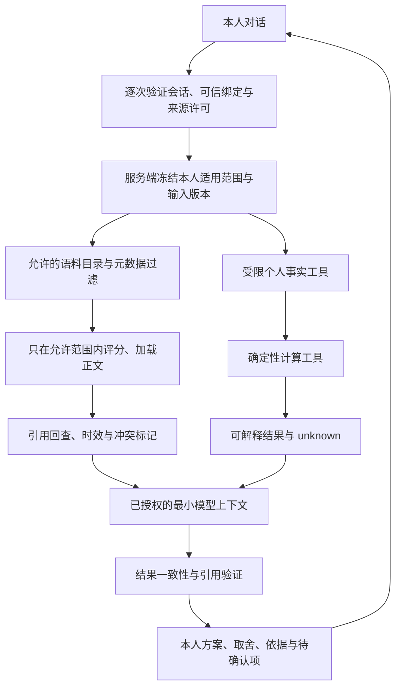

# RAG 检索、权限、引用与评估设计 v1

日期：2026-10-09。状态：可审核设计 + 离线关键词参考切片；没有运行时 RAG、模型生成、多轮编排、个人索引或检索缓存。配套 [数据接入契约](数据接入契约与最小切片_v1.md)和 [Agent 模型设计](Agent对话与模型接入设计_v1.md)。

## 1. 分工与目标链路

主入口保留 Agent 对话。本人档案/学业/选课等结构化事实由服务端受限工具读取；学分、资格、冲突、比较、调整和导出调用现有确定性工具。RAG 检索政策、要求原文、课程说明及已授权的解释材料，给出出处、范围、版本、争议与缺口。检索命中不审核规则，不决定身份，也不修改账本。

未来 `retrieve_basis` 工具参数只包含 query/用途与允许的 top_k；plan/owner/realm/grant/snapshot 不由模型选择。学生请求比较不适用专业时可进入明确的公共“参考浏览”用途，前提是允许该资料访问；不能混入本人推荐依据。当前离线切片的 plan_id 参数只用于开发审阅，不是运行工具接口。

## 2. 语料分域与取回前过滤

| 集合 | 允许的内容与用途 | 访问控制 |
| --- | --- | --- |
| 共享培养依据 | 已分类且获准使用的培养 PDF、政策、课程说明 | shared 不等于匿名公开；资料许可、访问角色、安全域、有效范围都检查 |
| 待审核依据 | 原候选、来源差异和未知依赖 | 可在获准参考/诊断用途检索，标 pending/unconfirmed；不充当已生效执行规则 |
| 本人解释材料 | 经授权且确需文本检索的本人认定解释等 | owner+realm+有效绑定+来源 grant；默认结构化事实走工具，不索引整份成绩/聊天 |
| restricted_reference | 字段参考 Excel/截图与来源未分类材料 | 与运行索引隔离，默认拒绝运行用户/模型访问；不因文件名/内部 ID 转共享 |
| synthetic | 独立合成来源与明确合成上下文 | mock realm；不能包含真实个人记录，也不能用于证明正式学校事实 |

检索顺序固定：live session → binding → purpose/grant → 允许 corpus/版本 → owner/realm → 学校/方案/专业/年级/路径/语言层级/目标学期/有效期/审核状态 → 对剩余行做关键词/向量评分 → 允许范围内重排 → 再授权并返回正文与引用。若技术栈不能保证向量评分前过滤，按 owner/域建隔离索引；不能全库 top-k 后由模型或应用删除他人正文。

未知适用字段不作通配符：针对本人“有效依据”检索返回 needs_scope 或仅诊断未知。条件特定路径/学期的资料要求对应字段已知且匹配。范围内说明资料可以有 unknown 官方状态，但返回只能是参考，不能包装成正式结论。范围错误、版本错误与检索失败分别报告。

## 3. Chunk 与索引契约

| 元数据组 | 拟议必需字段 |
| --- | --- |
| 内容身份 | chunk_id、text_sha256、source_id/source_version/raw_digest、snapshot_id、schema/parser/mapping/chunking/index 版本；ID 包含来源、定位、文本和处理版本 |
| 权限 | data_scope/data_kind/owner_student_id/security_realm/access_policy_version、grant 引用与允许用途；继承源，不因摘要/向量清除 owner |
| 适用性 | 学校、plan_version_id、专业/年级、study_scope、方向/路径/语言层级、目标学期、effective_from/to，逐字段状态；all/unknown 分开 |
| 依据状态 | official_status、review_status、enforce_automatically、issue_ids、supersedes/conflict_group；项目审核与学校效力分开 |
| 覆盖与时效 | observed_at/recorded_at、coverage_scope/completeness、expiry_policy、文档角色（policy/course_description/reference/diagnostic）；有效期未知不能由上传时间补造 |
| 定位 | PDF 物理页+段落/表行，或单元格/原观察；原文、整理文本与建模解释分别存放；定位粒度不足如实标注 |

分块先按逻辑章节、单条规则及课程表行：标题、单位、例外、适用条件与跨页表头一并保留，不能切掉“例外”使阈值变成全称。图形/OCR 单独标 extraction_status，人工对照后使用；相邻 overlap 只维持语境，不生成新的规则或重复事实。

首版不预定向量库与 embedding 供应商。先用标准库/SQLite 承载来源与版本，关键词建立可复核基准。学校课程代码作为精确词项，中文可从字符 n-gram 开始；自然语言同义、长问题漏检靠评估决定是否需混合检索/向量或重排。外部 embedding 同样是资料外传，需要独立服务与范围授权；本地模型也遵守本人过滤。

本轮只从已校验 JSON 建 54 个记录块（19 课程+23 候选+12 问题），不提取全文。每块有 JSON pointer 和原记录摘要；PDF 引用为原 JSON 的证据页集合，不能把多页集合假写成某一句的精确页/坐标。没有 PDF 来源的缺口问题如 SRC-007 只引用 JSON 问题记录，不编造 PDF 页。

## 4. 检索、引用与异常结果

拟议返回：status（ok/no_match_in_scope/needs_scope/stale_input/source_unavailable/timeout）、corpus/input_versions、scope、coverage、matches、plan_open_issues、warnings。每个 match 带 chunk_id、原文片段、score、出处、状态与适用范围。score 只是检索排序，不是官方置信度、可行性或学分。

引用通过 server-issued chunk/source 引用回查，验证本人、许可、范围、版本、hash 和 locator；模型不能编 source_id/PDF 页码。回答中的事实还需检查被引用片段是否支持，不把“引用存在”当“结论正确”。个人引用端点再次授权，使用不透明 ID，不能显示私人绝对路径或带会话 URL；资料缺权限与不存在采用一致响应。

| 场景 | 正常处理 |
| --- | --- |
| 没命中 | no_match_in_scope，并说明语料/页数覆盖；不说学校没有规则或课程 |
| 适用绑定未知 | needs_scope；可澄清，不靠相似度选专业或方案 |
| 超时/来源不可用 | 区分未取得结果与无命中；限定预算，不能拿旧结果声称当前检索成功 |
| 过期/撤销/版本变化 | 有效检索排除；参考浏览可在许可下明确旧版标签；需要重新读取与校验 |
| 多来源争议 | 同范围冲突一并取回；无法决定时 unknown；15/16 或课程性质差异不得任选 |
| pending 规则 | 提供原文与待审核说明，enforce_automatically=false；解释中不说已确认强制要求 |
| 恶意来源文字 | 当普通证据数据；不得改变工具、身份、endpoint、锁定和授权；提示词不是唯一防线 |
| 模型幻觉或与工具矛盾 | 丢弃非法引用/结论，保留实际工具状态；不将模型填的 pass 写入校验 |
| 退出/撤销发生在检索或模型调用中 | 返回个人结果前再授权，停止后续任务；不返回旧缓存或流式尾部个人内容 |

本轮离线切片把每个匹配方案的全部开放问题另列出来，避免 top-k 截掉争议，但这是保守的方案级提醒，不声称已有字段级冲突关联或正式冲突解决。没有模型，恶意文本不可执行只证明切片数据路径；端到端模型注入评估另做。

来源差异说明可合法提及其他方案的代码，例如材料范围内 SRC-012 提及商务 CS1001G 以解释近名不等价。它属于 diagnostic，并不建立材料课程成员关系，也不能被规划器当候选班。首轮问题集曾把这一诊断命中错误预期为 no_match，后已根据实际原文改为“允许诊断、禁止混入跨方案课程成员”；保留首轮 7/8 记录和修订理由，不把它计为实现修复或真实质量提升。

## 5. 缓存与更新设计

默认先不实现个人缓存。未来缓存键至少包含 realm/owner、绑定与授权策略版本、来源 grant 版本集合、适用绑定与输入版本、corpus/index/chunking/embedding 版本、用途、normalized_query、过滤条件及 top_k。凭据不作缓存键，不记录完整敏感查询到共享日志。

命中也执行 live 授权与依赖版本核对；源撤销、到期、用途缩减、绑定冲突或换版均拒绝旧结果。TTL 是性能策略，不能代替授权；未知时效不得被 TTL 自动改为 current。无命中缓存同样带 corpus 版本，不能跨更新继续误报。纯公共缓存仅限输入输出确实无个人事实的共享用途；个人化解释、工具结果和对话不能共用。

异步刷新/索引任务在入队、执行、完成取回时按服务端固定主体和许可再检查；不得只持有提交时的 AuthContext 无限运行。索引先写新版本并验证，再原子切换；清理旧版不能破坏历史方案的合法可回查证据。留存、撤销、删除和备份规则待来源许可确定后落实。

## 6. 评估与验收门槛

固定源码、原输入 MANIFEST、映射、语料和检索版本，问题集包含 query、可信范围、相关 chunk/出处、期望拒绝/未知、工具期望和人工判定理由。相关性标准先人工标注，再测 Recall@k/MRR/引用支持率与漏检；不能从少量夹具推断真实准确率或性能。

| 测试组 | 基准问题 / 期望 | 当前证据边界 |
| --- | --- | --- |
| D 来源契约 | 重建稳定 ID、缺字段 unknown、原始引用/摘要回查、旧映射与源版本拒绝 | 本轮只实现 JSON 参考资料映射和稳定重建；个人 batch/事务未实现 |
| R 适用检索 | 材料 Python 不返回商务相近课；未知方案不默认；精确代码；无命中不宣称不存在 | 本轮离线关键词切片；目标学期/个人绑定过滤尚未运行 |
| C 引用与争议 | JSON pointer/原摘要/PDF 来源页一致；15/16、CS1243G 差异可见；非法 ID/错范围/错语料拒绝 | 本轮记录级回查与方案问题提醒；不是全文阅读或模型引用支持率 |
| P 权限 | A/B 成绩/认定/源文件/chunk/缓存不串；撤销/到期/并发；shared 不任意公开 | 设计待实施；现有 A/B 会话测试不扩大为个人检索验收 |
| S 安全 | 模型伪造 owner/source_id、来源注入、越权重排、导出/日志/embedding 请求凭据检查 | 端到端模型/个人索引未实现；本轮没有模型请求 |
| A Agent | 需求歧义、软→硬、锁定/固定/版本、真实计算结果、无解/unknown/上限、超时/竞争 | 仍未实现真实模型闭环，表单测试不能代替 |
| B 学校业务 | 真实认证、本人来源许可、状态/覆盖、实际字段与更新复核 | 未运行；取得对应样本与权限再逐项验收 |

硬门槛：越权正文/引用/缓存泄露、候选误启用、编造出处、锁定丢失必须为零失败；其中未实施的检查写未验收，不能写零问题。检索相关性阈值需在代表性真实获准语料标注后确定，本轮没有量化产品准确率结论。原八项与 A01–A10 未覆盖部分保持未完成。

## 7. 当前实现与下步接入位置

离线切片命令与证据见 [切片验收](../validation/数据接入与参考检索切片_20261009.md)。它没有模型/RAG 答案，只返回参考候选和出处；不挂应用 API、不改前端或偏好，不新增私有索引/缓存/后台任务。

后续运行工具需复用 `AuthManager.require_context`、`Application.workspace/versions`，再加入来源 grant 与适用绑定；当前 AuthManager 固定 PROFILES，不能直接作为学校适配器。规划调整继续走 `revise_constraints` 和确定性工具，冻结输入版本不交模型决定。`/api/import` 保持 synthetic 全包，不能改名为真实接入接口。个人来源、依据索引、对话编排可各自验收后再通过授权服务组合；相关未确认依赖见配套契约。
