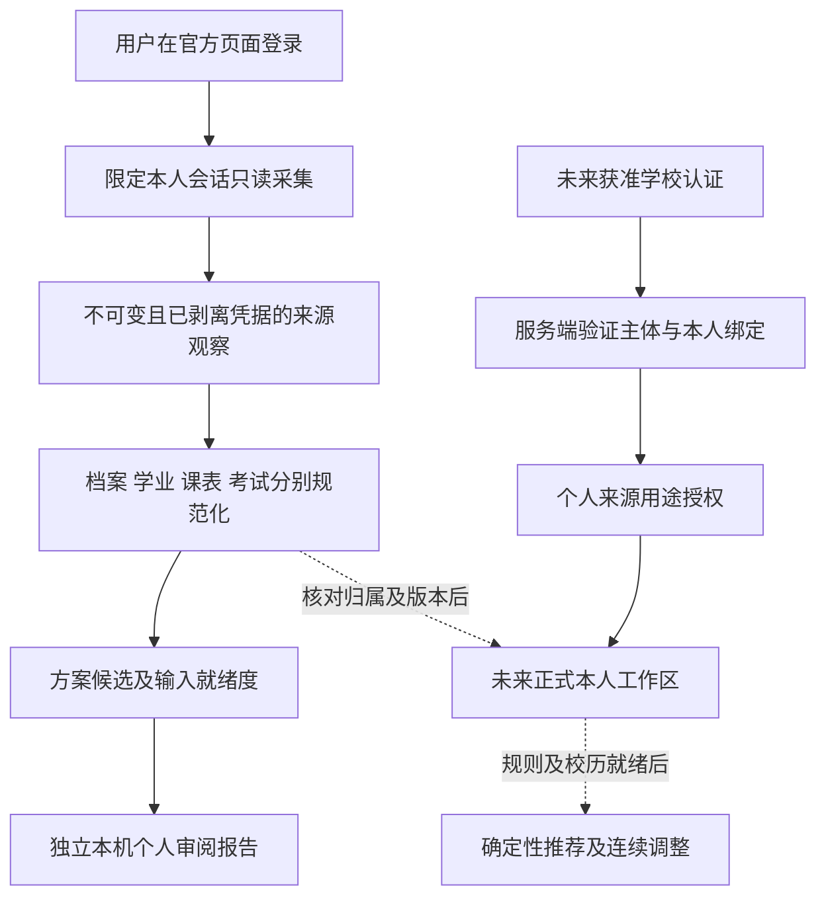

# 学生信息系统接入设计 v1

日期：2026-10-14。目标：尝试取得本人学生资料、学业与当前安排，为既有多课表推荐补充真实上下文。首轮优先使用用户在学校官方页面建立的浏览器会话，只读获取并在独立本机个人审阅域规范化；正式学校应用认证按实际提供的协议与许可另接。取得资料、项目认证、方案适用和真实推荐分别验收，允许只取得部分资料或路线失败。

用户本轮已要求设计完成后新开 `gpt-6.1-sol / ultra` 对话具体执行尝试，恢复此前暂缓的学生接入探索。当前对话只交付设计；新执行对话可直接开始[执行方案](学生信息系统接入执行方案与交接_v1_20261014.md)中的开发与有限只读核验，无需沿用上一轮推荐规划的审阅等待节点。需要用户官方登录或缺少获准应用配置时，停在具体依赖处。

当前基线 `main@7b491f97042ee7d999e8aec129f0914888c28615`：R0—R2合成推荐与R3本机参考首片已实现；学校认证及真实个人源未接入。现385项是历史工程证据，不代表学生接入验收。见[当前交接](开发交接摘要_20261014_推荐闭环_界面精简_R3本机参考.md)。

## 1 最小目标与完整产品的关系

本轮先证明：用户自己登录官方教务 → 取得当前来源会话下的个人资料观察 → 分别解析档案、学业及目标学期安排 → 匹配或明确缺少适用培养方案 → 给出可复核的输入就绪度。已有课表推荐继续运行在合成域，真实个人资料不塞入模拟学生A/B。

最终产品仍是：可信学校主体及本人绑定 → 获准个人来源 → 适用培养方案 → Agent检索与确定性推荐 → 多课表连续调整。浏览器读取实验服务于确认数据渠道，不能替代这条产品认证链。

| 本轮结果 | 可交付 | 不随之成立的结论 |
| --- | --- | --- |
| 本人资料页可读 | 专业/学院/入学年等实际返回字段及出处，缺失字段unknown | 本项目已完成学校SSO |
| 成绩或课表部分可读 | 独立快照、原值、覆盖与解析问题 | 完整学业账本、正式中选或全校可选课程池 |
| 方案匹配存在候选 | 对应年级/项目/路径的0、1或多个候选及匹配依据 | 单靠专业或用户选择已确认本人适用 |
| 实际获取失败 | 可复用适配器、合成异常回归、实际失败位置及可重试条件 | 用mock或旧缓存代替学校成功 |

首轮不做选课/退选/志愿提交、全账号或全学年抓取、恢复跨类/研究生/搜索入口、二三四课堂接入、个人Embedding或真实材料模型出站。必要的本科本人单份培养方案可定向读取，不扩为全目录采集。

## 2 Celechron可参考的实物设计

参考仓库固定为 `Celechron/Celechron@724e54a3d8feb190a90544963cd53e8ef01c0ff9`，核对日期2026-10-14。它是第三方客户端实现线索，不是学校为本项目提供的开放API或当前可用性证明。只研究源码与测试，不执行上游程序。

| 参考点 | 源码证据 | 本项目采用的设计 |
| --- | --- | --- |
| SSO与业务会话分层 | [zdbk.dart 39—125](https://github.com/Celechron/Celechron/blob/724e54a3d8feb190a90544963cd53e8ef01c0ff9/lib/http/zjuServices/zdbk.dart#L39-L125) | 区分官方登录、教务会话与业务读取；不以HTTP 200当成功 |
| 并发及过期控制 | [zdbk.dart 161—224](https://github.com/Celechron/Celechron/blob/724e54a3d8feb190a90544963cd53e8ef01c0ff9/lib/http/zjuServices/zdbk.dart#L161-L224) | 每连接串行、有限重试、会话代次防错人；过期回官方页人工登录 |
| 成绩/课表/考试分接口 | [zdbk.dart 353—629](https://github.com/Celechron/Celechron/blob/724e54a3d8feb190a90544963cd53e8ef01c0ff9/lib/http/zjuServices/zdbk.dart#L353-L629) | 拆开学业与安排适配，按各自结果/覆盖发布 |
| 验证响应再解析 | [response_utils.dart 50—212](https://github.com/Celechron/Celechron/blob/724e54a3d8feb190a90544963cd53e8ef01c0ff9/lib/http/zjuServices/response_utils.dart#L50-L212) | 登录页、认证错误、传输失败、格式变化各有状态 |
| 凭据与回调 | [zjuam.dart 108—198、200—315](https://github.com/Celechron/Celechron/blob/724e54a3d8feb190a90544963cd53e8ef01c0ff9/lib/http/zjuServices/zjuam.dart#L108-L315) | 借鉴目标校验与一次性回调；不复制客户端密码处理 |

上游本科编排还按用户名片段推入学年；本项目只接受来源明确字段，不沿用这一推断。[ugrs_spider.dart 346—369](https://github.com/Celechron/Celechron/blob/724e54a3d8feb190a90544963cd53e8ef01c0ff9/lib/http/ugrs_spider.dart#L346-L369) 所核对本科接口未提供完整专业/路径/培养方案链路，需从用户实际教务菜单寻找本人信息入口。

成绩和课表解析中的缺值补零、姓名关联、默认星期/单双周也不沿用；保留原观察及未知。[Grade解析](https://github.com/Celechron/Celechron/blob/724e54a3d8feb190a90544963cd53e8ef01c0ff9/lib/model/grade.dart#L75-L107)、[Session解析](https://github.com/Celechron/Celechron/blob/724e54a3d8feb190a90544963cd53e8ef01c0ff9/lib/model/session.dart#L64-L108)。其第三方校历及推算降级不能当本项目的官方校历依据。[校历降级](https://github.com/Celechron/Celechron/blob/724e54a3d8feb190a90544963cd53e8ef01c0ff9/lib/http/time_config_service.dart#L137-L189)

参考接口清单仅用于执行对话对照实际页面；不凭仓库路径盲猜未发现入口，不复制上游代码或引入Flutter/Dart。仓库声明GPL-3.0，若以后要直接复用代码，另核对复用范围；当前采用独立Python实现。[仓库](https://github.com/Celechron/Celechron)

## 3 连接路线与身份信任

### 优先路线 用户官方浏览器会话

执行对话先检查用户可用的官方本科教务标签。已有有效会话可复用；未登录由用户在官方页面完成账号、密码及验证码输入，不让用户把凭据发到聊天。工具仅在登录后的业务页读取；身份不明、多账号或账号切换时先确定目标会话。

采集优先用实际菜单、查询按钮、翻页和可见DOM。只有工具文档允许、目标查询已由实际页面或同会话只读请求确认时，才在浏览器内发限定的同源业务查询；Cookie继续由浏览器管理，不导出Cookie/Token到项目、终端或普通业务接口。若现有工具不支持该查询方式，使用界面路径或记录工具限制，不绕过。

这条路线生成 `SourceSessionObservation` 和授权的本机采集上下文，状态为 `browser_source_observed`。来源主体以官方业务页实际返回字段及同会话连续性记录，用户确认用于选择当前本人会话；这些仍不生成 `school_official` 项目会话或verified本人绑定。姓名、手填学号、DOM签名和本地工具签名都不能替代校方认证结果。

真实观察、规范化产物及私有就绪度报告先落独立 `restricted_personal_reference` 域，使用本机操作授权与单任务grant。它不进入现有HTTP个人工作区，也不向mock或R3共享培养资料域返回正文。可通过获准本机CLI/原生文件查看结果；终端、聊天和公开验证只报去敏计数、状态及别名。

### 未来路线 本项目正式认证

只有取得本项目获准应用、真实协议/验证配置、回调地址与可信主体字段后，才实现正式provider。由学校认证结果验证来源、受众、时效、请求关联和重放，再解析可信学生映射；认证成功和档案/学业来源grant分别检查。Celechron使用教务自己的CAS service，不能挪用该service把项目回调包装为获准学校登录。

首轮只做provider能力检查及未配置状态/合成协议测试，不提交学校接入申请或联系人员。没有配置不阻止浏览器来源试验；不能自动降级成mock成功。现有[认证权限设计](登录认证与权限设计_v1.md)和[接入契约](数据接入契约与最小切片_v1.md)继续有效。

## 4 首轮数据读取范围

| 数据域 | 首轮获取及依据 | 规范化边界 |
| --- | --- | --- |
| 本人资料 | 实际菜单的学生信息/学籍/个人信息页；先一份当前资料，记录专业、项目、学院、入学年、培养类型、路径及源主体 | 所无字段保持unknown，不按学号猜年级，不将菜单账号名自动当正式student_id |
| 全部及主修成绩 | 上游线索分别为 `cxdy/xscjcx_cxXscjIndex.html`、`zycjtj/xszgkc_cxXsZgkcIndex.html`；先一个可核对查询范围 | `items`及`xkkh/kcmc/xf/cj/jd`保留原值；主修标记不等于已匹配专业/培养方案 |
| 目标学期本人课表 | 上游线索 `kbcx/xskbcx_cxXsKb.html`、参数 `xnm/xqm/captcha_value`、结果 `kbList` | 学年/季值从实际页面核对；`kcb/sfqd/xqj/dsz/xxq/djj/skcd`为候选映射，不预设正式状态/完整周集合 |
| 当前考试 | 上游线索 `xskscx/kscx_cxXsgrksIndex.html`；仅目标学期且页面可达时读取 | 考试与上课分开；时区、身份或结束时刻缺失则unknown |
| 适用培养方案 | 基于实际专业、入学年、项目/路径匹配已登记目录；不足时沿本人培养计划入口定向取一份 | 当前162份是2026级。实际入学年不同不能套用；没有对应版本返回缺口 |
| 认定/替换及学校审核 | 仅已有明确个人要求页面可见时另作来源观察 | 本轮不主动扩展二三四课堂；修读、认定、学校报告与项目计算分开 |

这些路径是上游代码中的相对业务路径，主机限定为实际核对的官方教务；是否存在、菜单权限、参数及完整性均由本轮来源观察确定。`showCount=5000`只是上游查询上限，不证明全量。课表只读取一个用户选定的实际目标学期，不沿上游扩扫所有学年/未来学年。

档案不可得但成绩或课表可读时仍保存受限来源观察和缺口；不得为凑完整链路生成专业/年级。反之只有档案可读，也可完成该域验证。读取不到的领域不会变成空学业/零学分/没有课程。

## 5 数据流程与契约

| 对象 | 核心语义 |
| --- | --- |
| ConnectionAttempt | 任务ID、目标浏览器/来源域、授权用途、有限预算、开始/结束状态、源主体连续性代次；不含凭据 |
| SourceSessionObservation | 实际官方origin、允许的业务入口、主体字段的受限引用、观察时间、会话切换/失效证据；不是项目认证票据 |
| AcquisitionEnvelope | 来源别名、realm、本机操作主体/任务grant及版本、源主体观察、已剥离凭据的材料摘要/不透明引用、学期/筛选/分页/覆盖、schema/parser/mapping版本 |
| ProfileSnapshot | 专业/学院/项目、入学年、培养类型/方向/路径与逐字段来源/六态；用户自述另标，不转可信来源字段 |
| AcademicSnapshot | 原始行、课程身份、修读实例候选、学期、成绩原值/量表、额定学分与获分状态、认定/替换/主修观察；保留解析失败行 |
| EnrollmentSnapshot | 课程级/班行级/正式课表来源、原页面状态、班次/多时段/周次/考试及稳定身份状态；正式安排需源证据与映射核验 |
| PlanMatch | 方案版本、匹配字段及证据、0/1/多候选、缺失/冲突、项目审核状态；本机路线不能生成可信StudentPlanBinding |
| PersonalContextReadiness | 认证、来源身份、档案、方案、学业、安排、规则、校历各自状态与缺口；不只返回一个connected=true |

源主体标识可留私有域，但资源所有者由本机授权上下文赋予，不能从用户输入的学号生成所有权。该所有权表示获准审阅材料，不表示真实学校本人绑定。正式模式以后才由VerifiedPrincipal＋可信binding赋owner。

允许的字段六态为known、unknown、not_provided、not_applicable、pending_verification、conflicting；计算仍为pass/fail/unknown。学分采用Decimal/十进制文本。`xkkh`先是源选课标识，不用截字符串直接推稳定课程/修读实例；同名和同码体育多成绩不自动合并。缺成绩状态不按绩点非零推获分；缺周次、`sfqd`或`dsz`不默认已确认、单双周或整学期。

## 6 更新与存储

来源观察不可变，规范化以映射版本生成；不同来源/学期/账号的字段不拼成不存在的快照。幂等键包含任务域/操作主体、源主体观察版本、来源、覆盖、剥离凭据后摘要和解析版本。来源切换、中途退出、grant撤销或来源混入另一学生时终止该任务，隔离结果，不能改owner后发布。

真实试验使用独立忽略目录与独立数据库，权限目录0700/文件0600，正文和真实定位不进入Git、公共静态目录、普通日志或模型。只保存必要业务字段/定位，不保存登录HTML、隐藏认证字段、完整HAR、请求头、SSO票据、Cookie或密码；摘要明确其对应剥离后的材料，不冒称完整原响应字节。

刷新默认追加；完整同范围替换须有完整性证据、预期版本和当前授权，再原子发布新版活动指针。部分失败保留旧版并标历史，不能缓存兜底成实时成功。首次无数据不计为已修0学分。个人源撤销停止后续取回/引用；原件留存或删除依许可处理，不擅自删除既有证据。

## 7 与现有实现的连接点

现`AuthManager`与会话绑定只支持mock/PROFILES，`/api/auth/school-login`固定未配置；个人正式provider不能靠新增按钮完成。新建独立来源适配与个人材料验证器，保留现`validate_demo`及`/api/import`拒绝真实资料的行为。

R3的grant限定共享培养资料参考，不接受个人owner；复用它的权限/版本/引用模式，不复用同一数据域。现`chat._check_workspace`及推荐/审核规则仍只准固定synthetic，取得真实成绩不解除这些检查。本轮先交付本机规范化和方案/输入就绪度；真实审核/推荐需要另一套有审核与适用证据的个人计算契约。

正式provider可逐步抽离`AuthContext.identity()`对PROFILES的依赖、会话provider/auth_mode和binding证据；存储迁移须改显式列名并保留旧演示/历史。真正官方验证配置未齐时该provider保持disabled。现DeepSeek和R4状态保持，真实个人聊天/成绩/课表均不自动出站。

## 8 失败状态与验收口径

| 状态 | 含义与下一步 |
| --- | --- |
| awaiting_user_login | 用户到官方页面完成登录；不索取密码/验证码到聊天 |
| source_session_expired | 停止个人取回，用户重新登录后建立新任务代次 |
| source_subject_unknown / changed | 身份关联不足或变化；只保留受限观察，拒绝发布可信本人上下文 |
| source_unavailable / permission_denied | 当前网络或菜单不允许；记录具体范围，停止对应路径 |
| schema_changed / incomplete_capture | HTTP成功但正文或分页/关键字段不符合预期；保留解析问题，不静默跳过 |
| partial_acquisition | 仅部分域成功，逐域报告，不覆盖未成功域 |
| plan_version_missing / ambiguous_plan | 年级/路径或版本不匹配；定向核对已有入口或报告缺口 |
| official_provider_not_configured | 本项目正式认证未具备配置，浏览器源实验仍可独立进行 |
| input_not_ready_for_recommendation | 学业/规则/安排/校历仍缺；不输出真实完整课表通过 |

有效成功可以是一份真实档案或一个学期课表的可复核来源切片；更高一级是多个域一致并完成本地规范化。只有实际官方provider验证及本人源授权通过才称本项目学校认证成功，只有规则/时间等充分并完成产品验收才称真实推荐成功。

试验允许不成功，但须交付“尝试了哪条路径、得到什么、失败在哪里、实现哪些适配能力、缺少什么才能再试”。执行顺序、预算、测试与新对话启动词见[执行方案](学生信息系统接入执行方案与交接_v1_20261014.md)。
