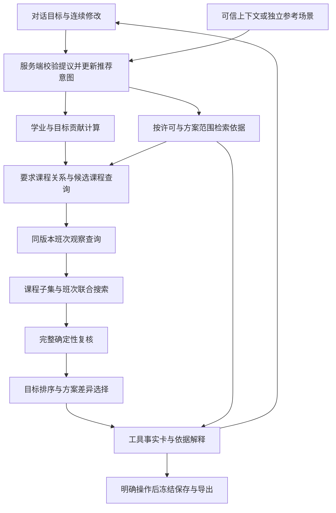

# 推荐能力线产品与技术设计 v1

日期：2026-10-13。状态：待用户审阅的设计，功能尚未按本方案实现。

推荐能力线围绕一个完整任务展开：学生通过 Agent 表达选课目标，获得多个有实际课程或班次差异的课表，再连续比较、换课、换班、锁定、调整和保存。首个完整闭环使用独立 synthetic 数据；随后在获准的本机参考域连接真实培养依据与秋冬班次观察。学校学生接入线暂缓，未来以可信本人上下文替换合成上下文，保留同一推荐流程。

本设计承接[最新范围与启动提示词](开发交接摘要_20261013_推荐能力线规划入口.md)、[原四个问题](../inputs/zju_course_agent_handoff_v1/ANALYSIS.md)、[当前系统设计](系统与对话查询实施设计_v1.md)和[RAG v2](真实语料RAG设计与最小实施切片_v2_20261013.md)。阶段任务、验收用例及执行对话启动词见[执行方案](推荐能力线执行方案与新对话交接_v1_20261013.md)。

## 1 产品范围与首版目标

最终链路为：学校登录 → 可信本人绑定及来源授权 → 适用方案与学业上下文 → 对话澄清 → 依据检索与课程查询 → 课程选择和班次搜索 → 多方案复核与解释 → 连续调整、保存和导出。实际选课由学生在官方系统完成。

| 原问题 | 首版推荐能力 | 缺输入时的行为 |
| --- | --- | --- |
| 我还缺哪些要求 | 有可靠学业与审核规则时分账计算；合成场景验证计算 | 无学业不默认零获分，展示方案要求与缺少的上下文 |
| 接下来适合修什么 | 从要求课程池、目标学期观察和有依据的兴趣信息选课程 | 无课程说明不猜内容、难度、考核或教师质量；可按用户指定课程继续 |
| 本学期如何排课 | 为选课子集选择具体班次，复核资格、时间、考试、学分和固定安排 | 已知失败排除，未知保留为待确认草案；不承诺可选或中选 |
| 为什么这样推荐及改条件会怎样 | 同输入比较贡献、偏好与变化，继承锁定连续计算 | 无解、只有一解、范围不全和搜索未完成分别说明 |

首版包含课程选择、具体班次、2—3套有意义备选（数量由解集决定）、对话调整和明确保存/导出操作。表单用于检查条件。全量专业精细处理、学校登录/个人数据连接、自动选课、完整毕业认证及无依据的难度推荐不属于本轮首片。

二三四课堂只暂缓本轮业务，保留原文与官方总要求；不减去“+8”。其他认定、门数、路径要求保留状态与依赖，首片未实现的部分显示未覆盖。普通体育、劳动、实验、实习和毕业设计课程继续保留。

## 2 当前能力与需要补齐的部分

开工只读核对为 `main@7a4ffb09f8e102e2cffec591755955be78ff1893`。已有 README、进度和规划入口的未提交修改继续保留。历史249项验证不是本方案新功能的验收。

| 已有基础 | 本方案补齐 |
| --- | --- |
| DeepSeek 实际工具调用、本人多轮预览、权限/版本/引用复核 | 将培养目标与兴趣解析为可执行推荐意图，展示多方案理由与连续差异 |
| `generate_plans` 对指定课程逐课选班，最多返回三个结果 | 从课程池选子集并联合选班；增加目标贡献、软偏好及多样性排序 |
| `validate_plan` 三态、周次/考试/资格/余量/固定项复核 | 新课程选择、替换、比较和保存均调用相同复核；扩展时保留现有语义 |
| 预览条件在对话内继承 | 用显式增删/替换操作支持换课、取消排除及明确放宽个人条件 |
| 表单已有保存、冻结、当前重校验与导出 | 为对话预览建立服务端结果引用及保存桥接，防止条件或版本错用 |
| 54块 JSON 参考检索；真实资料离线去重/盘点 | 将目标章节、要求课程关系和真实观察工具接入独立本机参考场景 |

代码依据：`planner.py` 的 `generate_plans`、`validate_plan`、`compare_plans`；`chat.py` 的 `_patch`、`_check_workspace`、`_execute`、`_present_decision`；`server.py` 的 `frozen_result`；`audit.py` 的 `_rule_blockers`。当前对话 patch 对请求课程及排除班做并集，硬条件不能由模型放宽；计算审核只准独立 DEMO 规则。真实数据不能靠改标签直接放入这些入口。

## 3 首个代表场景与数据模式

代表用户目标采用原需求变体：“优先补专业选修，偏向 AI，尽量周五没课，保留体育课。”目标学期为一个秋冬学期，要求池只选一个普通专业模块。这是设计场景，不认定当前用户的专业、学业或兴趣。

真实方案候选优先考察2026材料科学与工程：原需求已有模块与计算材料案例。执行时须局部核对标题/路径、目标模块完整条款与附注、精确课程代码、秋冬观察及可辨认班次，才固定首片；春学期建议课程不能因此视作秋冬开课。若这一池不足以支撑推荐，记录原因并从已有162份中换一个满足门槛的池，无需恢复采集或补造课程。合成闭环不等待该核对。

| 模式 | 上下文与用途 | 结果口径 |
| --- | --- | --- |
| synthetic 推荐演示 | 服务端固定合成主体、另存演示要求/课程/班次/校历与合成说明证据 | 可验证完整对话、多个具体课表和 pass；始终标模拟 |
| 本机真实参考场景 | 独立本机审阅授权、限定来源 grant 和用途、选择参考方案、显式假设 | 真实观察与假设分别标识；组合为条件性参考草案，无真实本人结论 |
| 未来本人推荐 | 学校验证身份、可信本人及方案绑定、来源许可、学业和正式安排 | 对证据充分的部分计算，未知部分仍不能宣称通过 |

本机参考场景不填写姓名/学号来获取权限，不读现有采集中的个人页面状态，不接 A/B mock。新增假设场景组合用途需在实施授权中明确；已有本机审阅许可不自动扩大成真实推荐或模型出站许可。

## 4 完整对话与课表呈现

首次进入默认对话。界面显示当前模式、方案/目标学期及资料覆盖；固定合成场景可直接使用服务端预置范围。参考场景若没有方案或目标学期，Agent 只澄清影响当前结果的必要字段，避免要求先填完整档案。

| 步骤 | 用户与系统行为 | 可见结果 |
| --- | --- | --- |
| 提出目标 | 解析专业模块优先、AI偏好、周五软偏好和体育保留 | 简洁的条件摘要，硬/软属性、锁定来源、缺口可核对 |
| 澄清影响计算的条件 | 体育是哪一班、修读目标是否有学分范围；有歧义才询问 | 允许沿用已确认条件；用户未给学分范围不虚构上限 |
| 准备候选 | 查目标模块关系、已修状态及当期班次；检索要求和兴趣依据 | 每门候选的纳入/排除/待确认原因及出处 |
| 生成备选 | 在同一输入下选择课程与班次，完整复核后选有差异的结果 | 方案卡、具体课表、预计贡献、偏好取舍和未知项 |
| 比较追问 | “A和B为什么不同”“哪套周五空闲” | 同版本差异表，指出换课/换班及对应目标影响 |
| 连续调整 | “周五必须空闲，其他锁定保持”“把B的课程换成另一门” | 更新条件摘要、新课表及相对基准的增删/换班原因 |
| 保存与导出 | “保存刚才的B”“导出这版JSON”或点击明确操作 | 服务端版本复核、冻结新版本、返回真实保存/下载状态 |

每套卡片必须包含具体课程、快照内班次引用（官方班号未知时注明）、教师与全部已知时段、预计课程学分、对目标要求的预计贡献、偏好指标、校验结果、引用、缺口和版本。方案号由服务端签发，用户所说“B”绑定到当时方案集；新一轮不得让旧B静默指向新课表。

周课表用秋/冬切换呈现已知星期和节次；真实周集合未知时注明“仅已知时段示意”，未知时段另列，不能画成整学期可靠日期安排。比较表集中展示课程差异、班次差异、学分、目标贡献、周五安排、锁定保持和待确认数量。候选不足时如实显示一个或零个结果。

### 合成场景的具体结果示例

下表是待实现的独立夹具设计，课程名、代码、学分、时段和规则全部虚构。假定目标模块本轮希望安排6学分；体育1学分已锁定；所有列示课时为合成第1—16周，合成校历/节次映射齐全，来源显式无考试、资格已知、余量有效。该6学分是测试目标，不是任何真实方案阈值。

| 合成课程及班次 | 学分 | 课时 | 合成说明依据 |
| --- | ---: | --- | --- |
| DEMO-AI / DEMO-AI-01 AI实践 | 3 | 周一1—2节、周五1—2节 | 合成说明明确覆盖AI项目实践 |
| DEMO-DATA / DEMO-DATA-01 数据分析 | 3 | 周二3—4节 | 合成说明明确覆盖数据处理 |
| DEMO-MODEL / DEMO-MODEL-01 模型方法 | 3 | 周三3—4节 | 合成说明明确覆盖建模方法 |
| DEMO-PE / DEMO-PE-01 体育 | 1 | 周四7—8节 | 必须保留的合成班次 |

| 方案 | 具体班次 | 预计总学分及模块贡献 | 取舍 |
| --- | --- | --- | --- |
| A | AI-01＋DATA-01＋PE-01（均为上述DEMO班次） | 总7、目标模块6 | AI实践偏好较好，周五有课 |
| B | DATA-01＋MODEL-01＋PE-01（均为上述DEMO班次） | 总7、目标模块6 | 周五空闲，少了AI实践课程 |

两套具有课程差异，同一组锁定均保留。用户升级为“周五必须空闲”后，A已知失败，B保留；如果范围内只有B满足，不再凑三套。若用户继续说“把B的模型方法换成AI实践”，替换后冲突可证明，解释周五硬条件与该班课时不兼容，不撤销体育或放宽周五。另建体育在周五的冲突夹具验证锁定冲突；不修改真实记录或原输入。

## 5 推荐架构与职责

| 组件 | 承担的决策 | 不承担的决策 |
| --- | --- | --- |
| Agent | 解析需求、课程消歧、必要澄清、选择受限工具、组织差异解释 | 不创造资格、成绩、课程身份或规则，不直接写库 |
| RAG | 取得要求、课程说明与政策的完整支持证据 | 不提供全量班次列表，不以相似度决定本人适用或计算阈值 |
| 结构化查询 | 按要求关系取课程池，按目标学期及版本列班次与观察束 | 板块出现不变成必修关系，不跨时点拼动态事实 |
| 学业及贡献计算 | 已获、在修、认定分账；计算确定的缺口及计划贡献 | 预计贡献不写回已获账本，未知修读不默认未修 |
| 排课搜索 | 选择课程子集及班次，保留固定/锁定，剪掉已证明失败 | 不因想输出多套而丢硬条件，不把未完成搜索称全局无解 |
| 排序与差异选择 | 同输入比较用户目标、偏好与课程/时间差异 | 不以综合高分抵消硬失败，不用unknown换取高排名 |
| 统一复核与呈现 | 重新验证完整方案、版本和授权，绑定理由与有效引用 | 模型状态不能覆盖程序结果，保存不代表正式中选 |

## 6 最小数据契约

沿用现有逻辑对象，新增推荐对象可先嵌套存JSON，不要求一对象一张表。下面是拟议内部契约，尚未实现；模型只能提供允许的业务提议，身份、许可和版本由服务端注入。

| 对象 | 最小字段及语义 |
| --- | --- |
| RecommendationContext | `mode`、服务端上下文引用、方案/路径/目标学期、学业和正式安排状态、来源用途及允许版本、字段未知；真实本人模式使用可信绑定，参考模式使用场景授权 |
| RecommendationIntent | `intent_id/revision`、目标要求IDs、必选/可选/排除课程、目标学分范围、硬条件、软偏好与优先次序、锁定课程/班次、固定项、原话证据及待澄清字段 |
| IntentPatch | 有限 `add/remove/replace/set_strength` 操作、目标对象、原话/本轮依据；省略和空数组不代表清空；解绑个人锁需明确意图，正式/预置项不受普通解锁影响 |
| CandidateCourse | 已解决课程身份、所属要求关系、目标学期开课观察、预计贡献/依赖、有依据的兴趣匹配、纳入或排除原因、引用与字段状态 |
| SectionChoice | 快照内候选班引用、课程、目标学期、选用 `observation_id`、完整时段/考试/容量束、官方班号状态、资格与来源问题 |
| RecommendationRun | 服务端 `run_id`、intent与所有输入摘要、候选过滤范围、算法/排序/差异策略版本、预算及实际搜索覆盖、结果集/诊断/状态 |
| PlanOption | `option_id`、run引用、具体课程与班次、完整复核、预计贡献、偏好分量、取舍、引用、与基准方案的差异；不包含已获学分更新 |

版本至少包含方案/适用绑定或场景、学业、正式安排、课程映射、班次观察集、规则、校历、意图、语料/索引/范围策略、授权策略和推荐引擎。模型配置/提示版本另记。授权到期、输入换版或引用被撤销后结果标失效；历史按当时输入只读查看，当前重校验产生新结果。

未来个人接入适配器输出同一上下文契约。缺个人绑定或来源授权时仍不能读取个人资料；用户自述可成为场景假设及偏好，不成为可信学业事实。

## 7 候选课程与排课算法

### 候选准备

先固定用途、方案、目标学期、来源版本与意图。由结构化要求关系枚举目标课程池；RAG为条款和解释补证据。精确代码及经核验代码映射连接到当期班次；近名或向量相似只可用于消歧候选，不建立课程身份或互认。指导计划建议学期与实际开课分别记录。

已有可靠学业时计算局部目标缺口，排除已证明重复无贡献的课程；体育重复修读按适用政策处理。有在修/未知认定时单列条件性贡献。无学业时只计算“该场景安排了多少目标课程”，不计算“本人还差多少”。每门候选记录被纳入、被硬条件排除或缺依据的原因。

AI偏好先用有出处的课程说明/大纲或已核对的标签；只按名称命中时标“名称匹配，内容待确认”，不赋予已验证的内容匹配分。不补造难度和考核。没有这些依据也能按培养目标、用户指定课程与时间生成备选。

### 联合搜索与三态

首片采用标准库、确定性、有预算的回溯。外层选择必选课及可选课程子集，内层为每门选班；抽出并复用现有班次展开与完整校验。必选、受保护班和来源正式安排优先；同课多班互斥，联选/组合规则只有证据完整才启用。目标模块毕业必修不自动变成本学期必选。

全局意图中的必选课程与备选池分开。每个课表的低层`requested_course_ids`只包含全局必选及该套选中的可选课；不会要求A含B专有课程。比较使用相同全局目标、硬条件、偏好和来源版本，逐套构造各自选中课程的低层校验条件，再比较贡献与取舍。现有`compare_plans`可直接复用同课程换班场景；跨课程组合需推荐层包装，不直接套一个全候选必选列表。

按选项少的课程优先展开，剪掉已证明的资格失败、禁用班次、硬时间冲突及学分上限超限。学分下限剪枝需证明剩余最大可达学分不足；任意unknown不能据此剪枝为无解。所有叶方案重新执行完整复核；贡献计算保留学分、门数、学时、记点的独立量纲，不重复加实际学分。

`pass`进入已校验草案集，`unknown`进入待确认集，`fail`进入诊断。已知失败优先于未知；未处理的必要规则也必须产生unknown。预算同时限制节点、候选规模、耗时和保留结果，保留确定性的最好候选并报告截断；不得悄悄限制课程池后宣称已遍历整个模块。

推荐路径新增共享预算和叶候选输出接口，在旧`generate_plans`按周五排序并`[:limit]`裁切之前，将已复核候选交推荐层计算贡献、兴趣与差异。预算覆盖预校验、课程子集和班次节点；已校验/待确认候选池和诊断均有界，候选保留策略版本化。搜索未穷尽与结果池裁剪分别报告，后者也不能声称已得到全局最优的差异组合。原固定请求接口保持兼容的默认行为；不能循环调用现接口的前三份结果充当全部推荐候选。

### 排序与多个方案

先分离已校验与待确认结果，再按用户确认的目标优先次序比较。默认首片依次比较目标贡献（封顶于已知目标，避免无意义多选）、有依据的兴趣匹配、时间偏好、相对基准的修改成本。用户可明确把时间偏好提高；硬条件永远先校验。首片显示各分量与单位，避免一个无法解释的总分。

从满足硬条件的候选中，先去掉相同课程/班次集合，再选择有意义差异：优先课程集合变化；课程相同时，班次应带来可见时段、教师选择或其他有依据属性差异。使用课程集合差异比例及课时占用差异作选择指标，参数版本化；锁定项从差异比较中单列，避免共同体育稀释差异。

可按当前用户表达产生“模块贡献较多”“兴趣依据较强”“时间更集中”等结果标签，标签由计算指标支撑，不固定三种策略。若所有课程均必选，只有换班差异就明确说明。质量下限由目标与偏好定义，不能为了多样性放入明显无贡献或不可校验的方案。小池若只存在一套可行课表，则返回一套；不承诺全局最优。

## 8 RAG怎样进入推荐

复用RAG v2的来源、权限/用途、页级适用、分块、引用与版本约束。首片只精细处理目标模块条款、相关课程表行/表头/跨页附注，以及确实影响资格或兴趣解释的已有材料。全部资料已有盘点可作目录基础，不以处理全部162份、29类或5方案50题作为首次推荐前置。

连接顺序为：要求依据 → 项目核对的课程池关系 → 已核验课程身份 → 目标学期观察 → 选择与复核 → 每项推荐理由。课程池关系用结构化查询枚举，避免RAG top-k遗漏可选课；解释用RAG支持对应条件与取舍。项目局部核对形成独立规则版本，原23候选继续不启用，项目规则不冒充校方认定。

本机真实参考域先验收词法及结构化查询与引用卡。评分前限制允许集合，扩展父章节和引用回查再次授权。混合页按行分scope，暂缓活动不删除同页正常课程；年级冲突页不作为有效依据。每条实质结论须由有效工具结果及完整证据支持，引用存在不等于内容支持。

现远程chat只接受固定synthetic；真实PDF和真实结构化课程事实均不得直接加入该上下文。真实原文出站继续关闭。此时本机可以显示有效引用和条件性观察课表，但远程模型不能声称已读原文或已完成真实参考Agent推荐。若要真实参考Agent闭环，需另明确生成服务及允许字段/片段范围；原文许可关闭不妨碍合成Agent完整验收。

Embedding安排在同语料、人审题与词法基线之后。先归因漏检：资料缺失、错误分块、遗漏附注、身份映射，还是语义表达不匹配。只有最后一类确实影响候选依据或解释，才在独立授权下比较词法、向量和混合；不先安装模型或向量库。衡量必需证据覆盖、引用支持、无依据错误肯定和资源消耗，算法收益与增加语料的收益分开报告。

## 9 连续调整与保存机制

对话状态保存确认过的结构化意图、锁定/固定来源、预览条件、run和option引用及输入版本；文本历史可缩短，结构化条件不丢。普通咨询不改变条件。修改建立新意图版本，复核后才替换当前预览；失败保留上一个有效结果并明确本轮失败。

“周五必须空闲”是明确升级指令，可以直接执行；“周五可有课”“解除我锁定的某班”在对象与来源清楚时也是明确修改，不额外重复询问。硬条件放宽必须能绑定到本轮用户的具体指令，不能只信模型patch：由服务端可核验的有限表达或页面显式条件变更授权对应操作，非明确表达则澄清。该动作许可绑定原条件、对象与revision，只在本轮有效；来源文字和模型建议不能生成许可。预置/正式成员与固定安排只能经各自定义的来源/操作路径变化。

“保留体育”若有一个已确认班则锁班；有多个班或只有课程级已选信息，澄清是保留课程可换班还是保留具体班。课程锁与班次锁分开。删除/替换可选课程必须显式指定操作；不得用空列表清掉所有条件。比较或调整指定旧A/B时，服务端核对该结果所属会话、轮次、run和版本，过期需重校验。

保存桥接使用服务端持有的预览引用，客户端不提交可信校验结果。读取预览 → 验证所属域/主体及明确动作 → 核对数据、工作区与意图版本 → 完整复核 → 再授权并原子提交。用户一次“保存B”即可授权这一可见操作；接口响应同时说明已应用的条件与保存的版本。

同一SQLite事务内检查预期数据摘要、工作区revision、会话/意图版本，写入明确选择的当前条件、冻结新方案、会话基线/意图修订/option映射和动作幂等回执；任何写入失败全回滚。新增存储事务方法，不能顺序调用现有各自提交的工作区/保存/会话方法冒充原子操作。重复动作返回原回执，提交后的模型解释失败不重复保存。

会话随保存原子更新，仍有效的锁定、固定安排和选中课程保留；新一轮不能因偏好revision变化恢复保存前条件。另一个页面或请求并发修改时拒绝旧保存，展示当前条件差异后由用户重新发起。

导出使用已保存版本，或将当前有效预览作为只读冻结输出；后者不自动保存/覆盖偏好。真实参考草案的导出保持独立域与标识。JSON/CSV保留unknown、假设、来源及版本；缺可靠校历拒绝日期ICS。旧历史保持不变，数据刷新后新算，不将旧通过作为本轮通过。

## 10 异常与缺数据行为

| 情况 | 返回与允许展示 |
| --- | --- |
| 未知方案、学期或对象歧义 | 只澄清当前任务所需条件；不给本人结论 |
| 本人学业缺失 | 可列方案课程及场景贡献；剩余要求未知，不默认未修 |
| 周集合/校历或考试时区未知 | 显示具体观察班及已知课时，unknown逐项可见；不宣称完整无冲突，不生成可靠日期ICS |
| 星期/节次相同但周次未知 | 标潜在重叠；只有独立充分证据才判已知冲突，不假定全周 |
| 周五硬空闲而已知该班周五有课 | 对“整个目标学期周五不安排课”的明确条件判失败；完整周次未知仍保留其他unknown |
| 历史余量为零/负或时效未知 | 展示原观察和时间；新选资格按现有时效契约复核，失效值不能当实时不可用证明；可列需刷新候选，不能声称有效可选 |
| 班次跨刷新身份未核验 | 使用快照内引用；换版匹配待确认，不静默删锁或伪造官方班号 |
| 只有一套通过 | 返回一套及候选限制；可另列待确认草案，不能算作第二套通过 |
| 范围完整、搜索完成且条件已知不兼容 | `scoped_infeasible`，给具体冲突和可修改的个人条件；不称全校无解 |
| 数据不全或只剩unknown组合 | `incomplete_data`，区分“未获得通过”与“确证冲突”；必要缺口可定位 |
| 搜索截断 | `search_limit`，可展示已得结果，标未穷尽；不声称最优/无解 |
| 版本竞争、权限撤销、来源失效 | 旧结果失效；按当前授权重取并重校验，历史不覆写 |
| 模型错误、虚构引用或解释与工具矛盾 | 拒绝该模型结论，保留仍有效的实际工具卡及失败状态；不伪装成功 |

真实容量没有刷新渠道时，不将“当前无已验证余量”包装为“现已满额”。无解说明首片提供可审查的冲突集合及具体原因，不宣称已求得数学最小冲突核。任何放宽建议仅作为提议，用户明确修改后再算。

## 11 设计决定与实施边界

实施顺序建议为：先补课程选择与多方案算法，再完成Agent连续调整和保存的完整synthetic体验；同时局部准备真实方案证据，之后接独立本机参考工具与条件性草案。检索扩展始终服务于该推荐场景。具体执行和验收见[执行方案](推荐能力线执行方案与新对话交接_v1_20261013.md)。

当前可做的是设计与本机合成实现；真实首片方案/模块和代码映射需要局部核对。真实假设场景的用途、真实材料模型出站及Embedding安装调用是独立决定；学校认证与本人源需要学校渠道。本轮只交付设计，不编码、处理派生数据、调用模型/Embedding、采集或部署，不提交推送。
