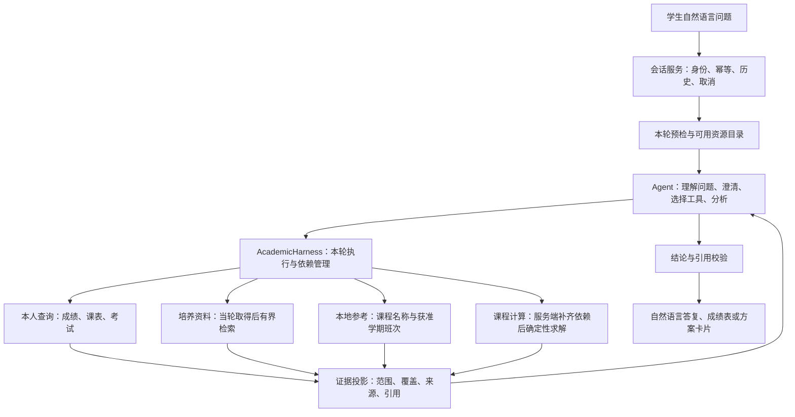

# 教务 Agent 与 Harness 架构

本设计对应用户的核心使用方式：登录一次后直接提问，由系统取得相关教务数据和本地课程资料，完成分析、课程组合计算及后续调整。用户无需下载、上传文件或手动启动准备步骤。v26 工程及实测状态以开发进度第86节和对应回执为准；此文不替代业务验收。

## 1. 运行链路

Agent 保留选择下一步的能力。问成绩只查相应成绩；需要分析课程背景时可以先查已修课程和培养条款，再检索候选。明确课程范围的组合任务可直接检索候选并请求计算，Harness 自动完成计算所需的本轮来源读取。`prepare_recommendation_inputs` 继续用于显式准备检查、待补请求续接、额外考试来源检查及旧适配器兼容，不再是所有计算必须由模型记住的前置动作。

## 2. 各层职责和实际文件

| 层 | 职责 | 当前实现 |
|---|---|---|
| 会话服务 | 可信学生绑定、会话归属、请求去重、输入与模型版本、任务/方案续接、取消和落盘 | `personal_chat.py`、`storage.py`、`chat_runs.py` |
| Agent 循环 | 每轮动态声明工具，理解意图并选用工具，整合当前证据；限制模型轮次和工具次数 | `personal_dialogue.py`、`model_client.py` |
| 执行层 | 本轮 receipts、可信原话约束、计算依赖、调用前后授权、嵌套工具事件 | 新增 `academic_harness.py` |
| 数据适配 | 在学校连接锁内校验身份/会话代际，按注册端点取数；管理当轮来源与派生资料 | `school_accounts.py`、`student_source_client.py`、`personal_evidence.py` |
| 领域计算 | 搜索准入、本人方案、锁定/固定项/条件版本、确定性排课；生成最小来源依赖配方 | `personal_course_plans.py`、`course_plan_policy.py`、`current_term_recommendation.py` |
| 输出和页面 | 只投影允许的字段和当前引用，校验结构化计算结论；渲染答案、过程与实际供应商可见推理 | `personal_dialogue.py`、`personal_plan_explanation.py`、`web/app.js` |

没有新增第二套 Agent 循环或学校登录方式。此次把原会话内部的执行闭包抽成明确边界，并新增自动依赖路径；已有适配器、检索、计算器和来源约束继续使用。未来替换模型 SDK 时，可复用这些边界。

## 3. 数据和状态

| 类型 | 如何取得 | 有效期与使用边界 |
|---|---|---|
| 当前学生身份 | 学校验证后的服务端连接 | 不接受模型传入学号、路径或 owner；凭据只在内存 |
| 学期成绩、主修成绩、本人课表、考试 | Agent 按问题范围选择注册查询，或计算依赖触发 | 每轮按需读学校；同轮同范围复用读取凭据，失败也记录并抑制重复读取；失败不能退回旧快照冒充当前 |
| 培养资料 | 当轮取得学校文件，本地分块/检索返回相关原文 | 文件取得不等于正式身份适用、先修规则及学分认定均已核验 |
| 课程名称与代码 | 本地配置的参考库 | 可以检索名称，不证明开课或本人资格 |
| 班次与观察时段 | 已获准的 2026-2027 秋冬历史数据 | 只用于限定条件测试；不扩大年份，不声称最新余量、完整周次或正式可选 |
| 对话与任务记忆 | 本人可见对话、可信任务提示、当前方案引用 | 用于理解“这个”“保持其他条件”；旧工具事实/可见推理不直接当作本轮新事实 |
| 方案状态 | 本人连接中的计算结果及 revision | 修改必须校验归属、原话依据、锁定、硬条件、固定项和版本；只解释时读取保存计算，无学校重读或求解 |
| 执行记录 | 实际 tool/model/source/SSE 事件 | 区分模型选工具、执行层补依赖和学校来源读取；不虚构脚本或内部思维 |

每次发送创建一个新的 `AcademicHarness`，`receipts` 从空开始。资源目录是服务端预检的受限投影，描述“能从哪里查”，不把缓存是否为空当成数据条数，也不授予访问权限。

## 4. 关键执行契约

1. 模型工具仅接受业务参数；身份、连接、当前 receipts 和原话策略由服务端注入。
2. 调用生成/调整工具时，学校适配器在可信连接锁内向本人计算服务索取依赖配方。新生成必须已经在本轮搜索得到对应课程；外来方案、旧 revision、未搜索课程不会触发自动取数。
3. 最小计算依赖是主修记录及一次有界培养检索；排课再加对应学期本人课表。培养检索的第一个课程词只是取得资料的探针，不声称覆盖所有课程要求。个性化分析需要 Agent 自主补充相关查询。
4. 已在本轮尝试的来源范围不重取。新增来源返回 `prepared_sources`，与独立查询走相同白名单、字数预算、范围核验和引用生成；原始 PDF、账号、Cookie、路径不进入模型上下文。
5. 数据到齐后原有确定性计算器检查观察时段、学分和保留条件。执行层不代替计算器宣布可行，也不把“已取得培养 PDF”升级为正式规则审核通过。
6. 来源受阻返回具体结果和已完成证据；本人课表部分读取/不可解析时停止该轮排课，允许有界同范围诊断。授权或版本变化立即终止；不跨身份继续。
7. 工具提供绑定本轮引用的 `answer_claim` 格式提示，模型完成用户所需动作后使用。提示只降低格式错误，不绕过最终引用、范围和结论校验。
8. 证据解释要求与排课硬条件分开处理。实测“不能把未见成绩当作没学过”曾误挡计算，已纳入完整句匹配的执行边界；相邻的星期、节次、校区等条件仍独立解析，未知硬条件仍阻止计算。学习建议也需区分课程来源记录与能力推测，不能仅凭少量分数认定个人“主要短板”。
9. 要求结合已修情况选课时，Agent 应查询相关课程记录，而非仅引用全局成绩概况。最终通过引用校验的成绩/培养分析保留为`evidence_analysis`，随方案直接显示；工具步骤和重复统计继续折叠，避免分析已生成却在页面中消失。

## 5. 开源项目取舍

- [Pydantic AI](https://github.com/pydantic/pydantic-ai)：适合将来收敛模型适配、函数参数 schema 和依赖注入。其 [Function Tools 文档](https://pydantic.dev/docs/ai/tools-toolsets/tools/)展示了模型选择工具、`RunContext` 注入依赖和按函数生成 schema 的做法。本轮借鉴职责划分，未安装或迁移到该框架。
- [LangGraph](https://github.com/langchain-ai/langgraph)：其[官方概览](https://docs.langchain.com/oss/python/langgraph/overview)定位是有状态、长时任务的编排运行时，支持确定步骤与模型步骤混合、持久执行。当前常用短轮次查询/计算可以先用现有运行时；需要跨进程恢复长任务时再评估迁移收益。

框架选择不能替代学校数据边界、来源字段解释和确定性计算。当前优先把“自动取得正确资料并完成问题”验证清楚，保持标准库和现有 SQLite 实现；不为了框架名重建前端、认证或知识库。

## 6. 验证口径与后续顺序

工程检查覆盖：无显式 prepare 的生成/续调/解释、同轮复用与跨轮新取、来源失败无旧事实回退、中途授权变化、未搜索/外来方案不取数、自动取得的子来源投影和课表部分读取停止。现有权限、约束、分页、引用、历史和页面测试继续运行。

真实验证需分别核对：问题是否触发正确来源、原字段/原文是否支持结论、候选计算是否保留用户条件、追问是否只做必要动作、实际过程和推理是否显示。模型 HTTP 成功和工程测试数量不等于语义验收。

下一步按实际失败推进：先完善“已修课程＋培养条款＋候选选择”的相关性和解释，再考虑更多分析工具或持久任务恢复。当前未开放任意终端脚本；统计与排课通过受控工具完成。正式最新开课、资格、完整周次/校历、培养适用和认定仍需对应数据及业务审核，不能由本轮 Harness 改造补造。
