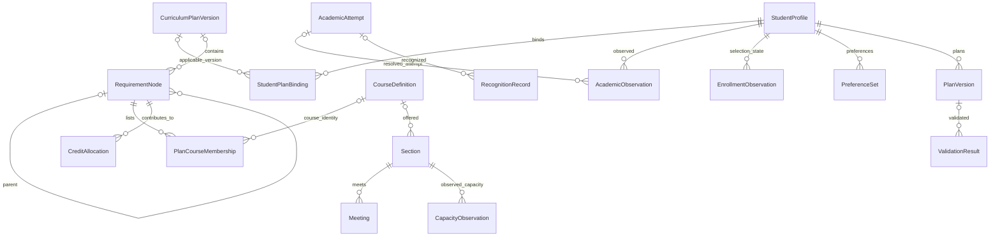

# 选课助手数据结构与字段字典 v1

日期：2026-10-09。状态：初步逻辑设计，待后续确认；不代表数据库、解析器或计算功能已实现。

本轮依据用户提供的培养方案 PDF、Excel 字段样本和真实选课截图设计业务对象、字段与关系。Excel 只用于理解数据结构，不据此规定真实使用者上传文件。最新方向为“学校身份登录 → 可信本人绑定 → 本人档案检索 → 偏好 → 针对性检索 → 答案”；基本信息输入不能授予访问他人数据的权限，本文件不设计检索接口、来源接入或用户操作流程。代码仍暂停。

## 1. 设计层级与对象总览

采用三层含义：原始观察保留材料中的文字和位置；规范化对象保存可明确解释的值及关联；计算结果独立保存版本和依据。以下是逻辑对象，不要求首版分别建立同数量的数据库表。小对象可以嵌套，具体持久化形式后续再定。

| 模块 | 拟议对象 | 主要关系 |
| --- | --- | --- |
| M1 学生档案 | StudentProfile、StudentPlanBinding | 学生可关联多个有适用范围的方案/个人要求版本；绑定单独确认 |
| M2 培养要求 | CurriculumPlanVersion、RequirementNode、PlanCourseMembership、RequirementRuleVersion | 方案包含要求树；课程与要求多对多；执行规则关联要求与适用范围 |
| M3 学业与认定 | AcademicObservation、AcademicAttempt、RecognitionRecord、StudentSubstitution、CreditAllocation、SchoolAuditReport | 原始行不直接等于一次修读；修读、认定和要求之间通过明确关系关联 |
| M4 课程与选课 | CourseDefinition、CourseCodeLink、Section、Meeting、ExamArrangement、CapacityObservation、EnrollmentObservation；可选 WishGroup/WishItem | 课程与教学班分开，班次可有多时段/考试；余量与个人状态按快照保存 |
| M5 需求与方案 | PreferenceSet、ConstraintItem、PlanVersion、ValidationResult | 偏好和锁定条件有版本；方案引用输入版本；校验结果由计算模块生成、M5 保存 |
| S0 来源与版本 | SourceDocument、DataSnapshot、EvidenceRef、SourceAssertion、DataIssue | 支撑所有业务对象；保留原值、出处、缺失与冲突 |
| S1 计算支撑 | AcademicCalendar、PeriodDefinition；读取规则定义 | 为真实周次、日期和节次换算提供版本，计算结果不改写原始记录 |

新增 S2 对象：AuthProvider、AuthenticatedPrincipal、StudentIdentityBinding、LoginSession、SecurityAuditEvent。字段定义及授权关系见[登录认证与权限设计](登录认证与权限设计_v1.md)，仍为设计，不是已实现身份服务。

## 2. 字段约定

### 2.1 类型、必填与未知值

- `string`：学号、课程代码、学校班号均按字符串保存，保留前导零。姓名不作为唯一标识。
- `decimal`：精确十进制数，用于学分、学时、记点和数值成绩；JSON 示例使用十进制字符串。计算时使用精确数值，不把字符串直接相加，不允许 NaN/Infinity。
- `integer`：门数、星期、节次和人数等整数；余量允许负数，容量和待定人数不允许负数。
- `date` / `local_time` / `datetime`：分别表示日期、本地时刻和带时区时间戳。考试原文没有时区时保留本地日期/时刻，不自行转换为 UTC。
- `T[]`：同类型数组。未知集合用 `null`；已确认没有成员才用 `[]`。
- `M`：记录成立所需的内部标识、来源或状态必须存在。`U`：字段应保留，但允许 `null`。`O`：可选扩展。表中有多个字段时，必填约定适用于该行全部字段。
- 可保存不完整记录，不用缺失周次、班号或方案版本拒绝所有样本；计算前检查相关必需条件，缺失则返回待确认。

### 2.2 公共字段

这些公共字段由所有规范化业务记录或其所属快照提供，表中不重复列出。每个业务字段至少有记录级来源；存在多来源或歧义时增加字段级 EvidenceRef。

| 字段 | 类型 / 约定 | 含义 |
| --- | --- | --- |
| `schema_version` | string / M | 字段结构版本，本草案为 `1.0-draft` |
| `record_version` | string / M | 该记录的不可变版本；修订建立新版，不覆盖历史证据 |
| `data_kind` | enum / M | `observed_sample`（当前真实材料样本）、`runtime_observation`（未来运行时观察）、`synthetic`、`derived` |
| `snapshot_id` | string / M | 所属数据快照；不与文件名或当前时间混为一谈 |
| `evidence_refs` | EvidenceRef[] / M | 至少一条源材料或派生输入引用；内部配置注明项目配置来源 |
| `field_states` | map<string, enum> / M | `known / unknown / not_provided / not_applicable / pending_verification / conflicting` |
| `field_assertion_ids` | string[] / O | 多来源字段陈述引用；冲突值通过 SourceAssertion 保留，未解决时不生成唯一有效值 |
| `issue_ids` | string[] / M | 问题引用；明确无已登记问题可用 `[]`，不表示记录所有条件已验证 |
| `data_scope` | enum / M | `shared / student / synthetic`，访问范围；与 data_kind 的来源含义分别保存，不能代替权限检查 |
| `owner_student_id` | string / 条件必填 | 个人资源必须保存可信服务端绑定推导的学生键；公共资料为空且不能含个人明细；synthetic 只能绑定合成学生 |

`null` 不等于 0、false、无先修或无冲突。原文 `--` 和空白应保留，并根据语义标记 unknown/not_provided。字段出现冲突时保存不同来源的值，公共值置空或待确认，不能任取一方。

`data_kind` 只描述记录来源，不代表规则官方有效或学生适用。真实样本也可能待解释；派生结果若使用 synthetic 输入，方案整体仍必须标注模拟。

## 3. 来源与快照（S0）

### SourceDocument

| 字段 | 类型 / 约定 | 来源与含义 |
| --- | --- | --- |
| `source_id` | string / M | 内部分配的来源键 |
| `source_kind` | enum / M | `archive / pdf / workbook / screenshot / json / user_statement / project_configuration` |
| `file_name`、`file_path` | string / U | 当前材料文件名与路径；其他来源可以为空 |
| `file_sha256` | string / U | 文件字节哈希，有文件时计算；不能当作学校版本号 |
| `title_raw`、`version_label_raw` | string / U | 材料自带标题和版本文字；没有则未知 |
| `provided_at` | datetime / U | 实际提供/登记时间；不知道则空，不用文件修改时间代替 |
| `usage_scope` | enum / M | `reference_sample / simulation / runtime`；当前 Excel、截图属于 reference_sample |
| `parent_source_id` | string / U | 例如解压文件关联原 ZIP |

### DataSnapshot

| 字段 | 类型 / 约定 | 来源与含义 |
| --- | --- | --- |
| `snapshot_id` | string / M | 内部快照键 |
| `source_ids` | string[] / M | 本快照关联的来源 |
| `snapshot_kind` | enum / M | `profile / curriculum / academic / offering / selection / combined_sample / synthetic_scenario` |
| `observed_at` | datetime / U | 学校数据实际观察/导出时间；样本未提供则未知 |
| `recorded_at` | datetime / M | 项目登记时间，不能用于填补 observed_at |
| `academic_year_raw`、`term_raw`、`selection_stage_raw` | string / U | 实际页面或文件的学年、学期、阶段；不能从方案入学年推断 |
| `student_id` | string / U | 个人视图关联学生；公共课程目录可为空 |
| `coverage_scope` | object / U | 学院/入口/搜索筛选、展开课程、可见范围、裁切情况等 |
| `completeness` | enum / M | `partial / complete_within_scope / unknown / awaiting_data`；不是全校完整性承诺 |
| `visible_record_count` | integer / U | 本范围可见记录数，不是教学班剩余名额 |
| `pagination_raw`、`end_marker_raw` | string / U | 分页/到最后等原文，仅对当前范围成立 |
| `parser_version`、`mapping_version` | string / U | 自动解析或人工字段映射版本；当前未实现解析器 |

### EvidenceRef、SourceAssertion 与 DataIssue

EvidenceRef 字段：`source_id:M string`、`locator:M object`、`field_path:U string`、`raw_value:U string|number|object`、`parent_record_refs:O string[]`。定位分别使用 PDF 物理页码、工作表与单元格/行范围、截图课程标题与班次行/像素区域。精确定位未取得时注明范围，不能编造像素坐标。

SourceAssertion 字段：`assertion_id:M string`、`entity_ref:M string`、`field_path:M string`、`value_raw:U string|number|object`、`normalized_value:U any`、`context_scope:U object`、`evidence_refs:M EvidenceRef[]`、`resolution_status:M enum(observed/pending_verification/accepted/rejected/retained_difference)`。同一属性的多处表述各保存一条，不静默覆盖。context_scope 保存方案、表格用途、个人或学期范围；不同用途的分类可以保留为差异而非强制统一。例如新闻 CS1243G 的主表归属与指导计划性质可关联 SRC-002。

DataIssue 字段：`issue_id:M string`、`issue_kind:M enum`、`affected_record_refs:M string[]`、`affected_field_paths:M string[]`、`description:M string`、`status:M enum(open/resolved/retained)`、`resolution_evidence_refs:U EvidenceRef[]`。现有 12 项来源问题继续独立引用，新增问题不能覆盖旧问题。

## 4. 学生档案与适用性（M1）

### StudentProfile

| 字段 | 类型 / 约定 | 当前依据与边界 |
| --- | --- | --- |
| `student_id` | string / M | 内部学生键；不是登录账户或学校 API ID |
| `student_number`、`name` | string / U | Excel B2 与截图表头；用于未来基本信息匹配的字段，姓名不唯一 |
| `university`、`college_name`、`major_name` | string / U | 学校、学院、专业；学院/专业见 Excel B2，学校有材料依据时填写 |
| `major_code`、`cohort` | string / U；integer / U | 样本未提供正式专业代码和入学年，不由学号猜测 |
| `specialization_raw`、`study_path_raw`、`language_level_raw` | string / U | 学生层面的方向、路径、外语层级；Excel 行的“无方向”不能直接证明学生全部路径 |
| `profile_observed_at` | datetime / U | 档案观察时间，当前样本未知 |

未来基本信息输入只在已验证的本人范围内匹配与校验，不能授予访问他人档案的权限。学生身份绑定与培养方案适用绑定分别保存，StudentProfile 不保存学校密码。认证主体、学生绑定与会话字段见[登录认证与权限设计](登录认证与权限设计_v1.md)；档案来源、匹配算法与接口仍未设计。

### StudentPlanBinding

| 字段 | 类型 / 约定 | 含义 |
| --- | --- | --- |
| `binding_id`、`student_id` | string / M | 绑定记录与学生引用 |
| `plan_version_id` | string / U | 适用通用方案版本，尚未明确时可空 |
| `personal_requirement_snapshot_id` | string / U | 个人要求观察引用，不冒充通用方案版本 |
| `study_scope`、`path_raw` | string / U | 主修/双学位/辅修等适用范围和路径 |
| `binding_status` | enum / M | `unknown / proposed / student_confirmed / source_verified / rejected`，为内部状态 |
| `confirmed_at` | datetime / U | 实际确认时间 |
| `applicability_evidence_refs` | EvidenceRef[] / U | 适用范围确认依据；学生确认与学校官方效力分别处理 |

## 5. 培养方案与要求（M2）

### CurriculumPlanVersion

| 字段 | 类型 / 约定 | 当前依据与边界 |
| --- | --- | --- |
| `plan_version_id` | string / M | 内部方案版本键，独立于旧 JSON 内部 plan_id；迁移时保存映射 |
| `university`、`program_name` | string / U | PDF 标题/正文 |
| `program_code`、`official_revision_no` | string / U | 三份样本缺失，保留未知 |
| `cohort`、`version_label_raw` | integer / U；string / U | PDF 标明 2026 级；不据此绑定个人 |
| `degree_names` | string[] / U | 支持商务样本的两个学位 |
| `recommended_duration_years` | decimal / U | PDF 学制；不是个人已修年限 |
| `study_scope` | enum / U | `major / dual_degree / minor_program / minor_degree / micro_minor / unknown`；辅修专业和辅修学位分别记录 |
| `minimum_credits_raw` | string / U | 例如 `168+8`，完整原值 |
| `credit_accounts` | CreditAccountRequirement[] / U | 分别保存基础、二/三/四课堂等账户的要求；不把 +8 直接混入课程账户 |
| `official_status` | enum / M | `unconfirmed / source_confirmed / revoked`；当前上传与核对不等于确认官方现行 |

CreditAccountRequirement 子对象：`account_key:M string`、`parent_account_key:U string`、`account_kind:M enum(base/second/third/fourth/extra_combined/unknown)`、`required_credits:U decimal`、`raw_value:U string`、`evidence_refs:M EvidenceRef[]`。额外总账户和三个子账户通过 parent_account_key 表达层级关系，不能一起重复加总。

### RequirementNode

| 字段 | 类型 / 约定 | 含义 |
| --- | --- | --- |
| `requirement_id` | string / M | 内部要求键；PDF 与个人 Excel 的节点分开，未经核对不自动合并 |
| `scope_type` | enum / M | `program_version / personal_snapshot` |
| `plan_version_id`、`student_id` | string / U | 通用要求关联方案；个人要求关联学生和快照。个人方案未知时不强制绑定 |
| `parent_requirement_id` | string / U | 父节点，根节点为空 |
| `name_raw`、`requirement_path_raw` | string / U | PDF 标题或 Excel 分组文字及完整路径 |
| `node_kind` | enum / M | `group / threshold / course_pool / choice / recognition / unknown` |
| `display_order` | integer / U | 原文排列顺序 |
| `metrics` | RequirementMetric[] / U | 支持同节点多个指标；分别保存学分、门数、学时、记点 |
| `listed_course_count` | integer / U | 来源列出了多少门，仅为课程池大小，不自动变成必修门数 |
| `scope_conditions` | object / U | 外语层级、修读路径、学位类型等条件；字段未知不默认适用 |
| `review_status` | enum / M | `observed / pending_verification / project_reviewed`；不代表学校新认定 |

RequirementMetric 子对象：`metric_kind:M enum(credits/course_count/hours/points)`、`comparator:U enum(gte/eq/lte/range)`、`threshold:U decimal`、`min_value:U decimal`、`max_value:U decimal`、`raw_value:U string`、`account_kind:U string`、`evidence_refs:M EvidenceRef[]`。门数指标的数值必须为整数。

新闻样本顶层个性要求 15 与进阶分支 16 分别保留，关联 SRC-001；不把标题数覆盖分支数，也不擅自选择生效阈值。父要求与子要求不自动求和。

### PlanCourseMembership

| 字段 | 类型 / 约定 | 来源与边界 |
| --- | --- | --- |
| `membership_id`、`requirement_id` | string / M | 课程列入某个要求的关系 |
| `course_id`、`plan_version_id` | string / U | 课程身份未解决时可空；个人要求未绑定方案时方案也可空 |
| `course_code_raw`、`course_name_raw` | string / U | PDF 或 Excel 的原代码与名称 |
| `credits_in_source` | decimal / U | 此处列示学分；与全局课程定义的其他来源分别保存 |
| `requiredness_raw`、`specialization_raw` | string / U | 必修/选修、方向的来源陈述，不设成课程全局属性 |
| `source_markers` | string[] / U | PDF 星号、脚注等；和名称分开保存 |
| `table_kind` | enum / U | `main_curriculum / suggested_schedule / personal_audit / other` |
| `study_recommendation` | object / U | 修读建议子对象，见下 |

修读建议字段：`year_term_raw:U string`、`term_options:U object[]`（每项含建议学年与学季组合）、`weekly_hours_raw:U string`、`weekly_hours_components:U object`、`total_hours_in_source:U decimal`。`四(秋冬)/四(春夏)` 保留两个建议组合；周学时 `3.0-2.0` 或 `+8` 未解释清楚前只保留原文。建议不能替代实际开课、Meeting 或正式先修。

### RequirementRuleVersion

字段：`rule_version_id:M string`、`target_requirement_id:U string`、`rule_kind:M enum`、`expression:U object`、`applicability_conditions:U object`、`source_text:U string`、`review_status:M string`、`human_review_required:M boolean`、`enforce_automatically:M boolean`、`official_effective:U boolean`、`unresolved_dependencies:M string[]`。

- 类型涵盖阈值、AND/OR、路径择一、混修、重复修读、上限、认定、互认/替代、超额学分转配、资格与先修。表达式是声明式数据，不是可执行 Python/JavaScript 字符串。互认规则可以关联两个不同课程，不能用于合并课程身份。
- 原 23 条保持 `candidate_pending_human_review`、`human_review_required=true`、`enforce_automatically=false`，不得修改原文件后自动执行。
- 后续项目内核对形成独立规则版本，官方效力仍单独有依据。演示规则另存 `synthetic_demo`，不修改原候选状态。
- 材料模块的混修与超额转配、新闻路径选择等分别关联方案和要求；不能套用全校统一规则。

## 6. 课程身份（M4，供 M2/M3 引用）

### CourseDefinition

| 字段 | 类型 / 约定 | 含义 |
| --- | --- | --- |
| `course_id`、`definition_id` | string / M | 课程内部键与某次定义观察版本键；相同课程不同来源可保留不同定义 |
| `institution_key` | string / U | 学校范围，不用课程名跨学校合并 |
| `primary_code_raw`、`course_name_raw` | string / U | 源材料中的主代码和名称；身份不明确时先保留观察，不强制建立全局课程 |
| `course_name_normalized` | string / U | 仅做空格、脚注等明确整理，不按近似名建立互认 |
| `credits_in_source` | decimal / U | 某来源中的课程学分；不等于学生已获学分 |
| `offering_college_raw` | string / U | 截图开课学院；与学生学院不同 |
| `selection_category_raw` | string / U | 选课入口类别，作用于该页面/快照，不覆盖培养要求归属 |
| `prerequisite_hint_raw` | string / U | “有预修要求”等提示；没显示提示不自动等于无先修 |
| `prerequisite_rule_version_id` | string / U | 有依据的具体先修规则；当前只有提示时为空 |

课程的通用定义、学期可变字段与个人状态分开保存。一个 Course 可关联多个 definition_id、方案归属和教学班。

### CourseCodeLink

字段：`code_link_id:M string`、`course_id:U string`、`left_code_raw:M string`、`right_code_raw:M string`、`left_role_raw:U string`、`right_role_raw:U string`、`relation_kind:M enum(same_source_header/verified_same_course)`、`verification_status:M enum(observed/pending_verification/verified)`、公共来源字段。该对象只处理代码身份关系，互认或替代另存规则与个人关系。

截图可证明 `ECON2001F` 与 `011A0011` 同时出现在宏观经济学同一标题。保存为 `same_source_header`，两侧字符串保留；不能把括号代码命名为已确认旧代码、班号或官方唯一 ID。同名的 `20123131`、`ECON2004F` 等课程行不能仅凭名称合并。

## 7. 修读、认定与学校报告（M3）

### AcademicObservation：一条原始课程/活动行

| 字段 | 类型 / 约定 | Excel 对应与含义 |
| --- | --- | --- |
| `observation_id`、`student_id` | string / M | 内部观察键和学生；不是一次修读已确认标识 |
| `requirement_id` | string / U | 此行所在分组/子组的个人要求 |
| `course_id`、`attempt_id` | string / U | 解决身份与实例后再关联；不由行号生成官方 attempt_id |
| `record_kind` | enum / M | `course / activity / recognition / adjustment / unknown`；代码前缀不能单独决定类型 |
| `course_name_raw`、`course_code_raw` | string / U | B、D 列 |
| `requiredness_raw`、`specialization_raw`、`substitution_raw` | string / U | E、F、G 列 |
| `credits_in_source` | decimal / U | H 列“学分”；未通过、在修等行仍会有值，不能直接计入已获 |
| `grade_raw` | string / U | I 列；支持 `91`、`良好`、`优秀`、`不合格`等，保留原文 |
| `grade_numeric`、`grade_scale` | decimal / U；string / U | 仅明确数值时解析；不把文字转换 GPA，不推定及格阈值 |
| `completion_status_raw` | string / U | J 列原文，包括空白 |
| `row_status` | enum / M | `passed / failed / in_progress / replaced / unknown`，仅表示此原始行的报告状态，不直接证明存在一次实际修读 |
| `academic_year_raw`、`term_raw`、`source_attempt_id` | string / U | 此 Excel 未提供，保留未知 |
| `identity_resolution_status` | enum / M | `unresolved / linked / conflicting`，与修读状态分别保存 |

### AcademicAttempt：经核对的一次实际修读

| 字段 | 类型 / 约定 | 含义 |
| --- | --- | --- |
| `attempt_id`、`student_id` | string / M | 内部修读实例键与学生 |
| `source_attempt_id`、`course_id` | string / U | 学校尝试 ID 和已解决课程身份，缺失不能补造 |
| `observation_ids` | string[] / M | 可追溯的原始观察；多类别出现的同一事实可关联多行 |
| `academic_year_raw`、`term_raw` | string / U | 修读学期；来源未知时为空 |
| `completion_status` | enum / M | `passed / failed / in_progress / unknown`；仅实际修读的状态。重修历史用多个实例，不覆盖原失败记录 |
| `grade_raw`、`grade_scale` | string / U | 成绩原值与量表 |
| `grade_numeric`、`course_credit_value`、`earned_credits` | decimal / U | 数值成绩、该次课程学分、明确获得的学分分别保存 |
| `repeat_credit_policy_rule_id` | string / U | 允许重复获得学分的适用规则；未知时不统一折叠或累计 |
| `resolution_status` | enum / M | `provisional / verified / conflicting`；暂定实例不作为已核验获分事实 |

同一快照同一原行再次登记应幂等。相同课程代码不等于相同修读实例；相同成绩也不保证同一实例。跨类别重复与体育多次修读要分别处理。不能把各来源行的 H 列求和重建毕业总学分。“被替代”是个人要求行的状态，不证明曾实际修读该课；只凭该行不得建立一个失败、通过或已获分的 AcademicAttempt。

### RecognitionRecord、StudentSubstitution、CreditAllocation

| 对象 | 必要字段 | 边界 |
| --- | --- | --- |
| RecognitionRecord | `recognition_id:M string`、`student_id:M string`、`attempt_id:U string`、`activity_observation_ids:U string[]`、`recognition_kind_raw:U string`、`recognition_status:M enum(reported_recognized/pending/rejected/unknown)`、`measurements:U MetricValue[]`、`recognized_at:U datetime` | 美育、劳育、课堂活动等认定独立于课程修读；“来源报告已认定”不等于项目新认定 |
| StudentSubstitution | `substitution_id:M string`、`student_id:M string`、`replaced_membership_id:U string`、`replacement_attempt_ids:U string[]`、`relation_raw:U string`、`scope_requirement_ids:U string[]`、`resolution_status:M enum(reported/pending_verification/verified)` | 个人替换限制在该学生/要求；被替代课与替代课不各算一份获分 |
| CreditAllocation | `allocation_id:M string`、`student_id:M string`、`academic_fact_ref:M string`、`requirement_id:M string`、`account_kind:U string`、`contribution_kind:M enum(actual_credit/condition_coverage/report_only/projection)`、`measurements:U MetricValue[]`、`allocation_status:M enum(reported/project_proposed/verified/unknown)`、`policy_rule_version_id:U string` | 多条件覆盖不等于多份实际学分；父子要求的覆盖关系也不能重复累计。预计贡献不能写回学业账本 |

MetricValue：`metric_kind:M enum(credits/course_count/hours/points)`、`value:U decimal`、`raw_value:U string`、`evidence_refs:M EvidenceRef[]`；门数为整数。真实总学分从唯一获分事实及适用政策计算，不能直接求和所有 Allocation 行。

`TDKC0005/TDKC0007` 与二三四课堂样本行先保留代码、名称和分组语义；不自动给每行建立当期开课教学班，也不把任何“通过”行当普通课程获分。

### SchoolAuditReport：来源系统的审核结论

字段：`report_id:M string`、`student_id:M string`、`requirement_id:U string`、`report_scope:M enum(overall/requirement/page_summary)`、`result_raw:U string`、`reported_metrics:U ReportedMetric[]`、`reported_at:U datetime`、公共来源字段。

ReportedMetric：`label_raw:M string`、`value_raw:U string`、`components:U object[]`（各含明确的单位、账户和数值）、`metric_kind:U string`、`account_kind:U string`。可以保存 `159+8`、`146.5+2` 及页面只显示基础学分的报告，保留各自范围；不把它们机械判定为矛盾。

学校报告的“审核不通过”与项目 ValidationResult 分开。学业行 H 列可能显示活动额定学分，即使“不通过”也不能作为已获学分；来源分组“获得学分 0”仍应单独保留。

## 8. 当期开课、时段及个人状态（M4）

### Section

| 字段 | 类型 / 约定 | 截图来源与含义 |
| --- | --- | --- |
| `section_id` | string / M | 内部班次键；没有官方班号时仅在本来源快照内稳定，不自动跨快照合并 |
| `source_section_id` | string / U | 实际学校班号/ID；两图未显示 |
| `course_id`、`course_definition_id` | string / U | 已解决课程身份与采用的课程定义；无法确认时保留待确认 |
| `academic_year_raw`、`term_raw` | string / U | 页面上下文及班行中的学年/学期 |
| `instructor_names` | string[] / U | 教师列；姓名列表，不推断唯一教师 ID |
| `teaching_form_raw`、`target_audience_raw` | string / U | 授课形式、面向对象原文；`--` 保留，归一值未知 |
| `is_international` | boolean / U | 国际化课程列明确“否”可映射 false；缺失保持 null |
| `teaching_mode_raw` | string / U | “线上线下课程”等原文，不先转换成固定教学比例 |
| `eligibility_rule_version_id` | string / U | 有具体依据的资格规则；不能由面向对象 `--` 得出无限制 |
| `source_row_locator` | object / M | 所属截图、课程标题、班行序号等来源定位 |

班次身份未知可以保留局部样本。教师+地点+时段组合只用于提出候选匹配，不能当作官方稳定班号。

### Meeting

| 字段 | 类型 / 约定 | 含义 |
| --- | --- | --- |
| `meeting_id`、`section_id` | string / M | 时段键与班次引用，一个班可以有多条 |
| `time_raw`、`term_raw`、`location_raw` | string / U | 上课时间、学期、地点原文 |
| `day_of_week` | integer / U | 星期一至星期日为 1–7，截图可解析 |
| `period_indices` | integer[] / U | 节次集合；不能只取首尾而忽略不连续节次 |
| `season_codes` | string[] / U | 可明确解析的秋/冬等；不等于具体周集合 |
| `week_pattern_raw`、`week_numbers` | string / U；integer[] / U | 真实周次原文与实际集合；两图未提供完整周次 |
| `academic_calendar_id` | string / U | 校历版本；未知时不能转换完整日期 |
| `start_time_local`、`end_time_local` | local_time / U | 根据已确认节次表得到的时间；不是截图已给出的字段 |
| `campus_raw`、`building_raw`、`room_raw` | string / U | 地点拆分；可解析部分先保存，未明确的部分未知 |
| `schedule_state` | enum / M | `partial / resolved / conflicting`；缺周次时为 partial |

### ExamArrangement 与 CapacityObservation

| 对象 | 字段 | 含义与校验 |
| --- | --- | --- |
| ExamArrangement | `exam_id:M string`、`section_ids:M string[]`、`exam_time_raw:U string`、`exam_date:U date`、`start_time_local:U local_time`、`end_time_local:U local_time`、`timezone:U string`、`location_raw:U string`、`source_exam_id:U string` | 课程考试与上课时间分开；来源时段一致不证明同一个官方考试 ID，未核对前可逐班保留 |
| CapacityObservation | `capacity_observation_id:M string`、`section_id:M string`、`availability_raw:U string`、`remaining_seats:U integer`、`capacity:U integer`、`major_pending_count:U integer`、`all_pending_count:U integer`、`observed_at:U datetime` | 余量为有符号整数，保留 `-4/130`、`-10/110`；容量和待定人数非负。不能由余量保证可选成功或推算正式人数 |

### EnrollmentObservation：个人页面状态与正式状态

| 字段 | 类型 / 约定 | 含义 |
| --- | --- | --- |
| `enrollment_observation_id`、`student_id` | string / M | 个人状态观察键和学生 |
| `scope_kind` | enum / M | `course_header / section_row / formal_schedule` |
| `course_id`、`section_id` | string / U | 课程级“已选”允许 section_id=null，不能补造选中班 |
| `selection_stage_raw` | string / U | 当前阶段，截图未提供 |
| `selection_status_raw` | string / U | 标题中的“已选/未选”等原文 |
| `row_visual_state_raw`、`action_label_raw` | string / U | 依据图例观察的可选/冲突/余量不足等与“选课”按钮文字 |
| `formal_enrollment_status` | enum / M | `unknown / tentative / selected / preloaded / cancelled`，为项目拟议状态，不冒充学校接口枚举 |
| `confirmed_schedule_membership` | boolean / U | 是否有正式课表证据；页面“已选”不能直接填 true |
| `status_mapping_version` | string / U | 原状态映射规则版本；未核验时空 |

页面粉色“冲突”是学校页面对当前个人上下文的观察；项目之后计算出的冲突存入 ValidationResult，不能当作同一个字段。按钮存在不等于当前可选成功。

WishGroup/WishItem 当前没有足够真实截图样本，只预留内部关系：group_id、student_id、term_raw、grouping_basis_raw、selection_limit、item_id、section_id、rank、status_observation_id。原手册可作概念参考，学校字段及志愿组织规则仍待实际样本核对。同组互斥备选不能全部当正式同时上课。

### 页面汇总与校历

截图表头的最低毕业学分、已获学分、本学期已选、秋冬/短学期小计用 SchoolAuditReport 的 page_summary 保存标签、原值与范围；不能替代逐条正式选课状态。右侧徽标数值 `3` 只保存为快照原始观察，计数语义未知。

AcademicCalendar 字段：`calendar_id:M string`、`version:M string`、`academic_year_raw:U string`、`term_raw:U string`、`timezone:U string`、`week_date_mapping:U object[]`、`season_ranges:U object[]`、`period_definitions:U PeriodDefinition[]`、公共来源字段。PeriodDefinition：`period_index:M integer`、`start_time_local:U local_time`、`end_time_local:U local_time`、`campus_scope:U string`。

当前材料不足以填真实校历和节次时刻。模拟校历独立标 synthetic；真实 Meeting 不引用模拟校历后宣称真实日期完整。

## 9. 偏好与方案的最小字段预留（M5）

这一节只设计存储对象，不设计偏好检索流程或用户界面。

| 对象 | 字段 | 含义 |
| --- | --- | --- |
| PreferenceSet | `preference_set_id:M string`、`student_id:M string`、`revision:M integer`、`target_academic_year_raw:U string`、`target_term_raw:U string`、`raw_user_statement:U string`、`constraint_items:M ConstraintItem[]` | 用户目标和条件集版本；未表达的条件不补造 |
| ConstraintItem | `constraint_id:M string`、`dimension:M string`、`value:M object`、`hardness:M enum(hard/soft)`、`weight:U decimal`、`is_locked:M boolean`、`confirmation_status:M enum(proposed/confirmed/unknown)`、`origin_ref:U string` | 可存课程目标、学分范围、空闲时间、班次/课程锁定。weight 非负；课程级已选不自动转换成班次锁定 |
| PlanVersion | `plan_id:M string`、`plan_version_id:M string`、`student_id:M string`、`previous_plan_version_id:U string`、`preference_set_ref:M string`、`binding_ref:U string`、`section_refs:M string[]`、`wish_group_refs:U string[]`、`input_version_refs:M object`、`scenario_mode:M enum(observed_partial/synthetic/hypothetical)`、`status:M enum(draft/needs_information/user_confirmed/stale)`、`validation_result_ref:U string`、`projected_contributions:U object[]` | 保存可复算输入；项目内确认的方案不是正式选课结果。模拟或混合假设的输出保留模拟标识 |
| ValidationResult | `validation_id:M string`、`plan_version_id:U string`、`result:M enum(pass/fail/unknown)`、`checks:M object[]`、`conflicts:M object[]`、`open_issue_ids:M string[]`、`preference_scores:U object[]`、`input_version_refs:M object`、`engine_version:M string`、`calculated_at:M datetime` | S1 生成，M5 保存；来源学校报告另存 SchoolAuditReport |

Check 子对象：`check_id:M string`、`rule_version_id:U string`、`result:M enum(pass/fail/unknown)`、`actual_value:U decimal`、`expected_value:U decimal`、`metric_kind:U string`、`reason:M string`、`missing_field_paths:M string[]`、`evidence_refs:M EvidenceRef[]`。

修改偏好时复制上一版仍有效的锁定条件，再形成新版条件集与校验结果；解除锁定需要明确操作，不因输入省略而消失。预计通过、预计贡献与已获学分分开，不能写回 AcademicAttempt/RecognitionRecord。

## 10. 关系图



关系图只表示核心关系；考试与班次、认定与多个要求、方案与多个班次等通过数组或关联对象保存。AcademicObservation 可以尚未链接 Attempt，课程身份和通用方案未知时允许引用为空。

## 11. 原字段到拟议字段的映射

### Excel 样本

| 原区域 / 字段 | 拟议字段 | 解释限制 |
| --- | --- | --- |
| B2 学号/姓名/学院/专业 | StudentProfile 身份字段 | 仅字段样本，不推断方案或入学年 |
| B2、分组审核结果 | SchoolAuditReport.result_raw | 不放入项目计算 result |
| 分组标题中的要求、门数及原阈值 | RequirementNode.metrics | 个人要求节点，未绑定时 plan_version_id=null |
| B 课程名称、D 课程代码 | AcademicObservation 原值；CourseDefinition/CodeLink 候选 | 同名或同代码不能自动解决修读实例 |
| E 选必修、F 专业方向、G 替代课程 | Membership/Observation 原陈述；Substitution 候选关系 | 不覆盖全局课程属性或学生全局方向 |
| H 学分 | credits_in_source | 不直接映射 earned_credits |
| I 成绩 | grade_raw；明确数值时 grade_numeric | 文字分数不转换 GPA；不自定通过阈值 |
| J 是否通过 | completion_status_raw；row_status 内部观察状态映射 | 空白映射 unknown；被替代不证明实际修读，也不当作获得第二份学分 |

### 选课截图样本

| 原字段 | 拟议字段 | 解释限制 |
| --- | --- | --- |
| 主课程代码、括号代码 | CourseDefinition.primary_code_raw；CourseCodeLink | 不命名为班号或已确认旧代码 |
| 课程类别、开课学院 | selection_category_raw、offering_college_raw | 选课分类与培养归属分开 |
| “有预修要求” | prerequisite_hint_raw | 具体 rule 引用仍为空 |
| 教师、学期、授课形式、面向对象、国际化、教学方式 | Section 对应字段 | `--` 未知；“否”可明确 false |
| 上课时间、地点 | Meeting 对应字段 | 周次/节次钟点缺失时 partial |
| 考试时间 | ExamArrangement | 不作为上课 Meeting |
| 余量/容量、本专业待定、所有待定 | CapacityObservation | 负余量与实际 0 都保留；时效未知 |
| 标题已选/未选、班行颜色、按钮 | EnrollmentObservation | 仅页面观察；不直接确认正式成员 |
| 表头学分小计、右侧徽标、已到最后 | SchoolAuditReport / DataSnapshot 原观察 | 汇总、计数和可见范围不能替代正式明细 |

## 12. 样本字段投射示例

以下仅展示将已见材料投射到拟议字段的方式，不写入业务库、不补造官方 ID。`SAMPLE-*` 都是本例内部标识。

### Excel 第 139 行：在修学分不当作已获

```json
{
  "observation_id": "SAMPLE-XLSX-ROW-139",
  "student_id": "SAMPLE-STUDENT",
  "course_code_raw": "20124920",
  "course_name_raw": "大数据信息系统分析与设计",
  "credits_in_source": "3.0",
  "grade_raw": null,
  "completion_status_raw": "在修",
  "row_status": "in_progress",
  "attempt_id": null,
  "academic_year_raw": null,
  "term_raw": null,
  "identity_resolution_status": "unresolved",
  "data_kind": "observed_sample",
  "field_states": {"grade_raw": "not_provided", "attempt_id": "unknown", "term_raw": "not_provided"}
}
```

此例为字段投射片段，公共版本和完整来源在实际记录中仍必填；不在原始行上补一个已获 3 学分字段。

### 截图 2 第四个班次行：负余量与缺周次分别保留

```json
{
  "section": {
    "section_id": "SAMPLE-IMG2-SECTION-4",
    "source_section_id": null,
    "term_raw": "秋冬",
    "instructor_names": ["李建琴"],
    "data_kind": "observed_sample",
    "field_states": {"source_section_id": "not_provided"}
  },
  "meeting": {
    "meeting_id": "SAMPLE-IMG2-MEETING-4",
    "section_id": "SAMPLE-IMG2-SECTION-4",
    "time_raw": "周二第6,7,8节",
    "day_of_week": 2,
    "period_indices": [6, 7, 8],
    "week_numbers": null,
    "academic_calendar_id": null,
    "schedule_state": "partial"
  },
  "capacity_observation": {
    "capacity_observation_id": "SAMPLE-IMG2-CAPACITY-4",
    "section_id": "SAMPLE-IMG2-SECTION-4",
    "availability_raw": "-4/130",
    "remaining_seats": -4,
    "capacity": 130,
    "major_pending_count": 0,
    "all_pending_count": 0,
    "observed_at": null
  }
}
```

此例未提供完整必填元数据，不是可导入运行数据包；展示的是有符号余量、已知零、未知时间及内部班次键之间的区别。

## 13. 来源定位与当前未决项

| 来源 | 已核对的范围与用途 |
| --- | --- |
| [商务大数据分析培养方案](../inputs/zju_course_agent_handoff_v1/sources/business_analytics_2026.pdf) | 物理第 1 页版本/学位/总要求；第 3–6 页课程字段与要求；第 6–7 页认定及二三四课堂。第 3、7 页视觉核对 |
| [材料培养方案](../inputs/zju_course_agent_handoff_v1/sources/materials_2026.pdf) | 第 1 页方案摘要；第 3–9 页要求与课程；第 5 页模块混修和转配，第 9 页辅修范围。第 5 页视觉核对 |
| [新闻培养方案](../inputs/zju_course_agent_handoff_v1/sources/journalism_2026.pdf) | 第 1 页摘要；第 4–10 页课程、要求和指导计划；第 7 页 15/16 差异，第 4/10 页 CS1243G 性质差异。第 7、10 页视觉核对 |
| `EXCEL-REFERENCE-001`（本机私有字段样本，定位见不提交的 private/本地资料定位.md） | Sheet1 B2:J165，重点 B2/B4、列标题及修读/替换/认定明细；不把行数当已修课程数 |
| `SCREENSHOT-REFERENCE-001`（本机私有截图） | 本类专业课程标题、表头汇总、状态、预修提示与可见范围 |
| `SCREENSHOT-REFERENCE-002`（本机私有截图） | 专业基础标题与宏观经济学七条可见班次；逐列字段和负余量 |

当前未决：个人实际适用方案与版本、修读实例身份和可重复获分规则、部分个人替换与认定依据、代码跨来源身份、真实班号、完整周次与校历、具体先修/限选、正式选课阶段和结果、数据观察时间与覆盖范围。这些先作为 null、字段状态与 DataIssue 保存，不阻止初步字段设计，也不是要求用户本轮全部补齐。

尚未设计：实际档案/课程检索数据源、接口与索引、真实用户交互、自动页面解析、最终数据库 DDL。尚未实现：上述新结构到既有草稿代码的迁移。下一次开展这些工作前，应先确认本字典中会影响计算的语义与关系。

开发与验证状态见 [开发进度](开发进度.md)。
