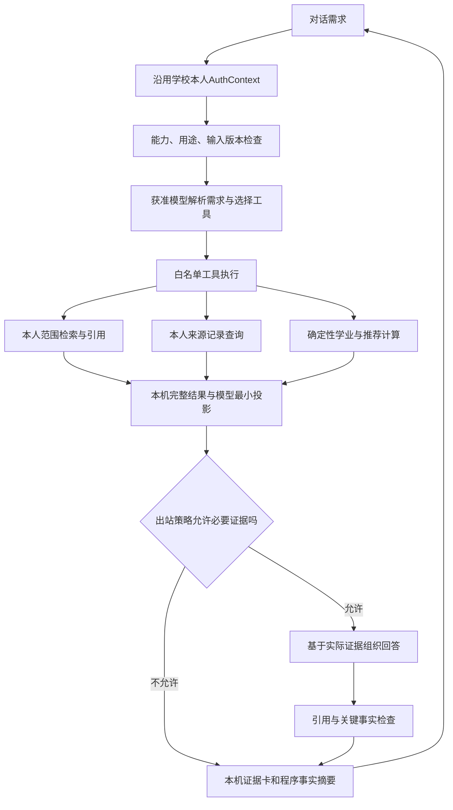

# 真实 RAG 与本人 Agent 对话设计 v1

日期：2026-10-15，Asia/Shanghai。源码基线：`main@a0c3bf7b15326c5df9535c233fd7ee4ad19850aa`，该提交仅归档前端，已提交并推送；本文及实施为其后本机改动。原设计中的阶段目标不等于实际完成；本轮实施、验证和未覆盖项以开发进度第54—57节及对应验收记录为准。

**用户实施纠正：对话界面仅提供直接自然语言对话，不放手动数据查询面板、数据源/快照选择或资料准备按钮。** 服务端从当前登录身份取得本人范围，模型按问题选择受限检索工具；来源记录及引用是回答的依据。D1表示后台底座，不能把它单独做成“对话”产品交付。

用户已再次确认学生教务登录、本人数据获取可以收口，并明确要求开始真实 RAG 与“对话”能力设计。登录与取数进入维护，不再重做学校客户端、扩展配对或另起采集系统。前端工程及页面验证已归档；本次进入设计不额外宣称所有视觉或真实业务验收完成。

## 1. “对话”要完成的任务

产品主入口仍是自然语言对话。系统应能回答取得的培养资料、查看本人来源记录，在依赖充分时解释缺口、推荐具体课表，再连续比较、调整、锁定、保存和导出。每轮结论要说清来自原文、来源观察还是确定性计算。

| 代表问题 | 读取与执行 | 能给出的结果 | 缺依据时 |
| --- | --- | --- | --- |
| “这份培养方案的专业选修要求是什么？” | 本人获准PDF中的条款、表头、课程行与附注检索 | 带物理页和支持片段的说明；适用未审时限于“这份取得的方案写了什么” | 澄清文档或路径；不把候选方案当本人正式要求 |
| “我的主修成绩里这门课有几条，分别是什么？” | 已读取记录的结构化筛选 | 保留重复记录、来源成绩和覆盖范围的本机结果卡 | 只说本次已读取范围；不推断未读部分或自动认定已获学分 |
| “我还缺多少专业选修？” | 本人适用要求、经审核规则、修读/认定事实，调用确定性学业工具 | 已知缺口与待确认项分开，逐项有版本和依据 | 学分认定、实例或规则缺失则unknown，不以成绩表额定学分直接相减 |
| “优先补6学分，保留体育，周五尽量空闲，给两三套” | 确认目标、枚举课程池、查具体班次、选择子集并完整复核 | 解集允许时给有课程/班次差异的方案与取舍；不是把全部候选设为必选 | 区分参考组合、待确认、范围内无解和搜索截断，不补课程/班次/周次 |
| “比较A/B，把周五改为必须空闲，再保存B” | 服务端解析本轮方案引用，继承约束，重算并执行明确动作 | 可复核差异、锁定保持、冻结保存及导出 | 过期A/B重新确认，不用旧通过覆盖当前条件 |

不从课名推断课程难度、好过程度、考核方式或教师质量；没有课程说明证据时只按明确目标、课程关系和已知时间处理。系统不执行学校选课或退选。二三四课堂沿用既定暂缓范围，原官方总要求保留，普通体育、劳动、实验和实践课程不按关键词排除。

## 2. 设计时的代码现状与复用边界

| 当前实现 | 可复用 | 必须补齐 |
| --- | --- | --- |
| `server.py:123/244/285`的学校分支仅开放教务；`workspace`、聊天和保存仍有真实推荐保护 | 学校验证出的AuthContext、现有教务服务、逐请求授权 | 按能力分派真实适配器，不能直接删除`real_recommendation_not_ready` |
| `chat.py:578`已有真实模型工具循环、预算、幂等、并发与版本复查 | 编排骨架、失败保留、对话/历史与工具卡 | `_check_workspace`固定夹具摘要、SYSTEM、工具描述和业务上下文目前均是synthetic |
| `recommendation_dialogue.py`及`storage.py`已有操作证据、锁定保护、方案引用和保存事务 | 多轮意图、确定性重算、冻结/幂等机制 | `validate_demo`和保存中的synthetic校验必须保留原路；新增有独立真实契约的分支 |
| `ReferenceIndex`处理原JSON；R3有真实PDF精细块、L0/L1、必要上下文、签名引用和观察查询 | 精确匹配、词法、引用/版本检查、完整观察束查询 | R3授权固定`restricted_reference/local_review`、EVAL-A、owner为空及特定selector，不是通用本人PDF索引 |
| `SchoolAccountService.fetch`返回记录、coverage、时间与来源别名；培养PDF已按本人获准版本保存 | 当前读取服务及不可变原件，不重新设计获取路线 | 观察→可查询事实→可计算输入的适配、适用审核和规则版本 |
| `chat.py:387`有模型结果投影，`ModelClient.complete`发送实际messages | 模型调用、严格JSON及工具协议 | 当前context、账本、时段、推荐意图等投影只对合成夹具获准，不能给真实数据直接复用 |

R3历史记录为162份元数据、1份正文首片、56块、47课程代码；人工gold为0，Embedding与真实原文生成未验收。本轮只核对源码/文档，未读取私有材料重新清点；这些历史数字不代表本人适用PDF或新对话可用覆盖。

## 3. 总体链路

本机资料搜索是显式检索功能，不冒称模型理解或RAG生成。只有实际生成模型接收到获准检索证据并据此回答，才验收为真实RAG问答。默认无真实数据模型出站；后续按第8节的具体方案授权。原文不出站时，远程模型不能声称读过或概括原文。

推荐和RAG分别提供能力。RAG可解释条款与连接依据，结构化工具负责完整清单，确定性程序负责缺分、冲突与组合。不能因为推荐输入尚缺而将所有资料问答都禁用，也不能因为检索可用就宣称本人推荐就绪。

## 4. 数据分层与首片范围

首片限定一个已获准的本人培养PDF版本、一个用户关心的普通课程模块、本人既有已读记录，以及必要的已获准课程观察范围。不以全处理162份PDF、全校课程更新、模型安装或Embedding作为前置。旧R3材料只能在其原用途下作方法/工程对照，不能自动绑定本人。

| 输入 | 本轮可依据的现状 | 新适配契约 |
| --- | --- | --- |
| 本人资料 | 服务端认证结果，明确年级/学院/专业字段及状态 | 仅在本机确定owner/realm与方案候选；缺专业不把类（专业）改成已确认专业，路径缺失不猜 |
| 成绩/主修记录 | 原成绩、来源额定学分、部分年份/学期、覆盖与未知 | 独立`AcademicObservation`；修读实例provisional与课程unresolved继续保留，不按同码折叠或按分数推已获分 |
| 本人课表/考试 | 已取得的时段及考试观察；正式中选和班次稳定身份仍未知 | 作安排来源；是否锁定由明确来源状态或用户操作决定，不自动成为全部候选目录或正式锁 |
| 本人培养PDF | 当前`acquired_pending_review`，绑定`not_verified`、规则`not_reviewed` | 允许受限地查询“这份文档”；本人适用与可执行规则另存审核结论和依据 |
| 课程及班次 | 已有去重观察与R3结构查询；是否满足当前目标学期及用途仍需核对 | 精确身份映射、学期/批次/时点、完整观察束和覆盖；未知或旧余量不当实时可选 |
| 周次/考试/校历 | 界面能展示节次、原文与公开作息参考 | 计算使用的周集合、分季、日期、例外及考试必须独立核验；显示用时刻不提供ICS日期映射 |

不要在标准化时重采学校数据。先消费现有获准快照；若真实推荐必需字段确实缺失，给出具体缺口和限定的补采建议。新增课程目录查询/更新需单独明确范围，不自动恢复全校采集。

### 4.1 已读观察的登记与恢复

当前`SchoolAccountService._capture`（324—346行）持久化操作、目标学期、owner、parser和payloads，`SOURCE-*`主要标识内容；完整coverage、captured/checked时间和授权代次在fetch返回值中，`StudentSourceClient`缓存只在内存。现有落盘文件因此不能单独复原“某次完整、当前有效查询”，本设计不假设已有完整观察数据库。

D1新增私有观察登记层，在当前服务返回有效结果时保存独立`observation_id`、owner/realm、操作/目标范围、原件与记录摘要、来源引用、coverage/分页预算与失败原因、data_source、captured_at/checked_at、parser/mapping版本及授权代次摘要。绑定来源页/行的引用只表示该次观察，不冒充稳定修读或班次身份。缓存有可信原观察关联时复用关联，不能把缓存取回时间写成新的学校捕获时间。

同字节哈希可以对应多次观察，不能把取得时点、覆盖或授权合并。旧原件缺这些元数据时，相关字段保持unknown并标历史/恢复来源；不拿文件mtime补captured_at，不按行数猜完整性，不因相同SHA恢复当前授权，也不隐式重采。新增内部读取服务先按context＋observation引用授权，再读取获准原件或规范记录；不向模型暴露原始路径或任意来源浏览接口。

## 5. 本人 RAG：从 PDF 到可回查证据

### 5.1 登记、提取与适用状态

由服务端固定本人上下文，通过已有`read_plan_document`/`OnDemandPlanService.read_document`读取当前获准字节，不接受任意文件路径、学校URL或另一个owner。派生文本和索引只放私有域，原件不改写。

保存物理页号、原页文/清理文及二者映射、PDF/页文/块摘要、抽取/清理/分块版本。条款保留否定、单位、阈值和前提；课程行保留表头；跨页表/星号保留作用边；OCR/读序未经核验、年级冲突或上下文不完整的块不进入可靠答案集合。

不要用单一“已完成”字段覆盖四种状态：

| 状态维度 | 例值 | 可以推出什么 |
| --- | --- | --- |
| 来源取得 | acquired / unavailable / historical | 文件存在及取得方式 |
| 文本/块审核 | unreviewed / assistant_reviewed_pending_human / reviewed_for_scope | 指定页与条款的可检索范围；助手审阅不算人工gold |
| 本人适用 | unknown / conflicting / user_confirmed_for_advisory / verified_from_source | 查询与建议可采用的适用边界；用户参考确认不冒称校方正式适用认定 |
| 执行规则 | not_reviewed / approved_project_rule / official_verified | 确定性程序能执行的独立规则版本及其权威层级 |

原23候选保持不改、不自动启用。项目审核形成新版本，不修改原PDF或把解释写回学校事实。

### 5.2 检索与课程连接

1. 先验证本人、用途、来源授权、会话/连接代次、方案范围和审核状态，得到允许集合，再评分。
2. 明确课程代码先精确匹配；完整课程/班次清单从结构化关系分页枚举，不以top-k冒充全部。
3. 普通表述先复用当前词法/汉字bigram；召回条款后补齐同授权的必要表头、附注及父条件，返回前再检查权限。
4. 不同方案同名课、不同表用途或同文不同适用范围不合并；课程身份只由核验映射建立，向量相似不能授予等价关系。
5. 无支持证据返回范围内未支持；冲突、暂缓节点和未审材料分别处理，不能用“最相似”强答。

Embedding是语义改写召回的后续对照，不负责权限、清单完整性或计算。先冻结同一获准语料和人审题，再比较词法、向量、混合及失败原因；不在本次设计中安装/下载模型、写真实向量或调用远程Embedding。小首片先沿用现有标准库/SQLite和精确评分，收益与规模证明有需要后再决定新增依赖。

### 5.3 引用、权限与换代

拟议本人引用绑定owner/realm、用途、来源/语料/索引/范围策略版本、授权及适用审核版本、块和必要上下文。每次resolve再次授权并核对摘要，定位优先物理页＋片段，缺精度如实声明。

现有`SchoolAccountService._authorize`把owner、realm、应用session及connection.generation放入scope_key，PDF元数据也绑定该授权域。因此任务在入队/运行/提交/取回时检查捕获的授权代次；重登、换号、重授权或版本变化后旧任务/缓存/引用失效，重新建立有效授权后才能取回。相同PDF SHA只证明字节相同，不能恢复旧权限。可复用内容编码，不可复用旧访问权。

给模型的证据标识使用本轮临时`E1/E2`映射；真正的本机签名引用和owner/来源定位由服务端保存和返回本机。模型不能构造引用、路径或授权。旧引用在新轮需重取核验，查看历史仍检查本人访问，不重放保存或下载。

## 6. 真实工作区与确定性工具

采用与synthetic平行的`PersonalWorkspaceProvider`（拟议逻辑模块），保持原合成校验器和测试不变。真实契约验证`runtime_observation/derived`、owner/realm、来源及审核版本，不把真实记录改成synthetic以绕过现有拒绝。

当前fetch响应的`data_kind=personal_source`是既有来源封装。新适配层另存带来源引用的`runtime_observation/derived`计算投影，不覆盖原封装，也不以换标签取代字段、身份和授权校验。

真实快照至少包含：授权上下文摘要、来源快照与coverage、parser/mapping版本、课程身份映射、修读/认定及状态、培养适用审核、规则版本、候选/观察池/目标学期、时段/考试/校历及偏好版本。逻辑对象可嵌入SQLite记录，不要求一对象一表或新增独立服务。

| 拟议工具或复用工具 | 允许参数 | 服务端固定与返回 |
| --- | --- | --- |
| `get_my_context`真实适配 | 无身份参数 | 能力、任务所需对象临时引用及缺口；完整个人事实不自动进入模型 |
| `query_my_records`新增 | 成绩/课表/考试的有限查询、课程引用、绑定版本的分页游标 | 本人已读记录、原值、coverage和时间；默认只在本机展示明细 |
| `search_my_curriculum`新增 | query、允许的条款类型及有界limit | 服务端固定文档/用途/范围；返回证据与必要上下文、审核/适用状态 |
| `lookup_course_observations`适配 | 准确课程引用、允许字段组、分页游标 | 同一候选池版本和学期的完整观察束；不混入个人页面状态 |
| `audit_my_progress`真实适配 | 无 | 只对依赖充分的已审核要求计算；未覆盖账户、未知认定与来源不完整明确列出 |
| `recommend/revise/validate/compare`真实适配 | 已解析对象、目标和显式操作证据 | 继承锁定/固定项、目标、全部输入版本，确定性程序给真值 |
| `act_on_my_option`及保存/导出复用 | 当前有效服务端方案引用与明确动作 | 再授权、重算、事务保存/幂等回执；JSON/CSV保留真实来源与unknown，ICS需可靠日期 |

推荐必须先枚举目标要求相关的课程池，再选子集与具体班次；RAG相关性不能直接当推荐分数。兴趣只能用已有课程说明或用户指定条件，缺说明不凭名字编造。

`input_versions`增加授权/绑定、来源覆盖、解析、适用审核、身份映射、范围策略、语料/索引、提示/工具契约和出站策略版本。数据/偏好变化后旧预览失效；冻结历史不覆写，重新校验产生新版本。保存真实方案需要扩展事务契约，不能只把存储中的`data_kind == synthetic`判断删除。

## 7. 能力状态与“对话”交互

`configured`只表示生成服务配置；`capabilities`分别表示实际就绪，不由一个“模型可用”掩盖数据缺口。建议独立报告：

| 能力 | 最小门槛 | 页面含义 |
| --- | --- | --- |
| `personal_record_query` | 当前本人会话＋获准来源观察 | 可以查询已读事实，不等于可以审核学业 |
| `curriculum_local_search` | 获准PDF版本＋可回查文本/块及明确范围 | 本机资料搜索，可先于远程生成完成 |
| `curriculum_rag_answer` | 上述检索＋实际生成服务＋必要证据使用许可 | 能按证据回答原文问题；区分文档与本人适用 |
| `academic_audit` | 必要学业语义、适用要求与审核规则 | 可以计算指定已覆盖要求的缺口 |
| `conditional_planning` | 明确候选及约束，允许逐项unknown | 只能给参考/待确认组合，不能称已核验本人可选课表 |
| `verified_recommendation` | 本轮计算所需事实、规则、资格与时段依赖充分且校验通过 | 当前限定范围内的本人推荐；不保证中选或全局最优 |
| `calendar_export` | 所选安排的可靠日期/时刻及必要例外 | 可导出日期ICS，不能拿界面作息参考补日期 |

学校身份不再永远“一刀切禁用对话”，但也不全量解锁：迁移时按以上能力逐条启用，对不就绪动作保留具体原因和受限保护。真实历史/已保存仅在相应本人接口完成隔离后启用。

首屏保留一句当前能力与主要缺口。用户提出问题后只澄清该任务需要的信息，不要求重复输入已可信取得的姓名/学号，不以输入身份授予权限。结果区区分“模型依据说明”“本机来源记录”“计算结果”，每条事实可展开来源和时间；不把工程内部JSON直接放到产品主流程。

新消息默认咨询，只有明确偏好修改才更新会话意图，只有明确保存/导出才执行动作。课程锁与班次锁分开；“保留体育”对象不唯一时澄清，不自动锁所有体育或解锁正式安排。A/B只指当前推荐集；旧轮精确引用必须重新核对版本。

## 8. 生成模型与真实数据使用方案

实施时按用户“直接对话、根据登录信息检索”的纠正，新增`personal-retrieval-v1`个人对话策略。它与下表原P1草案分开：最初实施使用独立勾选；2026-10-15用户随后明确无需勾选、默认发送问题与资料，因此现为用户点击发送时，自动携带consent_personal:true及当前策略版本，发送问题和必要相关教务记录/培养片段给当前provider/model。本人默认提交与合成演示许可分开，登录、状态刷新、切模型不自动发起问题。记录仅经字段白名单按问题限量投影，培养资料仅送必要的有界命中片段；整页上下文和原PDF留在本机，缺少的上下文须提示，不能假称已经分析。身份账号、凭据、本人键、来源路径和签名引用不送模型。会话/连接/HTTP代次、资料版本、provider/model及策略版本变化均复查；未授权请求必须零模型调用。原P1“事实明细默认仅本机”是设计时拟议，不代表用户已经给过明细出站许可。

聊天界面不呈现查询范围、快照或prepare控件。2026-10-15针对用户实测“我的成绩怎么样”空缓存失败，服务在模型请求前按问题准备缺少的必要来源：泛问成绩读本人主修历史、指定相邻学年及秋冬/春夏读对应学期、培养问题读本人培养文件；至多一类成绩加一份培养文件，已有来源复用，不推断未指定课表/考试学期。沿用正常学校只读服务及授权检查，准备动作单独记录为服务发起，不伪装成模型选工具。来源准备与版本接纳持有连接锁，外部并发输入变化仍拒绝；logout和进度授权不等待该锁。

随后服务强制本机`get_my_context`预检，白名单范围放在当轮临时system中；模型再选`query_my_records`或`search_my_curriculum`。空来源明确not_ready、未执行查询及未知匹配数，不显示为已确认0条。总览查询不把整句自然语言当课程名。成绩概况基于当前来源所有匹配行，独立证据引用；只计算已知0—100纯数字分数的非加权均值/范围，保留非数字、未知、多次修读及原coverage，不能称正式GPA或认定。身份介绍等由模型选择有限general_chat意图，再呈现明确标记来源的服务说明；未经引用的个人结论仍拒绝。

新登录的DeepSeek本人会话默认开启thinking，明确关闭仍保留；不修改全局模型配置。模型适配读取真实SSE `delta.reasoning_content`及工具参数，保持完整受限协议历史。答案前“处理过程”轮询当前本人/应用会话/绑定/连接及HTTP代次/请求UUID绑定的有界进度，实时展示实际来源步骤与可见推理，最终补齐私有运行日志。流中断不自动重试或采纳部分答案；普通模式和无推理字段不伪造思考。推理有脱敏/长度限制及末96字符缓冲，诊断不可当语义证明。已取得且当前允许访问的PDF可自动在本机准备索引；缺少来源仍保持unknown，不用合成数据代替。真实推荐及学分/毕业认定不因事实问答放行而开放。

原设计选择沿用现有DeepSeek适配路径，当时没有读取Key、调用API或验证额度。实施后沿用本机配置完成实际DeepSeek＋纯合成两题测试，不展示Key、不切换供应商；当前验收见第54节。现有synthetic的`consent_remote`布尔值和全局`COURSE_ALLOW_REFERENCE_TEXT`都不能授权真实数据。

建议先完成本机检索与本人事实工具，再由用户审阅以下**必要出站方案P1**。P1不是当前授权，也不是“去姓名即匿名”的承诺：

| 数据项 | P1拟议处理 | 作用 |
| --- | --- | --- |
| 当前问题 | 本人可查看/编辑将发送的文字，只发送获准本轮文本；凭据特征拒绝且不承诺识别全部敏感信息 | 理解需求和澄清；问题本身可能含个人信息，须明确许可 |
| 培养依据 | 仅当前问题所需、审核准入的非个人条款/表头/附注；最多5个主命中，连必要上下文总计初拟6000中文字符，超限缩小问题，不静默截断前提 | 真正的检索增强生成；不发送整份PDF或所有专业 |
| 引用和范围 | 本轮E1/E2、必要章节标题与范围说明 | 支持可回查回答；不传本人键、真实文件别名、授权/签名密钥或本机路径 |
| 本人事实工具 | 默认不发成绩行、完整修读史、地点、个人课表/考试；只返回不含具体个人事实的能力/执行状态，本机卡显示实际结果 | 模型可组织工具调用；不能在未见明细时自称分析了这些明细 |
| 偏好与推荐 | 本轮明确需求文字按上述许可；服务器持久偏好、锁定对象、已选课和推荐指标不自动发送 | 语义解析与本机计算分离；如后续确需个人结果解释，形成P2逐字段方案再审阅 |
| 历史 | 仅同一有效策略下必要且已获准的模型消息，重新投影后发送 | 不把本机完整聊天/工具历史再次整包外发 |
| 禁止项 | 密码、Cookie、Token、Key、会话标识、CSRF、owner/realm、授权文件、原始个人整包、任意来源路径、整份导出 | 始终不进入模型 |

工具同时产生`local_view`与`model_view`，远程只用出站投影器生成的`model_view`。在首次请求、每次工具回填、历史重发及最终生成前执行同一白名单；未知工具/字段默认拒绝，不能有当前`_model_result`式默认透传真实结果的回退。

授权绑定本人、用途、provider/model、字段组、资料范围/版本、策略摘要、期限和会话/连接代次。先预览具体字段/片段及摘要，用户认可后，在该范围内连续调用不重复弹确认；超范围、换供应商/资料版本、到期或撤销才停止并重新审阅。既有环境开关不能替代授权记录。

P1能支持培养依据RAG以及“模型选工具、本机显示本人事实”的受限Agent。它不能让远程模型自由解释整份个人成绩或所有课表取舍。若用户不希望资料/问题发远程，可保留明确本机检索；本地生成模型另评估，未部署前不宣称有本地RAG生成。

### 8.1 回答与语义检查

保留模型提出工具请求、服务端决定执行的机制。真实模式新增有版本的答案契约：`answer_kind`、本轮工具结果引用、`claims[{text,evidence_aliases}]`、unknown与范围说明；不能沿用只能输出outcome的合成最终格式，却在UI声称任意原文问答已实现。

课程码、学分、数量、约束、pass/fail/unknown及方案状态由程序对实际工具结果核验或直接渲染，模型无权改写。证据别名必须来自本轮有效返回，补齐引用依赖且再次授权。

**引用有效不等于语义支持。**程序可以检查标识、来源版本、定位及结构化事实，不能因此证明所有自然语言概括正确。首片采用短回答、逐结论证据；无充分支持时退回摘录/澄清，关键政策条件不补推。语义支持由人审样例和实际任务验收单独评价，不把正则或引用存在检查冒充语义证明。

## 9. 接口与改造位置

继续使用一个本机应用，不引入重框架或新的常驻外部服务。以下新增名称为设计接口，当前调用仍应拒绝，不表示已部署：

| 接口/改造 | 作用 |
| --- | --- |
| 扩展`GET /api/chat/status`及bootstrap | 分别返回生成配置、capabilities、blocked_reasons、输入/策略版本；不返回秘密或完整档案 |
| 新增`POST /api/evidence/prepare` | 仅接受服务端列出的本人来源引用和允许用途，登记/生成私有页文与块；有界任务，状态可由chat/status取得 |
| 新增`POST /api/evidence/search`、`resolve` | 明确本机搜索/证据回查；与Agent内部检索复用同一授权服务 |
| 新增`POST /api/chat/data-use` | preview/grant/revoke三种严格互斥Schema；grant只确认服务端预览引用及预期策略摘要，不信客户端自报允许字段 |
| 新增`POST /api/recommendation/prepare` | 从现有获准观察建立真实不可变计算输入，返回readiness和具体缺口；不执行学校请求或选课 |
| 扩展chat turn/conversations/history/save-option/export-option | 保持请求幂等与owner/realm；按能力选真实provider及工具，真实与synthetic历史隔离 |

建议新增逻辑模块：`personal_evidence`负责语料及引用适配；`personal_workspace`负责观察到计算输入；`model_egress`负责真实消息投影与授权。模块文件名实施时可调整，职责不能混进提示词。复用`school_accounts`/`student_plan_acquisition`、R3算法、现有planner/recommendation及存储事务；不放宽原R3 grant、mock或合成导入校验。

## 10. 实施顺序与阶段出口

| 阶段 | 交付 | 继续条件 |
| --- | --- | --- |
| D0 本轮设计 | 本文、字段/能力/出站方案、下一步清单 | 用户审阅业务切片；不调用真实模型、不改保护 |
| D1 本人证据与记录查询 | 已获准PDF的私有登记/分块/签名引用＋已读观察元数据登记/恢复＋事实工具＋能力状态 | 原件到引用回查、owner/realm/换代、覆盖/unknown及页面验收；只称本机查询 |
| D2 真实培养依据RAG | 在获准P1或实际可用的本地生成下，将真实检索证据交生成模型并回答 | 实际模型收发与逐字段出站证明、真实依据问答/引用支持、人审评估；无依据正确拒答 |
| D3 本人学业与推荐 | 适用/规则/修读认定、限定候选与校历输入；确定性缺口及联合选课排课 | 对应输入就绪，真实任务、多轮/版本/锁定与unknown验收；条件性参考单列 |
| D4 保存、历史、导出收口 | 真实事务保存、当前/历史结果、撤销重校验与导出 | 幂等和隔离，输入冻结可回查；ICS日期门槛通过；用户业务验收 |
| D5 按问题扩展 | 需要时做Embedding对照、更多文档/政策/课程说明 | 同语料同人审题对照；新增资料和采集范围单独明确 |

不必等D3全部完成才展示D1/D2真实能力；每项功能按能力开关逐步验收。本人查询不自动触发刷新学校来源，缺数据也不由模型发起任意网络请求。

### 10.1 下一步可执行的最小包

1. 以一个当前获准本人培养PDF版本列出scope、缺项、字节/页文/块版本；选一个模块，形成适用审核表和引用检查，不把候选绑定改成verified。
2. 实现本人证据、观察登记与已读记录的受限查询服务，以及按能力的status；先用独立合成权限/换代夹具验收，再在本人授权本机范围验证真实原件到引用。旧记录元数据缺失要保留unknown，不按来源内容摘要猜当前性。
3. 固定该片20题新审阅工作表，按同意图分组冻结开发12/保留8。可复用R3题型，不能把其另一份文档的答案/机器种子当本人gold。
4. 给出P1的真实最小出站预览，由用户确认具体范围后才启用实际RAG生成；未获准时停在真实本机检索，不宣称完成生成。
5. 并行列出D3的真实输入缺口；若某一模块依赖不足，先保留查询/参考结果，不扩大到全校采集或直接接通推荐。

## 11. 验收清单与证据分层

| 验收组 | 必查内容 |
| --- | --- |
| 来源与解析 | PDF/页文/块摘要和映射；跨页表头/附注、否定/阈值、OCR、年级冲突、缺页；必要上下文同授权 |
| 权限与换代 | A/B、mock/学校/本机参考域隔离；伪owner/路径/引用拒绝；退出、重登、连接generation、撤销、构建中与返回前变化 |
| 出站 | 未授权零请求；真实序列化载荷逐字段核对；未知字段不透传；参考许可关闭不带原文；历史重发不越界；无自动供应商回退 |
| 本人事实 | 部分覆盖、重复修读、缺状态/年份、来源额定学分与已获分分开，正式中选unknown；整批缺字段不补值 |
| 检索与回答 | 必需证据集合、逐结论支持、无依据/非本人适用拒答、完整列表走结构查询、提示注入不执行；回答不超已授权模型所见范围 |
| 计算与多轮 | 目标课程子集、真实班次/时段/考试、硬软条件、锁定/固定、搜索预算；版本变动后旧A/B失效，无解与unknown分开 |
| 保存与导出 | 服务端引用、原子提交、重复请求、不重放历史动作、冻结版本/unknown、可靠日期ICS与本人下载 |
| 页面与用户任务 | 实际“提问→澄清→证据/记录→比较/调整→保存/导出”，桌面/窄屏、未配置、超时、权限失效和部分工具成功 |

首片20题为拟议新样例，不是已执行结果。建议覆盖6题条款/跨页/例外、4题本人记录/覆盖、4题课程观察连接、6题授权/无依据/注入。只有人审完成、支持集合明确的题进入质量分母，保留组不调参。

准入目标沿用RAG v2：获准引用回查100%，已知隔离/伪引用/锁定攻击组0失败；可回答保留题Recall@5及必要证据覆盖至少90%、逐结论支持至少95%、无依据错误肯定为0。小样本同时报告原始分子/分母，不声称全专业准确率。安全工程、人工检索、实际模型、真实本人业务、页面和Git/部署分别出具证据；790项历史工程回归不作为这些新增能力已通过的证明。

## 12. 当前结论与阅读入口

登录/本人取数已收口；实施后已有本人观察登记、私有PDF/页文/块与引用、受限工具、真实模型聊天编排和自然语言对话页面。当前918项工程验证、实际DeepSeek＋纯合成两题及合成协议页面验证通过；本机18875已启用新后端，需本人重新登录。真实个人资料问答及语义支持、人审适用仍待用户验收；未做真实学分认定、推荐、Embedding或课程更新。模型实测仅纯合成材料，没有真实学校请求或个人资料出站；最终证据和Git状态见开发进度第54节。

本设计优先于旧文档中“学校尚未接入”等历史状态，但保留其来源/权限/规则/计算原则。相关基础：[10月15日归档](迭代时间窗归档_20261015_前端.md)、[来源说明](我的教务数据来源说明_20261014.md)、[推荐设计](推荐能力线产品与技术设计_v1_20261013.md)、[RAG v2](真实语料RAG设计与最小实施切片_v2_20261013.md)、[R3实现](R3本机参考首片实施与验收_20261014.md)。

## 2026-10-16 接续实现：最终答复修复与运行可观察性

本轮从真实18875页面继续：已有一次普通模式成功，同时也复现开启thinking后来源/记录查询完成、供应商返回可见推理而最终invalid_final_answer的失败。旧日志未保存被拒答复的结构细节，因此不能确定旧失败具体属于JSON、字段还是长度问题。当前HTTP日志接口本来就展开fields；前端新增该包裹兼容仅属健壮性，不能把它当成已证实的真实HTTP根因。

最终校验继续严格执行原字段、引用、敏感内容及能力边界。现在记录安全的failure_detail和计数，格式或本轮引用不符时最多追加一次模型生成，只复用当轮已授权工具证据，不重新执行工具或学校采集。被拒assistant正文及其推理从修复请求移除，只发送原问题、原工具结果与安全校验说明。权限变化、敏感内容、越界能力、HTTP失败和预算耗尽不自动重试；修复仍受总时限和上下文预算约束。修复请求使用空工具列表，额外工具调用被拒绝；失败链不成为后续模型历史。

在当前对话确有可授权读取的上一轮运行时，额外提供get_my_run_diagnostics。运行由服务端从当前conversation选择，不接受模型或客户端给出的run_id/owner。仅返回模式、状态、受控错误、调用种类、耗时与安全范围/数量；问题原文、来源行、供应商推理、私有路径及凭据不进入该投影。本机引用可关联原运行，远程投影不含本机run_id。日志损坏或不可用只让诊断降级，不阻止主问答；正常本人/版本检查独立执行。事实查询的三个原工具和已验收学校登录/取数行为保留，没有新增任意脚本或终端执行能力。初次修复工具版本为personal-question-tools-v3；后续增加全匹配行完成状态聚合及引用规则后改为personal-question-tools-v4，旧模型上下文按版本重建。

过程区分开呈现简短处理说明、完整实际调用记录和供应商实际推理，保留服务准备与模型选择的区别。来源范围、覆盖、实际返回数量、模型调用次序、耗时与安全错误可核对；不再截成最后四条工具事件。查询返回不等于成功，not_ready/failed/timeout分别说明；模型已经返回后不继续显示正在思考。普通模式或无推理字段如实显示，供用户查看的推理不等于完整内部思维或答案正确性证明。完成时定位答复开头，用户上翻位置及独立轨迹/推理滚动继续保留。

初次工程与真实模型使用合成资料的验证见开发进度第61节，重登后的真实本人问答、发现的问题和当前状态见第62节。当前版本已有真实调用和字段/原文核对，但小样本不证明全部自由文本语义正确或用户已验收；词法检索、来源分页/投影预算、真实推荐和学业认定的原有边界仍有效。

全范围成绩统计独立于模型可见的有限记录投影，新增completion_status_counts（known/unknown），仅表示来源完成状态字段是否已知，不推断通过、未通过或已获学分；全范围判断必须引用该聚合。自动采用来源不写成用户指定。每条结论允许最多15个本轮引用，与单次记录查询上限一致；超限格式修复应拆分结论并保留原候选已有的有效引用，不能靠删引用换取校验通过。这仍不是通用逐句语义证明。

按用户截图反馈，答案底部改为默认收起的单个“查看依据”，来源表和数字引用去重合并；培养资料实际引用片段优先，其他命中与原文上下文默认折叠。完整运行详情移到上方处理过程；过程运行时默认展开、终态收起，尊重用户手动选择，历史按需读取。未删除真实证据、重复修读行或供应商推理。培养回答优先所问模块，不能从并列版面推断禁止替代、抵充或正式认定。

## 2026-10-16 数据边界调整与v5工具链

用户明确仅课程信息依赖本地，其余信息通过教务接口取得。当前将本地课程名称/代码参考与教务事实分开：前者显式配置交付索引、核对manifest/hash，不能推断当前开课或本人资格；后者每轮强制读取，记录/培养工具固定本轮实际回执，失败或缺少新观察编号时不可回退旧快照。私有快照与PDF仍用于来源核对和本轮派生索引，不是个人资料的默认权威来源。没有删除原始材料、旧连接隔离或已验收登录能力。

采集默认最多50页、20条/页，单次总预算60秒；异常、重复页或预算耗尽仍保留明确partial，权限或代次变化继续拒绝。明确学年可读取两个半学年，跨学期按不同scope查询；无法核实的相对学期需澄清。同学年快照范围可用于筛选行内未知年份，不改写原值。逐页候选标识含页与全局位置，仍不冒充稳定修读ID。

query_my_records新增mode=summary/records。概况只返回全匹配聚合，明细通过本轮opaque PAGE token续取；真实签名cursor及来源ID不发模型，参数不匹配或token伪造拒绝。课程来源绩点允许按原值查询，不因此计算正式GPA。工具版本personal-question-tools-v5-live-sources；本轮未新增真实推荐、认定或选退课动作。

培养原始页、连续原文及字符定位不改；派生model_text与保留span记录保守水印清理。按模块、表头、课程行、附注及跨页继承组织，明确模块查询优先该模块。正文片段不超过1800字，发送有界model_context并按实际遗漏标记；本机整页上下文保持核对入口。候选上下文齐备不等于完整规则已审核或本人适用已确认。提取/分块版本更新，旧索引重建，旧引用不得复活。

模型证据分桶限额相互独立，总额为各桶之和，避免成绩扫描挤掉培养依据；总请求仍有UTF-8字节、步骤、工具数和时限上限。分页截断明确has_more，不跳过未投影行，不声称任意长清单可在一轮列全。live每轮只保留经过校验的用户意图；旧工具事实、旧模型答案及旧推理不再次出站，当前事实重新取证。动态读取在连接锁内先严格核对已有版本，仅采用本轮自己读取后的新版本，外部并发变更、撤权及模型变更继续拒绝。实际验证与未覆盖项见开发进度第64节。

旧用户意图以system中的已结束历史说明提供，仅供指代，不能作为未完成待办；模型请求只保留当前唯一user。显式只查询本地课程目录时不声明成绩/培养工具，运行时也拒绝未声明调用。真实模型配合纯合成来源的首轮三题曾复现目录追问重复旧任务及额外读取，原失败回执保留；同题修正复测目录题0次教务读取，不把此结果当真实本人语义验收。
