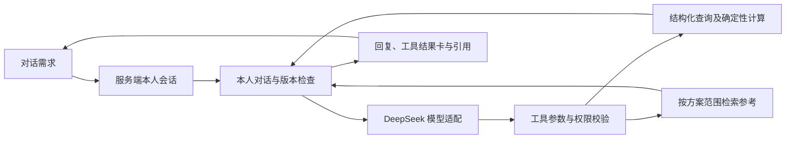

# 系统与对话查询实施设计 v1

日期：2026-10-13。目标：在现有本人 synthetic 工作区上完成真实模型的对话、受限查询、确定性推荐与结果解释。实现、离线回归、真实模型、浏览器和真实学校验收分别记录在开发进度；本文不是验收证明。

## 1. 完整产品与本轮闭环

学生从对话入口提出需求，系统先核对本人身份与数据范围，模型在工具白名单内查询现状、澄清条件、检索依据、计算推荐，再把实际结果与待确认项展示在同一轮。多轮调整继承锁定、固定项与输入版本。条件表单用于查看和修改可执行状态，保存/导出仍是明确操作。用户最终在学校系统选课，本系统没有自动选课工具。

本轮以已有固定合成学生完成这条链路；真实学生登录与个人数据来源依旧分别待接入。对话预览不直接修改工作区，以免模型解释失败、语义误读或旧版本请求产生隐蔽持久化。页面应明确“预览”，后续应用条件需要版本检查和再次确定性校验，不能将预览冒充已保存、正式中选或已获分。

## 2. 系统模块与边界

| 模块 | 输入与职责 | 输出/边界 |
| --- | --- | --- |
| 认证与本人绑定 | 服务端验证的主体、绑定、会话 | 每次请求/工具/最终返回重新校验；模型没有身份选择参数 |
| 数据接入 | 原始观察、映射、许可、覆盖与更新契约 | 原始层不可改；真实缺字段 unknown；固定 synthetic 与真实样本隔离 |
| 规范化工作区 | 本人档案/修读/认定、课程/班次/时段/考试、志愿/正式状态 | owner+realm 查询；带来源、快照及版本；当前仅 synthetic |
| 确定性引擎 | 当前已授权快照、规则和偏好 | 学业计算、候选搜索、冲突/资格与三态；候选原规则不执行 |
| 参考检索 | 固定适用范围、查询、语料版本 | 本机关键词基线；有出处的候选，不是适用性或学分判断 |
| 模型适配 | 最小上下文、工具 schema | 首接 DeepSeek；输出工具提议/语言解释；无 SQL/Shell/浏览器/选课权限 |
| 会话编排 | 本人 conversation、request_id、轮次、输入版本 | 限预算工具循环、幂等、防并发旧写、真实结果记录；网络不持全局锁 |
| 对话与课表页面 | 模型状态、消息、真实工具卡、引用 | 默认入口；区别模型解释与程序状态；模型失败不生成假回复 |
| 运维与验收 | 配置、测试、模型回执、页面证据 | 凭据/对话运行记录本机保存；Git 与部署单列 |

## 3. 数据和出站范围

仍采用 [数据接入契约](数据接入契约与最小切片_v1.md) 与 [RAG 设计](RAG检索权限引用与评估设计_v1.md)：学校认证、本人数据许可、模型数据处理授权互不代替。Excel/截图仅字段参考；不要求用户上传。

首轮远程模型只可访问服务端固定合成夹具的最小投影及用户同意发送的测试问题。运行工作区即使标成 synthetic，也可能通过开发导入夹带自由文本，因此出站前核对固定夹具，不能仅信任标签。模型不接收 cookie、CSRF、owner、学校身份凭据、原始学业整包、历史冻结整包或本机路径。用户输入仍可能包含真实信息，页面说明测试用途并要求一次会话同意；明确凭据特征需拒绝，不能声称能自动识别所有个人信息。

54 个现有参考块（19 课程、23 待审核候选、12 来源问题）保持 restricted_reference。本机查找可展示原文和引用；只有配置 `COURSE_ALLOW_REFERENCE_TEXT=true` 且有明确授权时，才向 DeepSeek 传必要非个人片段。默认 false，模型只能获知本机检索的状态，不能假称已阅读原文。个人资料向量、跨主体缓存和真实来源文件不在本轮接入范围。

## 4. 模型与工具契约

用户已选 DeepSeek API。服务端标准库 HTTP 适配固定官方 HTTPS 地址，不接受模型给出的 URL，不转发重定向，不自动切供应商或重试扣费。配置从环境或被忽略的本机 `.env` 读取，不执行其中内容，不输出值。首个默认模型名称按实查官方文档设置，仍可由本机 `DEEPSEEK_MODEL` 指定；能否调用由真实响应验收，不由文档推断。

使用模型实际提出的 function calls，执行后回传 role=tool，再由模型组织回答。采用非思考模式，限制输入长度、输出 tokens、响应体、单次超时、每轮工具和模型步数；截断、非有限数、重复 JSON 键、非法/多余参数均不成为可执行指令。[DeepSeek 工具调用](https://api-docs.deepseek.com/guides/tool_calls/)、[Chat Completions](https://api-docs.deepseek.com/api/create-chat-completion/)、[模式配置](https://api-docs.deepseek.com/guides/thinking_mode/)。

仅最终决策格式错误可在原预算内请求一次纠正，复用已完成工具证据，纠正阶段不提供或执行工具；响应记录 `final_decision_repairs`。第二次格式错误仍失败，矛盾结论、无效引用、权限或版本失效不借此放行；网络异常不自动重试。实际验收运行器先保存原始回执，再执行独立业务评价，评价崩溃不能消除失败证据。

| 工具 | 受限参数 | 服务端行为 |
| --- | --- | --- |
| get_my_context | 无 | 本人固定 synthetic 目录、当前偏好、必要状态与版本 |
| audit_my_progress | 无 | 当前学业三态和分账结果；不外传整份原始成绩 |
| find_my_sections | 当前课程 IDs | 在本人可访问快照中查班，未知/歧义不补造 |
| generate_my_plan | 允许的偏好 patch | 继承锁/预置/固定/版本，纯计算预览；不提交偏好 |
| validate_my_plan | 当前班次 IDs | 确定性检查指定组合，状态以工具为准 |
| search_plan_references | 查询文本 | 方案范围由服务端确定；候选仍待审核；原文出站受独立许可 |

保存、导出、解锁、删除固定项、读取任意路径、自由网络请求和学校选课不在这批模型工具中。它们不能借检索文字或“忽略之前指令”获得授权。

最终模型消息采用 `{kind, outcome, cited_chunk_ids}`；澄清另带有限的 `clarification`。answer 必须有本轮工具证据；服务端按 outcome 选择相应工具的最新相容结果，并返回其索引和工具名供复核。生成与校验须使用本轮最终有效条件，只忽略 revision 等记账差异，不能引用已改变条件下的旧通过结果。同条件生成可行后再校验其中一份通过，可以仍以生成的多方案为主要结果；后续相同组合的矛盾状态须拒绝，其他组合的失败须另行提示。引用逐个回查。模型自由事实文本不直接渲染，程序依据工具结果呈现摘要，响应标明 `reply_origin=verified_tool_presentation`；澄清为经校验的有限问句。

这是首版约束型 Agent：模型真正理解测试问题并选择/调用工具，程序呈现可验证事实。它不等同手动合成预览，也尚不提供任意自然语言事实解释。仅“请求成功”不表示任务正确；还需验证模型是否选对工具/条件/相关依据。若资料原文许可关闭，模型不能完成原文语义判断，只能查询并提示本机卡片；原文未覆盖的问题不应被相近命中当作答案。

## 5. 会话、并发与更新

- GET `/api/chat/status`：本人登录后读取配置状态，无凭据。
- POST `/api/chat/turn`：`message`、`conversation_id`（首次为空）、`request_id`、`expected_turn`、`consent_remote`。不接受客户端身份、模型地址或工具结果。
- POST `/api/chat/history`：按 conversation_id+owner+realm 查询。对象不存在和他人对象使用一致不可访问响应。
- 响应包含 `conversation_id/turn_id/status/reply/tool_results/citations/versions/data_kind`。工具名称、参数、结果来自真实执行；不是模型伪造 trace。

开始轮次先在短锁中验证会话/范围、冻结版本、认领 request_id；推理在锁外。每次请求模型、执行工具以及最终返回前，再校验会话和版本。退出、绑定撤销或期间修改工作区使旧轮失败，不用最新 revision 偷换旧意图。模型配置或原文出站策略变化时清空将被发送的旧模型历史，防止撤销原文许可后重发。相同请求只返回其既有结果；相同 request_id 换内容须拒绝。并发同一会话不得重复执行或覆盖先前轮次。

对话预览条件在会话内延续；模型上下文缩短不丢弃锁定、固定和版本。工作区版本变化后旧预览需失效并重新读取。错误保留实际已完成工具证据，不能声称模型已成功回复。运行会话与 trace 只放忽略的 SQLite，设置轮次/上下文限额，后续需补用户删除、保留期限与生产清理。

## 6. Embedding 的位置与推进顺序

Embedding 不替代生成模型，也不是首轮对话的前置条件。当前 54 块先沿用关键词参考检索，保留同样的范围/版本/引用接口。随后按 [Embedding 引入判断](Embedding引入判断与实施顺序_20261013.md) 构造人审问题集，对比关键词、向量、混合检索；原文缺失问题另做 PDF 接入，不将覆盖增加误算为向量算法改进。

新向量索引必须携带来源、适用范围、许可、正文与模型版本、维度、归一化、chunk 与原文摘要。查询前过滤权限，引用时再次回查。当前小语料可精确向量评分，不需要先部署向量数据库。未经许可的真实个人材料继续不进入索引/远程 embedding。

## 7. 验收与未确认依赖

本轮目标需同时证明：真实 DeepSeek 请求/响应；模型发起至少一次合法工具查询；实际工具结果回传；最终中文回答与结果一致；同一会话后续追问保留上下文；页面能够发送并展示真实回复与依据。推荐场景还需验证预览由确定性程序产生、锁与固定项继承、冲突/unknown可见。测试替身只能覆盖程序异常/权限路径，不能替代真实模型和页面验证。

必测错误：未配置、鉴权/超时、异常模型 JSON、伪造工具/身份、会话越权、撤销后返回、并发版本变化、重复请求、错误引用与未覆盖问题、外传范围关闭、合成导入夹带自由文本。每轮记录当前代码和 inputs 摘要。

2026-10-13 本机 Key 已配置，`deepseek-flash` 已取得真实响应；这不保证后续额度或可用性。尚待确认：非个人原文出站许可；学校应用许可/认证协议/可信本人绑定；个人档案/成绩/选课来源及用途许可；完整班次/周次/考试/校历；原 23 规则审核与真实修读认定政策。原八项及 A01–A10 未覆盖部分保持未完成，当前本机闭环不代表真实业务或生产部署完成。
