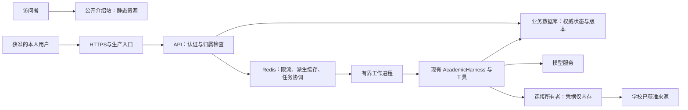

# 浙大教务助手：系统优化与公开部署路线图

> 2026-10-23 更新：本文件保留上一版建议。当前规划重点与推进顺序以[工程化建设与上线规划](工程化建设与上线规划_20261023.md)为准；部署、并发、账号、存储及运维是主线，旧版体验优先清单不作为当前展示排序。

更新：2026-10-22。状态：**设计建议，全部新增事项尚未实施。** 用户本轮授权将规划写入展示包；本轮不接入 Redis、不部署服务、不扩学校取数范围。下文把当前代码事实、拟议方案和未来验收分开。

## 1. 规划依据与当前限制

当前代码核对得到：

| 位置 | 当前事实 | 对后续演进的影响 |
|---|---|---|
| [server.py](../course_assistant/server.py) | 使用 ThreadingHTTPServer，绑定 127.0.0.1；应用内有 RLock | 当前是本机线程式服务，未形成生产容量结论；上线需改造 HTTP 适配层与运行方式 |
| [storage.py](../course_assistant/storage.py) | SQLite 按 realm/owner 隔离资源；有请求摘要、去重及事务；connect 中设置 15 秒等待和外键 | 保留已有正确性控制；连接等待并不等于高并发设计。连接函数未显式启用 WAL，未读取本人数据库来判断实际 journal 配置 |
| [school_accounts.py](../course_assistant/school_accounts.py) | 学校连接、当前方案等挂在进程内连接对象上，有每连接锁 | 不能直接启动多个副本就假设登录、方案和查询状态可共享；同一学校连接不应随意并行 |
| [personal_chat.py](../course_assistant/personal_chat.py) | 请求预留和落库使用应用锁，模型执行在这些代码段之外；终态仍核本人范围和版本 | 不应未经测量声称所有模型请求都被全局锁串行；要分别测应用锁、连接锁和数据库写等待 |
| [chat_progress.py](../course_assistant/chat_progress.py)、[personal_drafts.py](../course_assistant/personal_drafts.py) | 进度与草稿主要在进程内，有各自 TTL/容量；重启不能保证恢复 | 这些容量是保护上限，不是支持多少并发用户的验收结果 |
| [web/app.js](../web/app.js) | 约 800 毫秒轮询进度；模型供应商到后端使用 SSE | 浏览器并非已实现端到端 SSE；可评估退避轮询或事件推送，保持一行真实状态 |
| [v34 真实回执](../validation/dialogue_v34_real_20261022_acceptance.json) | 有限旅程完成，但仍有过度推断、重复表达与格式修复 | 先修常用体验，不用技术组件数量或 HTTP 成功率代替业务质量 |

没有生产流量、并发压测或成本基线；不填造当前 QPS、用户容量、准确率或可用性。完整设计原则沿用[当前架构](项目架构_职责收敛后_20261021.md)与[双能力线总体设计](学生教务问答与选课推荐总体设计_v2_20261016.md)，旧文档中的状态以最新实际记录为准。

## 2. 针对当前系统的优化清单

| 优先级 / 主题 | 当前依据 | 拟做的最小变化 | 验收方式 |
|---|---|---|---|
| P0 答复语义 | 概况被用来推断明细；返回集合被说成全部候选 | 让工具投影明确可支持的结论；具体课程问题先取得匹配明细；直接沿用实际星期节次、来源状态与范围 | 固定常用问题与原失败逐句对照数据；未支持的认定、时刻或穷尽性结论不能出现 |
| P0 简洁表达 | 正文与表格/方案卡重复；首问较长 | 结论优先，保留 2—3 条有证据的取舍理由；明细交给表格/卡片。详细请求仍可展开，不把所有问题硬套模板 | 问题得到直接回答，必要限制不丢；记录重复率、篇幅与用户判断 |
| P0 条件与引用 | 历史曾发生门数、锁定和新旧引用问题，已修一部分 | 继续让服务端规范条件与 revision 主导；对话只提交变更差量；保留终态引用检查 | 生成→锁课→改硬条件→只解释：未授权条件不变，解释不重算，旧引用拒绝 |
| P0 有界失败恢复 | 学校失联、模型额度/超时、格式问题表现不同 | 明确“需重新登录 / 来源暂不可用 / 正在排队 / 条件无解 / 格式失败”；重试前先查同一请求是否完成；实际取消向服务端执行传递并释放占用 | 断网后不重复提交、不把旧结果当最新；取消后是否仍产生模型费用单独核查，不能承诺一律零费用 |
| P1 等待与成本 | 多轮工具与格式修复增加等待 | 分段计时后优化重复调用和上下文；保留同轮来源复用、预算和已有一次修复边界；按独立请求与连接能力并发，不盲目并行学校读取 | 同一组常用任务比较首个状态、最终答复 p50/p95、调用数和费用，不能只比较最快一轮 |
| P1 培养检索 | 文档片段匹配不等于正式适用 | 做有界的词法/向量/混合检索对照，保留章节、表头、附注及页上下文；按本人权限、内容 hash、解析器与编码器版本复用派生计算 | 命中片段支持实际结论；原文缺项和本人适用未知继续明确，结构化成绩不交给向量猜测 |
| P1 候选与解释 | 课程名被推成方向，未见记录被当未修 | 增加获授权且有来源的课程描述/标签；保存筛选和排序事实，解释共同项、替换项及代价 | 方向有来源、淘汰理由可核对；仅声明已搜索的范围，不声称所有组合已遍历 |
| P1 方案后续使用 | 真实方案与当前登录/内存状态相关 | 补齐本人草案保存、版本失效后重核、可比较的修改历史；导出只包含来源足够的信息 | 重启后旧草案以历史状态打开，修改前重新授权/核验；日期周次不足时不生成伪准确日历 |
| P1 页面与无障碍 | 已有简洁界面，需要持续保证实际使用 | 核对手机、键盘焦点、表格阅读、长对话定位、状态朗读；保留深度思考按钮和模型选择 | 常用路径可完成；不恢复过程、依据、核验范围与运行记录面板，不增加发送授权勾选 |
| P1 维护与回归 | 已有大量版本记录，零散规则有维护成本 | 围绕工具契约、规范条件和存储接口补文档；只在真实改动涉及处整理重复逻辑；固定约 12 个常用案例及原失败 | 每次交付可定位输入、代码与结果版本；人工业务核对、工程回归和用户验收分别报告 |

上述是有限优化清单，不要求把所有事项同时实现，也不通过新增多 Agent 评审循环来掩盖事实问题。正式认定/推荐仍需关闭培养适用、已审规则、资格/余量、班次与校历等业务缺口；技术扩容不会自动补齐这些条件。

## 3. Redis 如何帮助多人使用

目标是减少适合复用的重复工作、限制突发请求并协调任务；Redis 不会缩短模型固有生成时间，也不能自动解除学校接口、连接串行或数据库写入限制。以下分工是针对本项目的建议，尚未接入。

| 用途 | 拟保存/处理内容 | 一致性与边界 |
|---|---|---|
| 派生缓存 | 已核验版本的公共课程参考、解析/检索派生结果；本人派生结果另按私有范围设计 | 本人键需包含安全域、内部所有者标识、授权代次、来源 hash、查询及算法版本；命中后仍校验当前权限和新鲜度，不因 TTL 未到就称最新 |
| 限流与并发配额 | 每用户、每会话及全局模型/学校查询的计数或令牌 | 在服务端原子更新；超过容量返回明确等待/重试状态；不得靠前端禁用按钮限流。Redis 可支持跨实例共享限流状态。[官方说明](https://redis.io/docs/latest/develop/use-cases/rate-limiter/) |
| 任务队列 | 不含凭据的 request/run 引用、状态与重试次数；长任务交给有界工作进程 | Redis Streams 可作为候选；消费确认与待处理恢复不等于恰好执行一次，业务需幂等。[官方说明](https://redis.io/docs/latest/develop/use-cases/streaming/) |
| 进度与路由 | 安全状态、事件序号、拥有连接的工作进程标识 | 不在事件里放成绩全文、密码或 Cookie；最终结果持久化由业务数据库负责，进度失效不代表业务一定失败 |
| 短期互斥 | 同一会话/方案修改的协调租约 | 只在跨进程必要时加入，保留数据库条件更新与方案版本检查；不能用一把 Redis 锁代替业务一致性 |

**缓存策略。** 成绩、课表、考试与培养资料仍按当前约定取得本轮有效来源；原文内容一致时才复用解析或编码结果，不把接口失败后的旧数据伪装成最新。初期不做跨用户“相似问题答案缓存”；同一句问题可能对应不同身份、学期、权限与方案。可丢弃缓存与任务协调数据建议使用分离的实例/资源策略；仅使用不同逻辑 DB 不能隔离同一 Redis 实例的全局内存淘汰策略。Redis 的内存上限和淘汰方式须显式配置，不能让缓存淘汰破坏仍在执行的任务状态。[官方内存淘汰说明](https://redis.io/docs/latest/develop/reference/eviction/)

**幂等与租约。** 现有 request_id、摘要、expected_turn 与 revision 应继续有效。若引入队列，业务库记录任务状态，队列传输引用；数据库与队列双写要有可恢复的投递记录，消费者在事务内核查状态并提交唯一结果。网络超时后的供应商调用结果可能不确定，不自动宣称恰好一次或无限重试。锁使用唯一持有者标记和有效期，原子核验持有者后释放；锁过期后的旧工作者仍须被数据库版本条件阻止提交。[Redis 锁的原理与限制](https://redis.io/docs/latest/develop/clients/patterns/distributed-locks/)

**学校会话是单独问题。** 当前学校连接持有客户端与内存凭据，不能序列化成共享 Redis 会话来扩容。第一阶段保留连接所有者和请求路由，同一连接保持受控串行；进程丢失后明确失效并要求重新认证。Redis 只存不含凭据的路由引用，不保存学校密码、Cookie、Token 或完整登录对象。公开后端是否可代用户连接学校，须先确认获准接入方式与网络可达性；本机登录的成功不能直接外推为云端可用。

**故障策略。** 可丢弃缓存失效时，仅在授权、上游预算与有界负载允许时回源；身份、配额或协调状态不能可靠确认时停止相关执行。任务队列满、Redis 不可用和工作进程重启应有可观察状态，不能无界排队或静默丢失。持久化/备份与重试策略在正式选型时验证，不把 Redis “在内存中”误认为不会落盘。

## 4. 数据库、工作进程与容量验证

短期保留业务模块，先测数据库事务耗时、锁等待和连接占用。SQLite WAL 可以改善读写并行，但仍只有一个写入者；它不是跨机器共享数据库方案。[SQLite 官方 WAL 说明](https://www.sqlite.org/wal.html)

如果多进程写入、连接数或备份恢复需求成为瓶颈，再评估 PostgreSQL 等服务型数据库和连接池。迁移应保留 owner/realm 查询、唯一请求、事务和 revision 条件更新，准备可逆迁移与恢复演练。PDF 解析/编码等重任务可按测量结果放入有界工作进程，HTTP 层负责认证、提交和查询状态；不要求立刻拆成微服务或引入 Kubernetes。

容量计划分三个层次：

1. **单用户基线：** 固定成绩查询、组合生成、调整与解释，记录前端等待、排队、学校、模型、计算、落库耗时，区分首次与复用。
2. **受控负载：** 先用 synthetic/替身上游验证并发与隔离。可从同时在途 1、5、10、20 个请求逐级试验，混合读取和修改；这些是拟议测试档位，不是已支持人数。真实学校与模型负载只在许可和预算内有限验证。
3. **小范围试点：** 记录实际请求到达率、平均耗时、p95、错误率、队列最老等待、重复执行、数据库锁等待及模型费用；由实测找出可承受容量，再决定是否增加工作进程/实例。

同时在线人数、同时执行任务数、每秒请求数和长连接数分别报告。粗略规划时，在途任务数约等于到达率乘平均执行时间；这只是估算关系，不能替代长尾、突发与上游配额验证。

首轮验收至少覆盖：跨用户数据泄漏为 0、重复请求不重复修改、原条件和版本保持、排队/限流可见、队列容量有上限、取消及重启后不遗留无限占用。时延与成功率目标先采基线再确定；“run 完成”和“答案正确”分别统计，不能把 200 响应率当业务准确率。

## 5. 公开部署分两条路径

### A. 公开项目介绍站

这是优先可交付的展示目标，可独立于后端扩容推进。

1. 用本包文案、时间线、当前/未来架构制作静态网页，资源使用相对路径。
2. 从本包另制可公开素材版本，逐项确定真实成绩、课表和对话的展示范围；当前私用 ZIP 不直接作为站点下载附件。无需收集访问者学校密码。
3. 选择静态托管、配置域名与 HTTPS，保留发布版本和可回退产物。托管商、费用与域名尚未选择，本次没有购买或部署。
4. 核对移动端、图片放大、视频播放、资源路径、可访问性，以及无凭据/私有文件外露；用户确认最终页面后再发布。

### B. 可登录的在线教务助手

这一步涉及多人真实数据与学校连接，单独制定上线范围，不以介绍页上线作为后端生产验收。

1. **接入前提：** 确定学校批准的认证与数据访问路径、云端网络条件、本人绑定和模型出站范围。不预设某种 SSO 协议已经获准，也不把所有人的学校连接复用为一个公共账号。
2. **生产入口：** 在保留业务模块的前提下迁移 HTTP 适配层，选择受维护的生产 WSGI/ASGI 服务，并配置反向代理、HTTPS、域名与可信代理边界。当前类不能直接作为 ASGI 应用启动；Python 官方不建议把 http.server 用于生产。[官方说明](https://docs.python.org/3.13/library/http.server.html)
3. **权限与配置：** 校验 Host/Origin、CSRF、会话 Cookie、注销与撤权传播；密钥由部署环境管理。数据库、Redis 和私有文件仅在受限网络/目录访问，下载继续按本人授权；不能为公网访问直接删除现有本机保护。
4. **任务与数据：** 根据试点需要引入 Redis 限流/协调、有界工作进程及适当数据库；先解决学校连接路由、状态恢复和版本一致性，再横向扩容。
5. **等待传输：** 初期可保留带退避的轮询；若改浏览器 SSE，要验证认证、断线续接、心跳、连接数和代理超时。流式路径单独配置响应缓冲，不全站关闭缓存，也不提前展示未通过终态检查的模型正文。Nginx 支持按代理位置控制响应缓冲。[官方说明](https://nginx.org/en/docs/http/ngx_http_proxy_module.html#proxy_buffering)
6. **上线运维：** 分开存活/就绪检查；准备限流、错误率和成本告警、受控日志、备份恢复、发布回滚及数据删除流程。先合成环境验收，再在获准范围试点，最后决定扩大开放。

图中 Redis、生产入口与工作进程是**未来候选结构**，没有部署。本机现状仍以当前架构文档为准；数据库类型、任务传输和认证方案需要实施时确定。

## 6. 按交付物推进，而不是按技术名词推进

| 里程碑 | 交付物 | 进入下一步的依据 |
|---|---|---|
| M1 常用体验 | 约 12 条固定案例、原失败修复、简洁答复和恢复说明 | 工程检查、实际来源/结果核对与用户判断分开记录 |
| M2 可展示 | 开发时间线、真实操作介绍、公开素材版与静态网站候选 | 页面可用且内容真实，公开范围确认；发布单独执行 |
| M3 并发基础 | 分段时延基线、配额和有界队列、Redis 最小接入实验 | 压测能说明瓶颈；缓存、限流、幂等、连接路由及故障行为可核验 |
| M4 获准试点 | 生产适配、多人隔离、恢复和运维手册 | 接入许可、数据路径、负载与成本边界明确后有限开放 |
| M5 持续演进 | 按真实需求扩来源、规则和容量 | 每个新范围独立取得授权与验收，不自动扩大采集或开放选退课 |

暂不安排新增多 Agent、跨用户语义答案缓存、自动选退课、全量扩采或直接把本机服务暴露公网。没有确认人力、目标人数、学校许可和预算，故不编造上线日期、价格或“百万并发”目标。

网页展示可使用短句：“围绕真实常用任务持续优化回答质量，并逐步建设公开展示、多人并发和线上运维能力。”工程实现按本路线图逐项验证；本文件本身只证明规划已整理。
