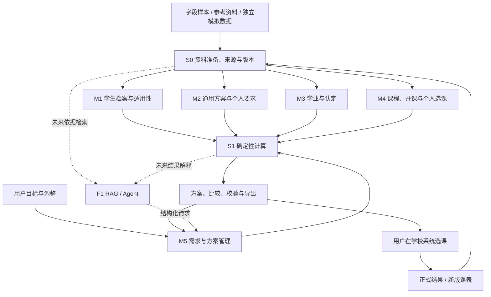

# 选课助手：系统模块与数据来源矩阵 v2

日期：2026-10-09。状态：设计草案，已同步用户最新纠偏；代码开发保持暂停。本文件描述拟议设计，不表示以下模块已经实现或通过验收。开发状态统一记录于 [开发进度](开发进度.md)。

后续授权记录：用户已要求根据现有 PDF、Excel 和截图初步设计数据字段。具体字段、类型、来源映射及关系见 [数据结构与字段字典 v1](数据结构与字段字典_v1.md)；本矩阵负责模块范围，字段命名以该字典草案为参考。检索流程与实际接入仍未设计，代码继续暂停。

## 1. 设计前提

资料准备阶段使用已提供的文件、截图和人工说明理解字段。**用户提供的 Excel 是字段与结构样本，不能据此确定真实使用者上传 Excel 的产品入口。**

用户确认的未来使用方向是：先以学校身份登录，取得可信的本人学生绑定，再检索本人档案；输入选课偏好，进行针对性检索，最终给出答案或方案。姓名、学号等输入只用于本人范围内匹配与校验，不能授予查询他人的权限。后台数据准备方式与真实用户使用方式分别处理；实际检索来源和接口尚未确定。新增权限模块见[登录认证与权限设计](登录认证与权限设计_v1.md)，当前仅完成设计。

- 用户上传的 Excel 是个人培养审核导出形式的参考样本，用于了解学生档案、个人培养要求、学业与认定的数据字段、层级和状态；不表示运行时必须由用户上传，也不表示应用已接入真实档案。
- 培养方案 PDF 和交接 JSON 保留为原始资料。已有三份 2026 级方案，不能直接绑定为当前学生的适用方案。
- 两张选课截图提供真实字段样本与部分当期开课信息，包含宏观经济学的七条可见教学班行；未取得完整开课快照。
- 模拟学生、规则、教学班与校历使用独立数据集并标注 synthetic。真实学生上下文与模拟教学班组合生成的方案也属于模拟方案。
- 首版业务范围为规划、比较、调整、保存与导出。正式选课结果需依据学校记录同步，获取方式后续确认。

继续采用五个业务模块，增加 S2 登录与权限后共有三个公共支撑模块，后续增加 RAG / Agent 交互层。它们是一个应用内的模块划分，首版无需分别部署。

## 2. 模块整体矩阵

下表的“现阶段可支持”描述样本允许分析或验证的范围，不表示代码已完成。数据来源栏用于记录当前参考材料及待确认项，不构成已确定的真实用户输入流程。

| 编号与模块 | 管理的数据与能力 | 当前来源及取得方式 | 输出 | 依赖与使用方 | 现阶段可支持 | 后续按需补充 |
| --- | --- | --- | --- | --- | --- | --- |
| M1 学生档案与适用性 | 姓名、学号、学院、专业；入学年、修读路径、语言层级、适用方案绑定与个人调整 | Excel 表头作为字段样本；未来按基本信息检索档案的方向已确认，来源与实现尚未设计 | 学生档案、适用范围、绑定状态及待确认项 | 来源与版本由 S0 记录；为 M2、M3、M5、S1 提供学生与适用范围 | 明确样本中的身份字段；缺失方案版本等保留未知 | 运行时档案来源与适用范围后续确认，本轮不展开 |
| M2 培养要求与个人修读要求 | 通用方案版本、要求树、单位与阈值、课程归属、关联规则定义；个人要求快照、替换/调整依据 | 培养方案 PDF、交接 JSON；Excel 分组标题与替换文字作为要求结构样本 | 通用方案要求；独立的个人要求视图；来源差异及待审核要求 | 依赖 S0、M1；供 S1 审核和 M5 规划使用 | 理解样本要求层级与单位；展示原方案及候选规则 | 实际适用要求与运行时来源后续确认；原 23 条候选继续待审核 |
| M3 个人学业与认定 | 修读/成绩观察、通过/在修/不通过/被替代状态；认定记录、替换关系、学分归属、学校报告的审核结果 | Excel 课程与认定明细作为字段、状态及关系样本；运行时获取来源尚未确定 | 可追溯学业账本、认定及分配关系、重复或缺失争议、学校报告结果 | 依赖 S0、M1、M2 的要求结构及 M4 的课程身份映射；供 S1 与 M5 使用 | 明确字段与状态含义；区分原始学校报告、在修与已获学分 | 修读实例和认定语义需核对；真实获取方式后续讨论，本轮不设计 |
| M4 课程、开课与个人选课数据 | 子模块 A：课程目录与代码映射；B：当期教学班、上课时段、考试、余量观察；C：个人志愿、页面状态、正式中选与正式课表 | 课程定义 JSON、Excel 中出现的课程及代码；真实截图、用户课表/列表导出或补录；未来浏览器采集；独立模拟数据 | 候选课程及教学班快照、已知时段、考试、当前安排与个人状态；每项带来源和范围 | A/B 依赖 S0；C 另依赖 M1 学生标识。课程身份供 M2/M3 使用，开课与个人安排供 M5/S1 使用 | 建立字段模型与部分真实记录；可用独立模拟班验证排课；不声称获得全校课程 | 目标范围的教学班、完整周次、实际班号、当前已选班与选课阶段；余量更新快照 |
| M5 个人需求与方案管理 | 目标学期、课程/学分目标、必须条件、软偏好、锁定项；方案生成请求、比较、修订、保存和导出 | 用户文字输入或界面填写；M4 的已确认安排；其他模块提供的有效数据与 S1 的结果 | 方案版本、差异与取舍、校验详情、待确认项；课表/志愿草案及导出 | 读取 M1–M4；调用 S1；由 S0 记录所用快照与版本 | 明确需求与锁定项；基于显式模拟数据设计完整规划流程 | 学生实际目标、时间安排及锁定条件；真实规划时补齐有关班次与规则 |
| S0 数据导入、来源与版本管理 | 原文件、解析器/字段映射版本、导入批次、字段状态、来源定位、快照、覆盖范围、差异与 synthetic 标识 | 当前参考资料：ZIP、PDF、JSON、Excel、截图、人工说明；运行时来源与接入方式后续确认 | 原始层与规范化层、资料预览、问题清单、可供各模块读取的数据版本 | 为各模块提供来源与版本依据；不把后台资料导入等同于用户使用入口 | 整理样本并保留未知和差异；可以人工核对截图 | 运行时数据来源、更新与接入方式待后续讨论 |
| S1 规则、校历与确定性计算 | 读取并执行有适用范围的规则表达式；学分/门数/学时/记点计算；资格、课程与考试冲突；排课搜索和评分；管理计算配置、校历与节次映射 | M2 的经核对要求、M3 学业、M4 班次、M5 约束；规则证据和校历；演示使用 synthetic 规则与校历 | 满足/不满足/待确认、归属明细、冲突证据、可行方案或受限原因、偏好评分 | 读取 M1–M5 与 S0 版本；结果回传 M5，不能改写原始学校记录 | 完整模拟数据可验证算法；真实数据只计算依据和字段充分的部分 | 目标学期校历、节次时间、预修与限选细则；按具体功能补充 |
| S2 登录、身份绑定与权限 | 学校认证适配、可信主体与学生映射、服务端会话、角色、个人资源所有权和最小安全日志 | 学校获准接入的认证结果及可信学生映射，具体协议和应用注册待确认；开发 mock 仅绑定 synthetic 学生 | AuthContext 与本人数据范围、逐请求允许/拒绝、会话与撤销状态 | 所有个人数据接口、个人 S0 来源及 F1 检索/工具均受此约束 | 已形成设计，无认证实现、无学校接入、无安全验收 | 校方接入资格、回调配置、可信学号属性/映射及验收环境；学校登录不等于学业接口 |
| F1 后续 RAG / Agent 交互层 | 按适用范围检索依据、对话理解、工具调用和解释 | S0 保存的来源；M5 的需求与方案；S1 的确定性计算结果 | 有出处的解释、结构化查询或调整请求、缺失信息提示 | 在数据与计算接口稳定后接入；通过 M5/S1 操作 | 当前仅保留接口设计 | 模型调用方式、检索配置与对话验收样本；在基础计算完成后推进 |

M1–M5 保存业务状态，S1 负责计算，S0 保存证据与数据版本，S2 约束可信身份及访问范围。个人接口从服务端会话推导学生，不能把请求参数中的学号作为身份。M2 保存要求与替换的适用依据，M3 保存实际修读、认定和归属事实；S1 输出计算与分配建议，M5 保存其对应的方案版本。规则的“项目内已核对可执行”与“学校官方认定”是不同属性，不能相互替代。

## 3. 数据源覆盖矩阵

本表记录当前资料与字段覆盖，不决定真实使用者需要上传什么。“参”表示参考或局部支持；“补”表示可能的补充材料；“模拟”表示仅支持显式演示。运行时档案与针对性检索来源待后续确认。

| 数据来源 | 学生档案 M1 | 培养要求 M2 | 学业认定 M3 | 课程/开课/选课 M4 | 需求方案 M5 | 计算 S1 | 采集与更新策略 |
| --- | --- | --- | --- | --- | --- | --- | --- |
| 个人审核 Excel 字段样本 | 参：身份字段 | 参：个人要求结构 | 参：修读、认定与审核状态字段 | 参：课程代码、名称、学分 | 参：理解需要哪些背景字段 | 参：明确计算字段与歧义 | 当前仅作样本；不确定为用户上传入口或运行时来源 |
| 培养方案 PDF / 交接 JSON | 参：方案元数据 | 参：通用方案与待审核规则 | 参：归属依据 | 参：课程定义；建议修读学期不是当期开课 | 参：培养依据 | 参：候选不可直接执行 | 原资料只读；补充适用资料后形成独立版本 |
| 真实选课截图 | 参：页面身份/目标学期 | 参：课程入口分类，不能覆盖个人方案归属 | 不作为获学分证明 | 参：局部课程、班次及页面状态观察 | 参：当前安排和候选字段 | 参：可见条件；缺周次时结论受限 | 当前作为字段样本，保存定位与范围；未提供的采集时间保留未知 |
| 当前已选列表 / 正式课表导出 | 补：个人关联 | — | 不作为已通过证明 | 补：实际班次、时段及正式结果 | 补：已确认安排、锁定对象 | 补：与候选班做冲突检查 | 每轮正式结果变化后导入；范围、阶段与时间明确 |
| 用户文字 / 人工说明 | 未来输入基本信息；其他内容以需求为准 | 补：样本含义 | 补：样本歧义 | 补：样本字段说明 | 用户输入偏好的方向已确认 | 参：明确条件含义 | 本轮仅记录方向与说明，不设计后续检索或交互 |
| 独立 synthetic 数据集 | 模拟 | 模拟 | 模拟 | 模拟 | 模拟场景 | 模拟验证 | 与真实库分开；记录生成版本、假设和使用范围 |
| 未来经验证的浏览器采集 | 补 | 以实际页面内容为准 | 以实际页面内容为准 | 补：用户可见、已加载范围 | 参：同步观察 | 补：字段完整时使用 | 不预设可获得全量；记录筛选、分页、加载范围和采集时间 |
| 规则通知 / 校历 / 节次表 | 补：适用对象 | 补：有效要求和调整 | 补：认定及重复修读规则 | 补：学期时段语义与限选条件 | 参：约束依据 | 补：资格、真实周次及导出时间 | 每份保留适用学年、对象、版本与证据 |

## 4. Excel 字段样本与模块的对应关系

来源：`EXCEL-REFERENCE-001`（本机私有字段样本），Sheet1。真实路径保存在不提交的 `private/本地资料定位.md`。以下用于说明已读取样本中各字段可能对应哪些业务对象，不是学校 API Schema，也不表示真实使用者上传 Excel 后执行这些步骤。表中的保存方式仍是先前草案的字段处理参考。

| Excel 区域或内容 | 进入模块 | 保存方式 | 不能推出的结论 |
| --- | --- | --- | --- |
| B2 表头中的学号、姓名、学院、专业 | M1 | 学生身份字段 + 源单元格引用 | 入学年、适用方案版本、外语层级和修读路径不能由此补造 |
| B2 的“审核结果 不通过”以及各分组的审核结果 | M3；关联 M2 对应要求 | 保存为学校导出报告的结果，含快照来源 | 不代表项目已复算，不代表该结果在当前时刻仍未变化 |
| B4 总要求、各组/子组要求与阈值 | M2 | 个人要求树；学分、门数等单位分别保存 | 不自动转为适用全专业/全入学年的通用培养方案 |
| B、D、E、F、G、H、I、J 的课程/认定行 | M3，并为 M4 提供课程身份线索 | 保留课程名、代码、选必修、方向、替代文字、学分、成绩与原状态；关联所在要求节点 | 一行不一定是一门独立已修课程；空状态不等于未修 |
| 个人替换及被替代行 | M2 + M3 | 原文与替换关系；无法完整解析则待确认 | 不自动变成全校互认规则，不把两边学分同时加总 |
| 美育、劳育、二三四课堂等分组与明细 | M2 + M3 | 要求、认定及覆盖关系分别保存；保留原单位 | 不把认定学分机械叠加进课程总学分 |

已见到同一羽毛球课程代码下有三条不同成绩，也有课程同时列于不同审核类别。数据结构需要“原始行观察”和“修读/认定实例”两层：

- 重复导入同一快照，应保持幂等。
- 同一学业事实覆盖多个条件，不重复增加实际学分。
- 同课程代码的多次修读不能一律删除；缺修读实例信息时保留待确认。
- 若后续后台资料准备采用多版文件，同一记录的多份观察不能不经匹配再累计；这不构成用户上传新版 Excel 的要求。

## 5. 关键数据对象矩阵

内部对象名为此前项目草案的拟议命名，不代表学校已有接口字段。它们仅供后续讨论字段关系，不能据此认为运行时档案检索或其数据源已经设计。

| 数据对象 | 归属 | 必须区分的含义 | 主要字段与引用 | 当前关键缺口 |
| --- | --- | --- | --- | --- |
| Student / PlanBinding | M1 | 学生身份与方案适用性分别确认 | 身份字段、方案/个人要求快照引用、适用性状态、用户确认依据 | 适用版本与个体调整不完整 |
| CurriculumVersion / PersonalRequirementSnapshot | M2 | 通用方案与个人有效要求观察 | 要求层级、阈值、单位、专业/年级/路径范围、来源 | 当前个人快照不提供完整通用方案版本 |
| Course / CourseIdentityMapping | M4 | 课程定义、代码对应、正式互认是不同关系 | 内部键、学校代码原文、名称、学分、映射证据与范围 | 部分页面主代码与括号代码对应可见；映射非全量，同名不自动合并 |
| AcademicObservation / AcademicAttempt | M3 | 源文件行与实际一次修读 | 原行引用、学生、课程、成绩、原始/归一状态、学期、尝试标识 | Excel 未提供完整学期和修读次数 |
| Recognition / Allocation / Substitution | M2 保存通用替代依据；M3 保存个人替代、认定和归属事实 | 认定、学分归属、个人替代 | 关联学业实例与要求、单位、认定状态、替代双方、依据 | 部分只有原文；规则不明时不能自行扩大认定范围 |
| Section | M4 | 某课程在某学期的具体教学班 | 内部键、实际学校班号、课程、学年/学季、教师、授课方式、资格信息 | 截图未显示实际教学班 ID；内部键不冒充学校班号 |
| Meeting | M4 | 一个班可有多个上课时段 | 班引用、周集合、学季、星期、节次、地点、原文 | 截图缺完整周次；秋冬不直接等于每周都上 |
| ExamArrangement | M4 | 考试安排独立于上课时段 | 日期、起止时间、地点、关联课程/班次、来源 | 仅部分可见安排；地点或覆盖范围可能缺失 |
| CapacityObservation | M4 | 时点余量与容量，不是长期保证 | 余量有符号整数及原文、容量、待定人数、观察时间/快照 | 负数保留；采集时间未知；后续需更新 |
| WishGroup / WishItem / EnrollmentObservation | M4 | 备选、待定、页面已选、正式中选、预置 | 班引用、组与排序、原始状态、阶段、正式结果依据 | 页面“已选”语义和具体班次不完整；同组备选不视为同时上课 |
| Preference / Constraint / Lock | M5 | 软偏好、必须条件、锁定项 | 目标、权重、硬软属性、锁定对象、原话、修订版本 | 待用户给出个人目标；修改偏好必须继承锁定项 |
| PlanVersion / ValidationResult | M5 保存；S1 生成计算结果 | 草案与正式结果；来源结果与项目计算结果 | 候选班/志愿、条件集、计算明细、待确认项、输入与引擎版本 | 当前仅设计；真实可用性取决于相关输入完整度 |
| RuleVersion / AcademicCalendar | M2 保存规则定义；S1 管理执行、计算配置和校历 | 原始规则证据、执行定义与官方效力 | 条件表达式、适用范围、审核/执行状态、校历、节次时间 | 原 23 条待审核；真实校历与具体资格细则未补齐 |
| SourceSnapshot / ImportBatch | S0 | 真实性、完整性、适用性分别记录 | 源文件哈希、定位、观察/导入时间、覆盖范围、字段状态、解析版本、synthetic | 部分截图观察时间和覆盖范围未知 |

一个课程的培养方案归属与选课页面入口分类应分别保存。例如政治经济学在该 Excel 的个人专业选修分组中，而截图入口是专业基础；两个分类的用途不同，不能用单一全局类别覆盖。

## 6. 数据与计算运行模式

| 模式 | 输入 | 输出标识与允许解释 |
| --- | --- | --- |
| 样本资料整理 / 字段核对 | 已提供 Excel、PDF、截图及说明 | 说明字段、原始报告含义和缺失项；不表示档案已接入或使用流程已确定 |
| 完整模拟演示 | 独立 synthetic 学生、规则、教学班和校历 | 所有方案和导出明确标注模拟，可验证算法，不能作为真实开课或毕业审核结论 |
| 真实背景的模拟场景 | 仅在未来学校身份验证、本人授权及数据源许可落实后，使用本人真实观察组合独立 synthetic 班次或规则假设；当前 mock 仅 synthetic | 整个方案标注模拟；逐项展示哪些输入真实、哪些是假设。推演结果不写回真实学业账本 |

每项字段保存来源与状态。真实性、适用性、解释/审核状态、完整性和时效性分别管理；真实文件也可能存在未知或待审核内容。

方案至少引用：档案/方案绑定版本、个人要求版本、学业快照、开课快照、规则版本、校历版本、偏好与锁定条件版本、计算引擎版本。相关输入更新后，新建计算结果；旧方案保留并注明需重新校验。

## 7. 功能与数据依赖矩阵

| 功能 | 最低数据依赖 | 数据不足时的行为 | 当前设计顺序 |
| --- | --- | --- | --- |
| 档案与学校审核结果展示 | 运行时来源待后续确认；当前 Excel 只参考身份、分组和明细字段 | 区分来源报告与项目计算结果；空值保留并标记 | 当前仅记录使用方向，不设计检索 |
| 学业缺口与局部复算 | 个人要求、明确修读状态、归属和重复处理依据 | 区分学校报告缺口与项目复算；含义或归属尚未明确的部分标待确认 | 确认后进入 P0 |
| 完整模拟规划 | synthetic 班次、周次/校历、规则、约束和锁定项 | 不以缺失字段默认无冲突 | P0 后进入 P1 |
| 真实候选班比较 / 规划 | 目标范围班次、当前实际安排、完整时间与考试信息、有关资格要求 | 已知冲突可报；缺周次或资格时不能输出完全通过 | 取得相关真实样本后逐项启用 |
| 多轮调整 | 上一版方案、需求修订、全部锁定项和当前输入版本 | 保留锁定项，重新校验；无解说明分清冲突、缺数据和搜索限制 | P1 核心能力 |
| CSV / JSON 导出 | 方案、来源与模式标识 | 同时导出缺失项与模拟标识 | 随方案管理交付 |
| 带真实日期的 ICS 课表导出 | 完整时段、校历、节次时间和时区 | 可保留草案列表；真实日期不足时不生成伪准确事件；演示可用 synthetic 校历 | 校历明确后启用真实日期导出 |
| RAG / 对话解释 | 来源引用、适用范围、稳定计算接口与结果 | 解释数据缺口，不能补造教师、时间、余量或规则 | 基础计算稳定后 |
| 浏览器自动导入 | 实际页面样本、解析和状态语义验证、采集范围机制 | 只报告已采集范围；失败不推断无课程 | 后续独立入口扩展 |

## 8. 资料准备与模块关系参考

下面保留的是此前草案的后台资料关系图，不是真实使用者操作流程，也不是本轮新增的档案检索设计。

当前使用方向已补充权限前提：学校身份登录 → 可信本人绑定 → 本人档案检索 → 偏好输入 → 针对性检索 → 答案或方案。后续由用户继续明确需求，再开展对应设计或实现；本轮不展开这部分检索流程，也不自动恢复代码。

修订记录：初次保存 v2 时曾将 Excel 参考样本扩展为“文件驱动的真实使用入口”；用户于 2026-10-09 纠正后，本文件已修订相关来源和流程表述。代码及原交接资料未修改。现有 `docs/DATA_INVENTORY.md` 是原交接包盘点；新增 Excel 与截图作为字段样本记录，不能将原包数量描述为项目当前全部资料范围。
