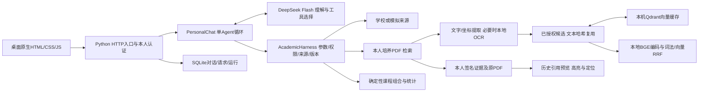

# 现版本介绍与优化建议

核对日期：2026-10-25。业务代码基线 `7004122`；此前重启验证记录 `7671f5d`。本文件是课程作业介绍的当前事实入口，旧设计文档保留历史语境，不能将其中的目标架构直接当作当前实现。

## 适合怎样介绍

**浙大教务助手：用自然语言连接本人教务查询、培养资料检索与课程组合计算。**

问题不是缺少一个聊天框，而是成绩、培养 PDF、课程信息和时间条件分散。项目将这些来源接入同一个对话入口，由模型理解请求、选择受控工具，确定性程序负责记录统计和条件计算，回答保留可追溯的来源。

讲解建议用五分钟串起四件事：为什么做（40秒）→真实功能与操作（100秒）→Agent、RAG和数据边界（100秒）→遇到的问题及工程演进（60秒）。演示使用本机即可；介绍网页与可供他人登录的公网教务应用是两个不同交付。

## 当前能力与不能混淆的事实

| 能力 | 已有实现或验证 | 介绍时的边界 |
| --- | --- | --- |
| 学校与模拟登录 | 共用主应用、Agent/Harness、查询及RAG，认证和来源提供层分流 | 不是学校官方SSO；学校密码与连接凭据只在内存 |
| 本人教务 | 成绩、课表、考试、培养资料的受控查询和辅助页面 | 来源缺项不等于零；不自动选退课 |
| 对话规划 | 限定历史课程的确定性组合、锁定、修改及比较 | 历史成功流程不是所有自然语言表述都可靠；当前可选资格、考试与正式培养适用未验收 |
| 持久RAG | 2023—2026批次604份PDF，176,915条原文向量；Qdrant服务端，去重缓存43,089条 | 批次清单不证明学校所有专业/方向全量；入库数量不是问答准确率 |
| 登录异步准备 | 有界后台执行；2023—2026只复用，其他可信年级检查缺项再增量 | 不是所有教务数据后台全量同步；已覆盖年级缺项不自动补写 |
| 原文追溯 | 引用页码、片段坐标高亮及页内定位参数；多轮历史PDF预览 | 历史预览与当前推理分开；同一授权代际、最近256签名版本，不承诺跨登录永久链接 |
| 对话存储 | SQLite已有本人归属的对话、请求和运行记录 | 内存学校认证状态不能随服务重启恢复，不能称为跨设备长期账号系统 |

本轮读取Qdrant两个集合均green，数量仍为176,915和43,089。上轮全套工程检查1553项（1542通过、11跳过）；工程测试不代表完整语义或用户体验验收。

## 当前架构：应画出的真实链路

需要特别讲清：主应用先确定本人获准的文档和候选，再从Qdrant按文本标识复用向量，沿用本地相似度和RRF流程；管理CLI有独立服务端KNN路径。不能将其描述成“模型任意搜索所有专业的共享向量库”。目前没有前置Embedding工具路由、独立精排模型、第二评审Agent、Redis或微服务。

源码入口：`scripts/run_vector_app.py`、`course_assistant/personal_chat.py`、`academic_harness.py`、`persistent_semantics.py`、`curriculum_preparation.py`、`personal_evidence.py`、`storage.py`。完整运行边界见《培养方案向量库运行指南》。

## 介绍前优先改什么

以下是建议与复现样本，本轮取材没有直接修改业务行为。另起新对话使用明确的标准表达后，生成7.5/7.5/8学分三套组合、保留锁定改硬周五（7.5/7.5/9学分）、仅比较A/B三轮均完成；说明问题集中在部分表达和澄清后的状态恢复，不能概括成计算功能整体不可用。

| 优先级 | 现象及证据 | 最小优化方向 | 可观察验收 |
| --- | --- | --- | --- |
| P0 数字一致性 | 本次真实回答正确引用毕业论文8.0学分，却夹入“即4学分” | 对已解析课程行的学分/学期输出做一致性核对；修正回答组装或约束，不新增第二Agent | 同一答案不出现冲突数字；8.0对应8学分，四春夏是学期；遇歧义保留原文 |
| P0 连续条件 | 用户说“其余条件保持”，仍要求再次确认此前周五偏好 | 核对明确条件继承和模型参数投影；避免用“本轮没重复”否定既有条件 | 补课程池不丢门数/学分/周五偏好，真正修改只覆盖对应项 |
| P0 澄清恢复 | “生成3套、每套3门”受阻后，用户撤回套数要求，旧未解析硬条件仍留在状态里 | 分离方案套数与课程门数；用户明确撤销条件后更新未解析约束集合 | 旧“生成3套”不再阻塞；每套3门、至少6学分的同义表达得到一致约束 |
| P0 演示稳定性 | 既往Qdrant未知退出；启动脚本只启动时检测；停止只等端口曾造成WAL锁竞争 | 演示前检查主应用、向量服务、模型配置和登录；必要时增加进程托管与有界重试 | 重启等旧进程退出；故障清晰显示降级，恢复可验证，不能用登录状态代表数据库健康 |
| P1 文档统一 | 旧架构正文仍有“不引入向量数据库”“后台预热未来”等历史阶段描述 | 明确当前实现入口，图分现状和未来；README启动和包内提示词保持一致 | 介绍页不照搬旧目标图或旧PID，不宣称未实现能力 |

这几项优先于为了展示而接入Redis或迁移数据库。展示资料保留受阻与错误样本；不能用历史成功视频替代本版真实结果。

## 后续工程化路线

| 阶段 | 建议工作 | 当前基础与实施理由 | 完成标准 |
| --- | --- | --- | --- |
| 单机可靠运行 | 主应用/Qdrant托管、配置检查、优雅退出、版本回滚、健康探针 | 已有统一启动脚本和健康接口，但无持续守护 | 异常退出可观测，恢复不破坏库；故障演练后数量/哈希一致 |
| 数据质量与生命周期 | PDF批次覆盖矩阵、缺项清单、OCR抽检、版本去重、引用保留策略、备份恢复 | 已有清单/哈希/版本、原PDF与派生库 | 展示按年级/专业覆盖的分母；备份包含源PDF、清单、SQLite和Qdrant，并实做恢复 |
| 账号与历史 | 明确平台身份、学校连接、授权代际、对话历史的独立生命周期 | 当前realm/owner/session隔离和SQLite已存在 | 重登录可按本人授权查看允许的历史；历史PDF重授权不扩大权限；退出及撤权可靠 |
| 外部访问 | 先独立静态介绍站；在线应用再处理域名/TLS、反向代理、学校网络与认证许可 | 当前HTTP服务只绑定回环并限制Host，不能只加域名就公开使用 | 部署环境与配置可复现；向量服务不裸露；真实学校连接经过目标环境验证 |
| 并发与任务 | 先测瓶颈，再引入跨进程限流、任务队列、幂等/重试与容量控制 | 现有登录池2工作线程、容量4，队列状态内存中；学校连接也在内存 | 断线/重启/重复提交无重复写；按用户和供应商配额拒绝或排队，压测报告给出实际容量 |
| 存储扩展 | 单机继续SQLite；出现明确写争用或多实例需求后评估PostgreSQL | 已有持久化，不能写成“从零增加对话数据库” | 迁移校验行数/归属/约束，回滚演练成功，再切换生产读写 |
| 可观测与成本 | 请求ID贯通、来源/模型/Qdrant耗时、编码缓存命中、失败率、token预算 | 已有运行证据可复用，不需要日志平台起步 | 区分模型慢、学校慢、检索降级；日志不含凭据和完整个人来源 |
| 发布质量 | 固定依赖和模型版本、CI分层检查、小型真实语义评测集 | 既有大量工程回归与真实失败可复用 | 先覆盖本次数字、条件继承、澄清恢复和旧引用案例；发布可追溯可回滚 |

Redis的具体用途应是多实例共享限流/短期状态或任务协调，不能把“用了Redis”当作高并发证明；官方说明强调跨实例一致配额，[Redis rate limiter](https://redis.io/docs/latest/develop/use-cases/rate-limiter/)。现服务使用Python的`http.server`体系，长期公网服务需要重新评估服务入口与部署边界；[Python官方文档](https://docs.python.org/3/library/http.server.html)不建议将其直接用于生产。

## 教务网联动：从辅助决策到确认执行（新增规划）

下一阶段希望将“查资料—生成方案—人工切换教务网操作”串联起来，减少重复搜索和录入。以下均为规划，尚未接入真实选退课写操作；本次只更新介绍资料，不执行选课。

| 阶段 | 用户可获得的能力 | 设计重点与完成标准 |
| --- | --- | --- |
| 信息同步与核对 | 在获准接口范围内核对当期课程、教学班、选课轮次、本人已选结果和课表 | 标注查询时间；区分容量、余量、志愿和正式中选；字段或接口未获准时明确不可用，不从历史班次推断当前可选 |
| 官方页面联动 | 从方案中的课程跳到教务网对应课程/教学班或选课页面 | 以稳定课程及教学班标识匹配；学校支持链接时精确跳转，否则展示可复制信息；不在URL携带凭据，不把打开页面记为选课成功 |
| 待选清单与提交预览 | 将选定方案转为待选清单，展示课程、班次、时间、学分和冲突检查结果 | 提交前重新核对当期规则、身份、选课窗口与资格；旧培养课号/新课号映射未确认时阻止自动匹配，不直接提交 |
| 一键选课（条件满足后） | 用户确认清单后，一次发起获准的选课请求，并逐项回显结果 | 前提是学校允许该集成方式、接口已验证且本人明确确认；验证码等由本人完成。防重复提交，超时先查结果再重试；批次部分成功逐项展示，不自动退掉已选课程来回滚 |
| 结果回读与变更提醒 | 将学校确认的结果同步回助手，展示失败原因、候补/志愿/中选状态及课表变化 | 以学校回执和再次查询为准，不以HTTP成功或按钮点击认定中选；提醒频率、渠道由本人设置，不无界轮询 |

推荐在介绍页中画出未来流程：**课程方案 → 官方数据复核 → 待选清单 → 本人确认 → 获准接口提交 → 学校结果回读**。其中“一键”指减少重复操作，不代表跳过学校规则、保证抢到课程或自动代替本人决策。退课作为另一个高影响操作单独设计和确认，不与选课默认捆绑。

当前可讲“规划与教务网形成从建议到执行的闭环”，不能讲“现已支持一键选课”。现状架构图保持不变，联动流程另标“未来规划”。

### 用户提供的真实教务网截图

制作包新增独立的“教务网真实截图”素材位，与本项目界面分开。已收到用户提供的1张自主选课页面原图，其余来源页面后续补充；不生成替代图，不从助手截图推断官方页面。

建议提供4—6张原始PNG：教务网首页/导航、课程搜索列表、教学班详情与选课按钮、已选/志愿/选课结果、官方课表；有适合分享的培养方案入口也可补充。无需为了取材实际选退课，使用现有页面即可。

每张尽量附一句页面名称、学年学期及想展示的功能。保留影响理解的状态字段（例如志愿、待确认或已选），密码、验证码、登录二维码及他人信息不入包。收到后记录原图来源和文件哈希，补充图注、素材预览和网页制作提示词。截图只能证明页面显示内容，不能证明助手已接通对应写入能力。

## 素材与讲解口径

主展示使用本次真实页面PNG和操作视频；旧版资料只作历史对照，并标采集日期。录屏包含等待压缩和结果停留，不作为性能测量。新视频从已登录状态开始，不含重新输入密码；录制流中断后补录了真实结果回看与教务页面查询，字幕和说明标明分段；不伪造登录或PDF阅读器内部画面。

讲解时区分：开发实现、工程测试、真实有限操作、正式业务适用、用户验收。项目可介绍为课程原型及工程探索，不能写成官方教务产品、已生产上线、支持全校并发、全专业完整覆盖、自动选课或已通过完整语义验收。

建议最后用一句话说明演进：先把真实问答与连续条件做稳定，再把服务运行、数据质量和账号历史做可靠，最后按实际需求扩展部署与并发。
