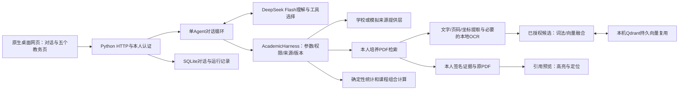

# 浙大教务助手：现版本介绍与素材口径

> 最新素材：第157节全流程重录已完成，使用同一次登录执行两轮真实问答及五页操作，两轮均成功且无自动修复。成片约159秒，不拼接旧素材；源码为包含第156节未提交修复的当前工作区。下方失败记录属于此前录制，保留其历史语境。

核对日期：2026-10-26。前端业务版本 `b777bfe`；后续展示文档提交不改变该界面。本文替代10月25日展示主文档作为新版介绍入口；旧文件保留历史语境。展示包内的版本核对清单记录实际源码提交。

## 产品介绍

**用自然语言连接本人教务查询、培养资料理解和课程方案比较。**

成绩、培养要求、课程和时间安排分散在不同页面。学生需要反复查找、核对，再比较选择。浙大教务助手将这些工作放进同一个对话入口：模型理解问题、选择受控工具；程序完成记录查询、检索和确定性计算；五个教务页面辅助核对数据。

这是使用 Codex 协作开发的课程项目。已走通限定范围内的真实流程，尚未量化验证节省时间、推荐质量或全体用户效果；不把平台或模型的能力全部归为个人实现。

## 两条能力线与五个辅助页面

| 能力 | 当前实现 | 介绍边界 |
| --- | --- | --- |
| 教务问答 | 本人学校登录、成绩/课表/考试/毕业自审读取，培养PDF检索与引用追溯 | 缺项不等于零；正式培养适用和完整语义仍需核验 |
| 对话式课程规划 | 在获准的2026—2027秋冬历史班次中生成、锁定、调整、比较课程组合 | 历史条件计算不等于当前可选，不执行选退课；部分连续表达仍有失败样本 |
| 培养进度 | 模块展示要求/已获学分、门数和学校自审结果；行内展开直接归属课程 | 不另列全量课程表，不将未知状态认作欠课，不把父子模块学分相加 |
| 成绩记录 | 按学年学期查询，即时搜索，成绩/学分表头排序，课程行内明细 | 页面只保留学期成绩；主修历史工具仍可由对话使用，未据不完整匹配增加主修筛选 |
| 我的课表 | 周课表与未定位时段课程，同页课程详情 | 本轮沿用原布局；未返回时段不能认作空闲 |
| 考试安排 | 按日期分组，时间/课程/类型/地点对齐，未知日期独立保留 | 期中/期末是独立事件；缺时间或地点不等于取消考试 |
| 当前选课 | 保留当前页面已选教学班与只读目录/班次预览 | 用户决定先保留；志愿、页面已选、正式中选不混为一谈 |

独立“本轮方案”页面已删除；方案卡片、比较和调整保留在原对话中。不要在新介绍页的导航图或功能截图里恢复旧入口。自然语言对话仍是主入口，五页不是五个独立智能体。

## 实际架构与职责

学校与模拟账号共用主应用、Agent/Harness、查询和RAG，认证及来源提供层分流；服务端按realm/owner/session隔离。模型不能绕过本人授权或任意执行终端脚本。主应用先限定获准候选，再复用Qdrant向量并做本地融合；不要画成任意检索所有专业的共享向量库。管理CLI另有KNN路径。

Python标准库、SQLite、原生HTML/CSS/JavaScript是主要技术基础。持久向量服务绑定回环，学校认证连接在内存；重启会影响登录。没有第二评审Agent、独立精排、Redis、多实例或正式公网教务服务。源码入口见 `scripts/run_vector_app.py`、`course_assistant/personal_chat.py`、`academic_harness.py`、`persistent_semantics.py`、`personal_evidence.py`、`storage.py`。

## 介绍页排版与五分钟讲解顺序

1. **首屏：定位与实际产品图（40秒）**。一句产品价值，主按钮播放现版操作视频，次按钮看项目说明。用当前首页或培养模块图，不把代码目录作首屏。
2. **真实使用：两条能力线（100秒）**。问答以毕业自审/培养原文为例；规划说明生成—锁定—修改—比较。五页只用一组可切换的大图，不堆五套长表。现版页面视频为主，旧对话演示放历史案例并标日期。
3. **为什么可信：职责与证据（100秒）**。用一张架构图解释模型、Harness、来源、计算、RAG；给出一个原文追溯案例，区分来源记录和模型解释。
4. **迭代与下一步（60秒）**。用五个里程碑讲工程演进，最后说明关键未完成事项和下一阶段验收目标。

配色沿用产品的浅底与蓝色重点，桌面优先，留白和大图为主。不做测试数量排行榜，不虚构用户增长、准确率、学校背书或节省时长。介绍站只展示资料，不收集学校账号密码，不连接教务后端。

## 开发历程与当前改进方向

| 阶段 | 工程变化 | 不能扩大的结论 |
| --- | --- | --- |
| 来源与规则基础 | 原始交接输入、课程/班次/时间建模、确定性规则 | 23条候选规则仍待审核 |
| 本人教务与单循环 | 学校登录、受控取数、SQLite记录、Agent/Harness | 学校正式SSO许可未确认 |
| 课程方案连续调整 | 限定历史数据生成、锁定、修改、比较 | 部分成功流程不代表全部自然语言表达已验收 |
| 持久RAG与原文追溯 | Qdrant复用、登录异步准备、PDF坐标引用与历史预览 | 既往批次入库数量不是全校覆盖或问答准确率；本轮不重查库数量 |
| 直接数据展示 | 毕业自审与只读选课预览接入；五页独立；模块内展开；成绩与考试精简 | 桌面实页和工程回归不替代用户体验或正式培养认定 |

优先完善回答数字一致性、连续条件继承及澄清后的恢复，并复用已有真实失败案例验证。10月25日演示曾出现毕业论文学分文字矛盾和条件恢复受阻；本轮未重跑这些模型案例，因此不宣称全部修复。

后续工程路线按实际需求推进：单机服务托管与恢复 → 数据覆盖/版本/备份恢复 → 本人身份与历史生命周期 → 独立介绍站 → 经许可的在线服务及容量验证。Redis/PostgreSQL/多实例仅在瓶颈和部署需求明确后评估。官方页面跳转、待选清单、本人确认后的选课提交与结果回读仍是规划；当前只读预览已实现，不能把它与选课写入混写。

## 本次素材与验证边界

首版素材为10月26日实际桌面五页截图和分段录屏。随后按用户要求补录真实账号密码登录及三轮模型对话，密码只以掩码出现。完整版按登录、真实对话、同日此前五页视频拼接，保留缺项与回答失败，不冒充一次登录下的连续全流程。静止段压缩或关键结果延长停留，不作为接口性能基准。

10月25日对话演示若收入包，单独放“历史演示”，保留原说明及失败样本。它用于理解两条能力线和已知问题，不是现版本导航或本轮模型验收证据。当前页面的方案结果在原对话显示，旧视频中的独立方案页不可照搬。

最终工作区192项Web回归通过；三个开发阶段分别核对，阶段复验结果写入开发进度。无后端重启，无选退课，不扩大来源范围；后续补录实际发起三轮毕业自审问答（含一次重试），不重新证明历史课程组合流程。首轮概况成功；课程明细追问被能力表述规则拦截，重试先遇到JSON格式错误，内部修复后仍被拦截。学校取数和查询返回均成功，不能称为数据源返回失败。是否误拦截仍缺被拒最终原文证据。素材仅本地交付，未上传或公开发布。

## 官方教务截图是否需要补充

介绍助手自身功能不依赖额外官方截图。若要说明“数据来自哪里、官方页面如何对应”，建议补齐：毕业资格自审、学期成绩查询、学生课表、考试查询、培养方案列表/PDF。已有一张用户提供的自主选课原图可作来源参考，原始拍摄时间未提供。

每张提供页面名及学年学期，保留标题、筛选条件和表头即可；不必截全量数据或为取材执行选退课。姓名/学号可遮挡，密码、验证码、二维码、Cookie和开发者工具请求头不需要入图。优先补毕业资格自审、成绩查询和培养方案PDF；课表与考试可后补。官方图与助手图分栏标注，官方截图不能证明助手已接通写入。
