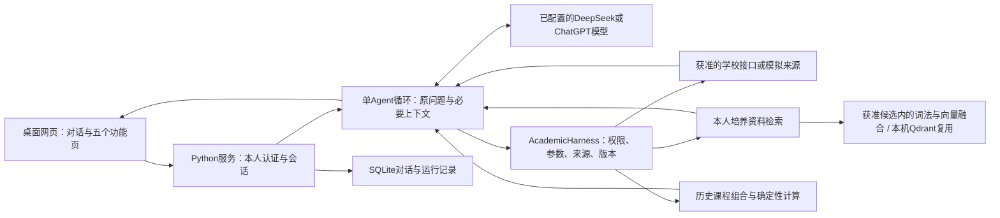

# 浙大教务助手：最新版展示口径与素材说明

更新：2026-10-29。供2026-10-30项目展示和ChatGPT制作介绍网页使用。本文件替代10月26日材料作为当前介绍入口，旧材料保留历史语境。

本轮基线为 `96e1a10`，业务代码未修改。录制前工作区干净，运行进程与最后启动记录及关键源码哈希一致，实际服务的前端文件与磁盘一致。本轮新增展示文档、验证记录及私有媒体；完整文件版本以交付包的核对清单为准。

## 1. 一句话介绍

**把分散的教务信息放进一个自然语言入口，让学生查记录、读要求，再比较和调整课程组合。**

学生提出问题，模型理解需求并选择工具；程序负责本人权限、来源读取、检索、学分和时间计算。对话是主入口，五个功能页面用于查看和核对原始业务记录。

这是使用Codex协作开发的课程项目。介绍个人贡献时按实际承担的需求梳理、产品设计、数据与规则核对、实现协作和验收工作讲述；不把模型训练、第三方模型能力或全部AI生成代码归为个人独立实现。当前没有经过量化验证的节省时间、准确率、用户规模或学校背书。

## 2. 两条能力线与五个功能页

| 功能 | 当前实现 | 展示边界 |
| --- | --- | --- |
| 教务问答 | 本人学校登录、成绩与自审查询、连续追问、培养原文检索与页码引用 | 查询范围、名义学分、已获认定分别表达；缺项保留未知 |
| 课程组合 | 获准的2026—2027秋冬历史班次内生成方案、锁定、修改条件和比较 | 历史试排不代表当前可选、本人完整课表或正式培养适用；不执行选退课 |
| 培养进度 | 模块表、未通过模块筛选、模块内展开直接归属课程 | 学校自审结果按来源展示；不累加父子模块、不作最终毕业认定 |
| 成绩记录 | 独立学期查询、即时搜索、成绩/学分排序、课程明细 | 页面只有学期成绩；对话的主修成绩来源与页面来源不同，不跨用途混排 |
| 我的课表 | 周课表、未定位时段课程、课程详情 | 未返回的时段不能被当作空闲 |
| 考试安排 | 日期分组、时间/课程/类型/地点，未知日期独立保留 | 期中期末分别处理，时间或地点缺失不表示考试取消 |
| 当前选课 | 当前页面已选教学班与本类课程的只读预览 | 页面“已选上”、正式中选与已获学分不混同 |

独立“本轮方案”页面已经删除；方案保留在原对话。不要沿用旧截图重建已删除的入口或过程面板。

## 3. 当前架构如何通俗说明

“模型负责听懂和组织答案，工具负责查资料和计算，Harness负责检查权限、来源和条件。”

沿用一个模型循环，没有第二评审Agent、前置语义路由、独立Cross-Encoder或模型任意终端能力。学校与模拟账号共用主应用和工具链，只有认证与来源层分流；身份权限由服务端验证，姓名或学号不能代替授权。

RAG先限定本人获准资料，再做词法/向量融合和原文定位。Qdrant持久复用与登录后的有界资料准备已接入，不能据此宣称全校覆盖或任意跨专业检索。学分、门数和节次约束由程序计算，模型不替代正式学分认定。

模型菜单现已接入DeepSeek和独立授权的ChatGPT订阅。本次实录使用GPT-6-Luna、high。学校登录和模型授权是两套不同状态；本地运行仍会按授权向所选模型发送问题和必要相关资料。

Harness²是独立开发对照工具：用于比较候选提示与运行时调整，不是主应用每轮问答的第二个Agent，也不会自动把候选发布到运行代码。自动提示改写未显示稳定收益，未采用；真实使用中发现的确定性缺陷由具体修复和回归处理。

## 4. 这次实际录制了什么

本人完成登录后，在当前18875服务中录制。正式问答共八轮：成绩筛选、学分含义、自审实践模块、培养原文、历史课程生成、锁定、放开周五、只读比较。录制前另有一轮成绩查询，用于确认登录和模型；它单列记录，不当作额外演示场景。

八轮均协议完成，终局修正次数为零。实际核对了成绩筛选和汇总、实践课程来源、培养引用文本、三次计算产生的七套方案及21条课程行，并检查锁定、候选集合、门数、学分和版本继承。最后的比较只读取当前方案，没有再次搜索或计算。具体检查见 `validation/showcase_20261029_validation.json`。这是一次有限样本，不能写成“成功率100%”或完整语义验收。

保留一处表述瑕疵：放开周五后，正文说“仍有3个方案”，实际是从两套变为三套；卡片与计算结果的数量正确。本轮未为录制修改业务代码或改写实际回复。

功能页使用既有获准范围：培养自审、2024—2025秋冬成绩、2026—2027秋冬课表、2024—2025秋考试和当前选课只读预览。课表的未定位时段、考试的缺失日期/地点按实际来源保留。

录屏提供完整时序版和等待加速版。两者来自本次同一条CDP画面变化采集，未混入旧版素材；加速版压缩模型等待和长静止段，底部有说明。均无音轨，登录过程未录入。CDP确认帧可能受工具衔接影响，完整版也不作为精确性能基准。

截图为本次真实页面，包含正式录制后的同轮结果回看和高清补拍。没有用模拟数据替换结果。独立PDF预览使用blob地址，自动浏览器拒绝访问；本轮保留培养问答及页码引用截图，不声称已完成该独立预览的视觉复验。

## 5. 开发历程：建议网页使用六个节点

| 时间 | 主要变化 |
| --- | --- |
| 10月9—13日 | 整理来源、课程/教学班/时间与规则，建立合成底座，接入真实模型工具调用 |
| 10月14—16日 | 本人学校登录与按轮取数，教务页面、培养资料检索、权限与来源隔离 |
| 10月16—24日 | 历史课程组合、锁定与连续修改；收敛单循环职责，修复条件和引用版本问题 |
| 10月25—26日 | 持久Qdrant、登录有界准备、PDF引用定位，形成当前五页和简洁对话布局 |
| 10月28日 | ChatGPT订阅接入、模型/强度菜单、完整成绩表与连续问答改善 |
| 10月29日 | Harness²开发对照；真实使用驱动的口语条件、锁定、失败原样重试接续修复；重新录制展示材料 |

这些节点来自开发记录，不代表准确工时。以前的失败样本保留；本轮通过不能覆盖网络失败或其他表述的未知情况。

## 6. 后续规划：与已有实现分开展示

| 优先级 | 下一步 | 完成时需要的证据 |
| --- | --- | --- |
| P0 | 完成本地展示站与用户实际任务验收 | 页面能离线播放；约定任务由用户确认；问题可复现 |
| P1 | 服务托管、可重复部署与恢复 | 干净环境部署、配置管理、健康检查、回滚及重启恢复 |
| P2 | 账号与对话生命周期 | 本人隔离、授权失效、历史分页、幂等、归档与删除可验证 |
| P3 | 根据测量决定并发治理 | 再评估Redis限流、有界队列、租约和派生缓存；给出负载证据 |
| P4 | 经许可的小范围在线试点 | 学校认证/数据路径许可，监控、成本、备份恢复和试点反馈 |

Redis、PostgreSQL、多实例与公网教务服务尚未作为现有能力交付。旧规划中的具体技术方案是候选，不是本轮新承诺或固定工期。继续维护真实失败和回归，不为展示额外扩展业务范围。

正式培养适用、旧培养与新课号对应、最新可选资格/余量、完整语义、长期连接稳定性和用户体验仍有待分别确认。选退课写入及结果回读属于后续获准后再评估的能力。

## 7. 给网页制作者的要求

先讲产品问题与真实操作，再讲架构、迭代和规划。以本包截图和等待加速视频作为主素材，完整录像用于核对。技术图区分“当前”与“规划”；不要把旧架构设想、旧页面或历史失败当作本次录制画面。

介绍站只展示资料，不接学校登录，不收集密码，不调用真实教务后端。素材为本地交付，未上传或发布；个人学业画面的公开范围由本人另行决定。源码包排除凭据、运行数据库、私有原件和受限课程索引，因此不是开箱即用的个人数据副本。

现场话术见 [展示演示台本](展示演示台本_20261030.md)。旧工程设计保留在 [工程化建设与上线规划](工程化建设与上线规划_20261023.md)，阅读其“当前状态”时以本文件和最新开发进度为准。
