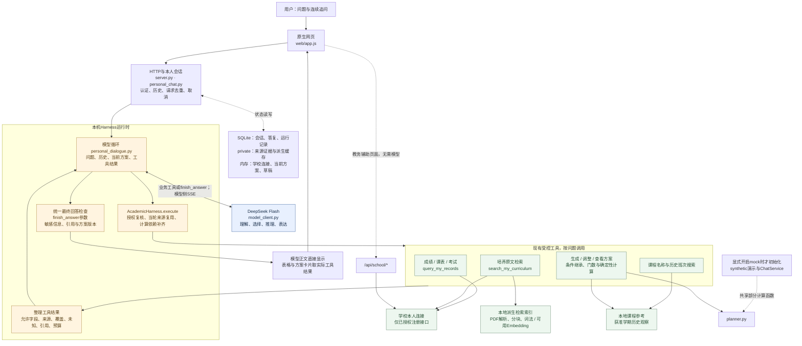
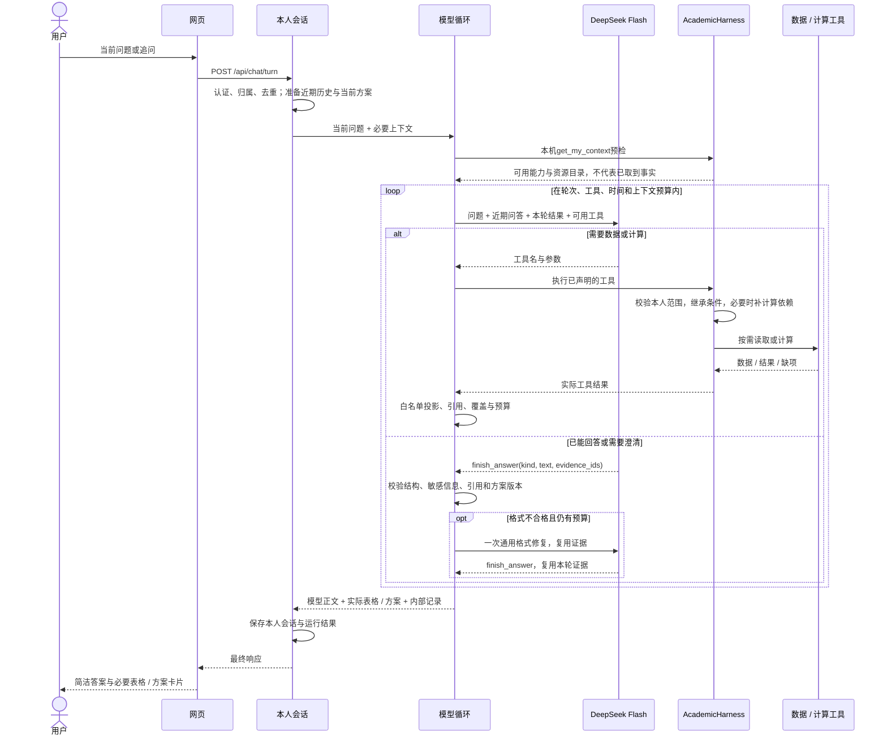

# 浙大教务助手：项目架构与 Agent / RAG 设计

**当前介绍入口（2026-10-25，第137节）：** 持久Qdrant、登录异步准备、多轮PDF引用预览已接入。请先读[项目展示与优化建议](项目展示与优化建议_20261025.md)及[向量库运行指南](培养方案向量库运行指南.md)。下文保留分阶段设计，旧PID、“本轮不引入向量数据库”和“可选后台预热”不代表最新实现。

**实现接续（2026-10-25，第113—117节）：** 工具内部增加模块导航、课程行数和确定性学分/建议学期汇总，保持单模型循环。按用户后续要求，学校与配置型模拟账号共用 Application → AuthManager → PersonalChatService → AcademicHarness → 查询/RAG/回答；仅登录验证和来源提供层分流。SchoolAccountService 读取获授权教务接口，ScenarioDataService 将本机审核记录接入同一个 PersonalObservationStore、将绑定 PDF 接入同一个 PersonalEvidenceService。两者按 realm/owner/session 隔离，模拟账号不能访问学校来源。当前统一主应用v41/PID90346已在18875启用并登录，18882候选已停止；真实成绩/培养与限定历史课程连续旅程分别有限核对。v41只补周五并列比较事实和门数语义，不增加模型层；旧培养与新课号对应按用户要求暂缓。下方第112节“本轮仅设计”是此前阶段记录。

**设计更新：2026-10-25。** 本轮按用户提出的“登录取数 → 模型理解 → 选工具 → 固定查询或RAG → 数据回上下文 → 回答”设计全链路，并评估前置Embedding。已核对当前工作树；本轮交付是设计与图，不修改业务实现、不启停服务、不新增学校取数或模型调用。第109—111节的v36/v37磁盘实现与旧在线进程需分开看，运行版本不能由源码推断。

## 1. 架构决策

采用**单个Agent循环＋受控工具执行＋两种用途的检索**。模型理解原问题、选择工具和组织答案；Harness执行授权、参数、来源依赖及版本检查；结构化查询、文档检索、确定性计算各自提供证据。

Embedding可以出现在工具选择之前，但用途是检索“可能用得上的工具说明”，即语义工具路由；它不直接选择唯一工具，也不替模型生成可靠参数。进入培养资料工具后，再用面向该资料的查询进行证据检索。工具候选索引与文档证据索引分开，不能拿“工具相似度高”当作“答案有依据”。

大模型接收原始问题文本就能选择工具，不要求先把外部Embedding数值送给模型。外部向量用于相似度检索；送回模型的是工具定义、候选提示或检索原文。一次问题向量不保证同时适合工具路由、多个资料子问题和连续追问。

当前`personal_dialogue.TOOLS`有5个基础工具，推荐等工具按能力另行加入。**近期默认保留模型直接选工具，前置语义检索设计为可旁路的辅助层；不默认增加调用延迟或硬性裁掉工具。** 当工具说明显著增多，或路由评测证明有收益，再启用候选缩减。Cross-Encoder精排同样先设可插拔位置，验证收益后启用；当前RRF融合排序不冒称已有独立精排模型。

## 2. 目标总图

实线是主流程；虚线工具候选检索是本次新增的设计能力，尚未实施。图中“资料足够”是模型结合任务和明确缺项作判断，并受可验证事实约束，不表示已有通用答案语义证明器。没有新增第二个Agent或独立评审模型。



[Mermaid图源](diagrams/agent_rag_target_20261025.mmd)。下文第10节保留既有实现图与时序，便于对照当前代码。

## 3. 登录与后台数据准备

将“后台获得对应数据”落实为两个层次，登录成功不等于全部业务数据已取全。

| 阶段 | 后台责任 | 失败及新鲜度处理 |
| --- | --- | --- |
| 登录必需 | 由学校验证凭据，服务端绑定本人；取得基础资料，建立学校连接和会话；登记已开放的数据能力 | 身份未核验则不进入本人查询；密码与学校凭据只在内存处理 |
| 来源状态 | 记录每类来源尚未读取、读取中、可用、部分可用或失败，以及已知版本/范围 | 能力可调用与事实已取得是两回事；没有缓存不能解释为0条 |
| 首次业务使用 | 模型选择工具后，按当前问题的课程、学期、记录范围读取成绩/课表/考试；培养工具取得当前本人PDF，再准备或复用派生索引 | 当轮读取失败则明确失败，不把旧快照称为最新；同轮已成功的同源回执可以复用 |
| 可选后台预热（未来策略） | 登录后在明确范围内准备高频数据或已授权文档索引，受速率、超时、取消约束，不阻塞对话入口 | 默认不做所有学年、所有接口全量同步；预热失败不影响登录本身；预热结果不能绕过回答时的新鲜度检查 |

当前`SchoolAccountService.login`已经建立本人连接并捕获profile；`_personal_services`按认证代次隔离个人观察与文档检索服务。登录自动全量采集、后台队列和全量预建向量并未实现。本设计建议先沿用最小登录准备；后台预热是可选策略，不构成扩采授权。学校动态数据仍按现有当轮取证约定执行。

部署保持一个Python应用内的模块划分：网页与HTTP入口、会话与授权、Agent运行时、学校适配器、查询/检索/计算服务。SQLite保存业务会话等持久状态，私有目录保存来源与派生证据，学校连接及当前认证代次相关状态留内存；本轮不引入微服务、消息中间件或新向量数据库。

## 4. 从问题到工具：前置Embedding放在哪里

先做本人范围与能力预检，再处理原问题、必要近期历史和当前任务。用户的“那这门课呢”必须结合指代对象；用户说“不用查成绩，只解释培养要求”必须保留否定条件；不能只把最后一句孤立向量化。

工具路由的候选资料是受维护的**工具说明卡**，包括功能、适用问题、参数要求、来源、能力限制、使用示例、反例与定义版本。向量化工具说明时不加入真实学生数据。先按已授权能力过滤候选卡，再进行词法/语义匹配；工具执行时仍重新授权。

例如“我上学期数学相关课程表现怎样，培养方案还要求学哪些？”可检索到两张能力卡：成绩读取、培养资料检索。即使两者都属于同一个较大的工具目录，也不能只保留相似度最高的一张。`query_my_records`下的academic、major_academic、timetable、exams可有各自说明卡，但执行仍映射到现有工具名及合法operation，不创建任意学校接口。

启用前置路由后的顺序是：

1. 保留用户原问题，附上明确的当前指代与范围提示；无法可靠补全时由主模型澄清。
2. 用本地Embedding匹配已授权工具说明，产生可有多个元素的候选集合；必要的结束/澄清能力始终保留。
3. 把原问题、必要历史、候选工具的完整Schema及限制送给主模型，由它决定是否调用、调用几个以及参数值。
4. 模型选择工具后，Harness检查参数、本人范围、来源依赖及预算；相似度不提供权限，也不触发业务读取。
5. 低相似度、候选冲突、路由超时或Embedding未配置时，回退到当前可用工具目录；不能把“路由未命中”解释成“没有这种能力”。

近期候选只作为排序/提示，不屏蔽原有授权工具。未来工具多到需要缩减时，应保留“继续发现工具”的路径；该发现工具当前未实现，不能直接假定已有。先在不改变执行结果的影子模式记录候选，再比较是否漏掉复合问题所需工具。工具检索可用词法或向量，不要求必须用Embedding；工具发现与执行分离的通用模式可参考[官方工具搜索说明](https://platform.claude.com/docs/en/agents-and-tools/tool-use/tool-search-tool)。这里只参考架构模式，项目继续使用DeepSeek，未接入该供应商工具。

## 5. 工具执行：固定查询、资料RAG与计算

| 用户需求 | 工具与执行方式 | 能输出的证据 |
| --- | --- | --- |
| 成绩、课表、考试 | `query_my_records`指定已注册operation和合法范围；适配器取得当轮来源，再做结构化过滤、分页或聚合 | 来源行、范围、页数/覆盖、缺项、采集状态；精确记录和统计不走向量Top-k |
| 培养模块、课程条目、附注 | `search_my_curriculum`读取本人当前PDF，在授权语料中进行词法/向量检索或结构化模块遍历 | 原文、页码、模块归属、条件、OCR待核状态和有效引用 |
| 课程名称与代码参考 | `search_course_catalog`查询本地配置参考；限定历史班次沿现有受控工具 | 名称/代码候选和明确数据范围；不能据此断言最新开课、余量或资格 |
| 推荐、排课、保锁调整 | 已声明的生成/调整/查看方案工具，Harness补齐依赖，再调用确定性计算 | 实际输入、硬/软条件、锁定项、版本、可行组合或明确无解/缺项 |

多源问题允许一个或多个工具，返回值逐次进入同一个上下文。独立且适配器允许的只读查询可并行；同一学校连接存在锁或依赖时按顺序执行，本设计不承诺当前已并行。培养规则适用尚未确认时只能做原文说明或条件性分析，不能用模型把名义学分认定为毕业学分。

## 6. 文档RAG：准备、召回、重排与条件补齐

**文档准备路径：** 当前获授权PDF → 来源摘要与版本 → 原生文字/坐标提取，必要时本地OCR → 模块/课程行/表头/附注分块 → 词法索引与文档向量。文档向量与问题向量必须采用兼容的编码器及编码约定；查询前缀、归一化和截断策略都应版本化。已有相同内容和版本可复用派生向量，来源权限和当轮回执仍需检查。

**普通语义问题的查询路径：**

1. 模型根据用户目标形成资料查询，例如从“我还缺哪些课”拆出明确模块/条款查询；保留原问题供最后综合回答，不把整句当课程名称。
2. 先限制本人文档、版本与已知模块；明确课程代码或完整课名优先准确匹配。
3. 词法与稠密向量各召回候选，再去重和RRF融合。当前词法是汉字bigram/词项重合，不称为BM25。
4. **可选精排（设计扩展）：** Cross-Encoder对“资料查询＋候选原文”联合评分，只处理已准入的有限候选；输入可带短模块标题以减少孤立片段歧义。超时则沿用融合排序并记录降级。候选数量、长度及阈值用本地评测确定，不把分数解释为事实真实性或正确率。召回与精排的职责可参考[Sentence Transformers官方说明](https://www.sbert.net/examples/sentence_transformer/applications/retrieve_rerank/README.html)。
5. 精排后按源结构补回表头、父模块、必要附注/例外和续页；不能因为条件文本分数较低就删去。当前条件补齐仍是保守的模块上下文关联，不证明已经找全所有法律式适用条件。
6. 在上下文预算内投影原文，复用同批重复条件；明确省略与继续读取参数。只把已真正传给模型的证据作为本轮回答依据。

**完整列举走另一条路径：** 用户要求“这个模块全部课程”时使用`module_courses`按来源顺序续取；条件遗漏用`module_context`继续读取。不能先只取Top-k再宣称列全，不能用精排删掉低分但确属模块的课程。范围内读取完成与原PDF解析完整性分开报告。

前置路由查询与文档查询不是必然相同：前者可能是“成绩分析＋培养要求”，后者可能拆成“专业选修学分要求”“具体课程认定条件”。仅当规范化文本、编码器、查询前缀、截断设置及可用范围一致时才可复用查询向量；否则重新计算。早算一次向量不保证后续零计算。当前v37只实现文档向量复用，未实现通用跨阶段查询向量缓存。

## 7. 上下文与回答的顺序约束

稳定的流程是“理解请求 → 提出取证动作 → 实际执行 → 将结果交回模型 → 回答或继续取证”。理解问题本来就发生在数据返回前；需要阻止的是在没有对应来源时给出确定的个人事实结论。无需把每个问题都固定成先查成绩、再查课表、最后查培养方案。

每次模型输入保留原问题、必要历史/当前方案、可用工具及本轮工具结果。工具结果通过tool_call_id配对，不只塞进一段无来源的摘要。以下是统一逻辑契约，不要求新建对象表或立刻改写所有已用字段：

| 信息 | 责任 |
| --- | --- |
| `request_id / tool_call_id` | 关联当前轮次、模型动作和实际返回 |
| 本人范围、来源与版本 | 服务端检查；对模型投影仅给必要来源别名和可用状态，不发凭据或本机路径 |
| 数据与证据 | 保留原始值/单位、课程和学期、引用、页码或行定位 |
| 新鲜度与覆盖 | 区分当轮读取/历史参考、全匹配行/部分分页、未读取/失败/确认为空；字段名沿用现有freshness、coverage、listing等 |
| 不足与下一步 | 哪些内容未知、哪些条件被省略、是否还有下一页、能否继续读取 |
| 计算结果 | 标注输入版本、条件、锁定和确定性输出；模型不能自行改数值或补造可行方案 |

回答前按当前任务检查事实依据：成绩概况要有匹配范围及覆盖；“全部课程”要处理分页与投影省略；“周五没课”要有足够完整的课表与时间范围；培养适用或资格未知就保留限制。能够机械验证的条件由代码检查，模型判断结论是否受原文支持；引用有效不等于语义正确。本设计不宣称现有`_final`已经实施了完整任务级证据充分性门禁。

缺项时继续调用工具、向用户澄清，或说明当前不能确定；禁止将接口失败、向量未命中、预算省略混作“学校没有这条记录”。最终仍经过格式、敏感字段、引用与方案版本检查，然后输出简洁正文及真实表格/方案。内部来源与运行记录保留，页面不恢复已移除的过程、依据或调试入口。

## 8. 同一个问题如何走完

例：“上学期专业选修课修得怎么样？培养方案要求多少学分，我还差多少？”

- 登录提供可信本人身份；若“上学期”无法由可信学期上下文确定，先澄清。
- 可选前置路由同时建议成绩与培养资料能力；模型决定具体工具参数，不凭向量分数把某门课归为专业选修。
- 成绩工具取得相应范围的实际记录；培养工具取得模块要求、课程条目和适用条件，必要时续页；两类结果都回到原问题所在的上下文。
- 课程身份、归属或已获学分认定不足时，可以回答“这些记录的成绩情况”和“原文要求多少”，但不计算成正式毕业缺口。规则与映射充分时才交确定性工具计算，模型解释计算结果。
- 用户追问“那明天上午呢”时重新结合指代/日期选择课表工具，不继续沿用培养检索候选；缺校历/周次时不推断完全空闲。

## 9. 实施边界与验收

| 项目 | 当前代码证据 | 本次设计结论 |
| --- | --- | --- |
| 登录与基础资料 | `school_accounts.py`的`login/_personal_services` | 保留；全量预取与后台预热不是现有能力 |
| 模型选择工具、结果回上下文 | `personal_dialogue.py`的`run/perform/_project`，`academic_harness.py`的`execute/resource_catalog` | 保留单循环；不增加分类模型或评审Agent |
| 固定查询/当轮取证 | `school_accounts.py`的`personal_chat_live_tool/local_query` | 保留；向量不替代结构化记录与聚合 |
| 语义工具候选检索 | 尚无专用实现 | 可选扩展；先影子评测，少量工具默认直接声明 |
| 混合RAG、模块遍历/条件续取 | `personal_evidence.py`的`search/_view`与v37记录 | 已有磁盘实现；线上是否启用需另行核验 |
| 向量与融合排序 | `semantic_retrieval.py`的`rank` | 当前本地BGE＋词法＋RRF及文档向量缓存；独立Cross-Encoder精排未实现 |
| 最终答案检查 | `personal_dialogue.py`的`_final` | 当前保证部分结构/引用/版本约束，不保证完整语义 |

后续落地分三步，均在上述架构内：先明确工具说明与数据契约，并补常用任务证据检查；再用影子模式比较“直接选工具”与“前置候选”；最后按同一冻结问题集评估是否增加Cross-Encoder。前置层或精排层没有收益就旁路，不为了出现Embedding而增加固定步骤。登录预热另按真实首问等待瓶颈决定，不和路由改造捆绑。

验收分别核对：

1. 登录仅建立本人范围和明确数据状态；未授权来源不能预取，失败不伪装为可用。
2. 简单成绩、课表、培养问题及复合问题能调用正确工具和合法范围；前置候选不漏掉必要工具，指代/否定/歧义有回退。
3. 模型收到的实际证据包含所需原值、表头和条件；完整列举不受Top-k截断；来源和认证代次变化后旧引用失效。
4. 最终答案对照原文及确定性结果核对，缺数据时不形成确定结论；引用合法与内容正确分开统计。
5. 分别记录登录准备、路由、学校查询、检索/精排、模型生成的耗时与成本；比较错误工具调用率、复合任务所需工具召回、必要证据覆盖、无依据结论和整体延迟，不能只比较向量检索速度。

本轮只核验设计与源码对应关系、图的渲染与需求覆盖；未运行新的业务测试，未实现前置工具路由、Cross-Encoder、后台预热或通用语义门禁。既有工程测试与v37固定PDF结果仍属于原阶段证据，不升级为本设计扩展的验收。

## 10. 既有实现参考

以下保留原实现图和分阶段记录；历史版本、运行状态及“尚未提交”等文字只描述当时状态，当前接续以开发进度最新节为准。目标扩展以上述第1—9节为准。

### 整体架构



“Harness运行时”是现有会话、循环、执行和上下文管理的总称；`AcademicHarness`类只负责其中的工具执行边界。没有新增第二个Agent循环。公开字段解释和上一轮受阻诊断在本机处理，不读取学校；图中集中展示主要数据路径。

学校入口独立创建模型客户端和本人服务。只有显式启用mock才读取演示夹具、原输入清单并创建`ChatService`；原inputs、演示能力和共享计算函数保留。

### 一次提问的实际流程



网页约每800毫秒通过`/api/chat/progress`轮询进度；模型到后端使用SSE。这是两段不同的传输方式。等待时只显示一行状态，页面不恢复依据、过程、核验范围或运行记录入口。底层实际来源、供应商返回的推理和执行记录继续保留。

### 模型与程序的分工

| 职责 | 负责方 | 具体行为 |
| --- | --- | --- |
| 理解问题、历史指代、选工具、课程取舍和表达 | DeepSeek | 按问题查询，结合返回资料推理，直接写正文；资料不足时澄清 |
| 身份与数据范围 | 服务端 | 使用已验证学校连接和本人绑定；模型不能提供身份、任意路径或新端点 |
| 数据进入模型前的整理 | 模型循环与适配器 | 保留来源原值、范围、覆盖、未知、引用；只发送允许且相关的字段 |
| 计算前准备 | AcademicHarness | 自动取得必要本轮来源；同轮同范围复用；失败不拿旧快照充最新 |
| 方案修改与计算 | 方案服务、策略与计算器 | 继承原条件，仅应用获准修改；核学分、观察节次、锁定、固定项和版本 |
| 最终回答 | DeepSeek写正文，程序作边界检查 | 不再要求分来源的claims/sections/analysis；表格和方案仍由真实工具结果生成 |
| 回答是否真正准确、有用 | 真实案例核对与用户体验验收 | 引用存在、格式合法、测试通过都不能证明每句解释正确 |

最终正文可通过现有function calling通道的`finish_answer`返回，也可在content中返回同一严格JSON对象。接口只有一份：

```json
{"kind":"answer","text":"直接回答用户的问题","evidence_ids":["本轮实际来源ID"]}
```

`kind`也可为`clarify`或`not_ready`。只有待澄清上下文才声明请求归属参数。两种传输统一检查引用、敏感信息和方案版本，不接受裸正文或标签包装，不自动补引用。最多一次格式修复；修复上下文列出按来源类型分组的有效编号和当前计算必引编号，排除旧方案，并保留同一事实措辞与简洁要求。真实运行仍有格式修复，不能把允许两种传输说成消除格式失败。v31的供应商JSON模式实验已撤回，未增加新的评审模型或重试循环，也未关闭思考来强制tool_choice。

用户明确要求的课程门数会进入确定性计算器，调整和只读摘要保留该条件。课程取舍和解释仍交给模型；程序不会把格式通过或引用存在当成逐句语义正确。

### 数据与上下文保存在哪里

| 内容 | 存放位置与使用方式 |
| --- | --- |
| 当前问题与近期问答 | 本人会话；最多六轮、总24KB近期问答用于理解指代，旧答复不作为最新事实 |
| 待澄清请求与当前方案提示 | 服务端可信上下文；已有方案的规范条件优先，不再重放旧准备摘要的偏好 |
| 本轮实际来源 | 按需读取，经投影加入本轮上下文；不跨轮整包发送旧工具结果和推理 |
| 学校连接、凭据、当前方案、草稿 | 内存；重启会影响登录和内存状态，不能把SQLite中的旧答复当成可继续修改的当前方案 |
| 会话、答复、引用、运行事件 | 私有SQLite；仍按本人范围访问 |
| 原始来源、PDF、派生索引、回放证据 | Git忽略的private目录；不是接口失败时的最新数据替身 |
| 课程名称及获准班次 | 本地参考；历史班次只支持限定条件测试，不证明最新开课或资格 |

### v31收敛了什么，v32仍保留什么

v31已去掉来源专属的最终回答模板和无调用的正文拼接函数；基础system指令由10,439降至1,622字符，`personal_dialogue.py`由1,985降至1,668行。学校链路对模型隐藏prepare步骤，工具错误统一返回受控原因和下一步；方案默认继承规范状态，“保留原条件”“说明依据”不再累积成硬条件；学校初始化不再依赖synthetic演示。

这些数字只描述结构变化。`course_plan_policy.py`的授权与中文条件校验仍保留，工具领域字段也没有统一改名重写；本轮没有声称彻底消除所有特例。继续保留本人授权、来源新鲜度、上下文预算、锁定/硬条件保护和确定性计算，因为这些不能靠模型自由生成保证。

v33在下一次模型调用前按现有终态版本检查区分方案引用：被替代的工具结果保留调用对应关系与非方案来源，只移除旧方案正文并列出当前引用；原工具结果/历史不改写，旧引用仍被拒绝。成绩列表只替换能绑定到当前引用课程的重复Markdown表，来源表、未知值与周边说明保留。复合保留句中的完整门数项继续进入原策略/计算，不把用户门数要求当成未知条件，也不静默覆盖冲突门数。

v34把当前本人原话中已核实的初次周五soft/hard条件绑定到计算，沿用原学分绑定方式；假设、引述和部分节次仍需原有检查。明确保留句中的“锁定”引用现有控制，不产生新锁。方案事实投影新增精确超出最低学分数、共同课程及周五占用标签，明确只代表返回方案集合；成绩上下文区分记录条数、未加权均值与未知字段。临近工具结果的一条临时指令指导交付与表达，不入历史、不新增模型调用，原始工具结果不改。

各版本工程与真实运行分阶段记录；原失败、条件误拒和语义不足均保留。完整语义、正式培养适用/推荐和用户体验未验收。所有v29以后代码与文档尚未提交推送；当前运行版本以第97节最新记录为准，不能沿用历史PID。以下v32图继续描述未改变的模块边界和典型finish_answer主时序；content严格JSON在同一终态检查处汇合，v33—34补充上述模块内部投影。

| 图 | 可缩放预览 | Mermaid源文件 |
| --- | --- | --- |
| 整体架构 | [SVG](diagrams/architecture_v32_20261022.svg) | [MMD](diagrams/architecture_v32_20261022.mmd) |
| 提问时序 | [SVG](diagrams/request_v32_20261022.svg) | [MMD](diagrams/request_v32_20261022.mmd) |
