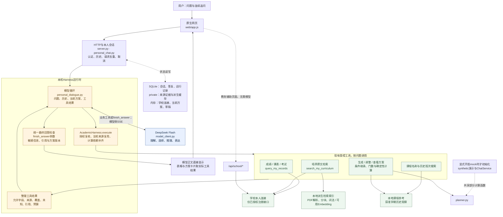
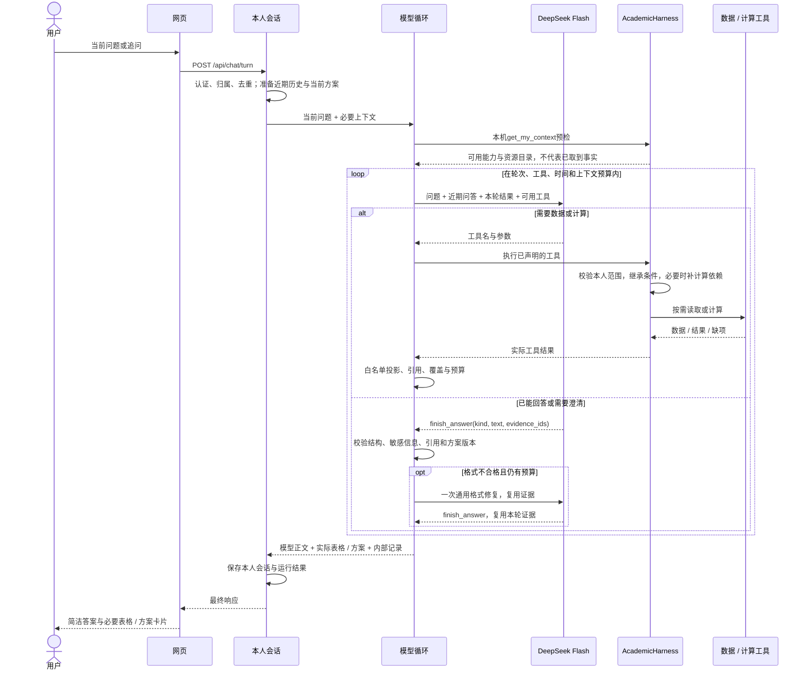

# 浙大教务助手：职责收敛后的项目架构

本文于2026-10-22更新到v34实际代码。18875已启用并登录，仅使用DeepSeek Flash；真实测试与剩余问题见开发进度第97节。v31的职责收敛保持，v32—33已修补最终答复传输、门数与锁课、有效方案引用及重复成绩表；v34在原循环内补充明确初次周五条件绑定、保留锁定引用、有界方案比较事实和最终交付提示，没有新增Agent循环或服务。历史复杂度审查见[原架构与简化建议](项目架构与简化建议_20261021.md)，v31实现过程见[职责收敛实施记录](职责收敛实施记录_20261021.md)。

核心是一个循环：**DeepSeek理解问题并选择工具，Harness取得相关数据或执行计算，再交给DeepSeek组织答案。** 项目仍是本机单Python服务、原生网页、SQLite和本地私有文件。下图中的模块不是独立服务。

## 整体架构



“Harness运行时”是现有会话、循环、执行和上下文管理的总称；`AcademicHarness`类只负责其中的工具执行边界。没有新增第二个Agent循环。公开字段解释和上一轮受阻诊断在本机处理，不读取学校；图中集中展示主要数据路径。

学校入口独立创建模型客户端和本人服务。只有显式启用mock才读取演示夹具、原输入清单并创建`ChatService`；原inputs、演示能力和共享计算函数保留。

## 一次提问的实际流程



网页约每800毫秒通过`/api/chat/progress`轮询进度；模型到后端使用SSE。这是两段不同的传输方式。等待时只显示一行状态，页面不恢复依据、过程、核验范围或运行记录入口。底层实际来源、供应商返回的推理和执行记录继续保留。

## 模型与程序的分工

| 职责 | 负责方 | 具体行为 |
| --- | --- | --- |
| 理解问题、历史指代、选工具、课程取舍和表达 | DeepSeek | 按问题查询，结合返回资料推理，直接写正文；资料不足时澄清 |
| 身份与数据范围 | 服务端 | 使用已验证学校连接和本人绑定；模型不能提供身份、任意路径或新端点 |
| 数据进入模型前的整理 | 模型循环与适配器 | 保留来源原值、范围、覆盖、未知、引用；只发送允许且相关的字段 |
| 计算前准备 | AcademicHarness | 自动取得必要本轮来源；同轮同范围复用；失败不拿旧快照充最新 |
| 方案修改与计算 | 方案服务、策略与计算器 | 继承原条件，仅应用获准修改；核学分、观察节次、锁定、固定项和版本 |
| 最终回答 | DeepSeek写正文，程序作边界检查 | 不再要求分来源的claims/sections/analysis；表格和方案仍由真实工具结果生成 |
| 回答是否真正准确、有用 | 真实案例核对与用户体验验收 | 引用存在、格式合法、测试通过都不能证明每句解释正确 |

最终正文可通过现有function calling通道的`finish_answer`返回，也可在content中返回同一严格JSON对象。接口只有一份：

```json
{"kind":"answer","text":"直接回答用户的问题","evidence_ids":["本轮实际来源ID"]}
```

`kind`也可为`clarify`或`not_ready`。只有待澄清上下文才声明请求归属参数。两种传输统一检查引用、敏感信息和方案版本，不接受裸正文或标签包装，不自动补引用。最多一次格式修复；修复上下文列出按来源类型分组的有效编号和当前计算必引编号，排除旧方案，并保留同一事实措辞与简洁要求。真实运行仍有格式修复，不能把允许两种传输说成消除格式失败。v31的供应商JSON模式实验已撤回，未增加新的评审模型或重试循环，也未关闭思考来强制tool_choice。

用户明确要求的课程门数会进入确定性计算器，调整和只读摘要保留该条件。课程取舍和解释仍交给模型；程序不会把格式通过或引用存在当成逐句语义正确。

## 数据与上下文保存在哪里

| 内容 | 存放位置与使用方式 |
| --- | --- |
| 当前问题与近期问答 | 本人会话；最多六轮、总24KB近期问答用于理解指代，旧答复不作为最新事实 |
| 待澄清请求与当前方案提示 | 服务端可信上下文；已有方案的规范条件优先，不再重放旧准备摘要的偏好 |
| 本轮实际来源 | 按需读取，经投影加入本轮上下文；不跨轮整包发送旧工具结果和推理 |
| 学校连接、凭据、当前方案、草稿 | 内存；重启会影响登录和内存状态，不能把SQLite中的旧答复当成可继续修改的当前方案 |
| 会话、答复、引用、运行事件 | 私有SQLite；仍按本人范围访问 |
| 原始来源、PDF、派生索引、回放证据 | Git忽略的private目录；不是接口失败时的最新数据替身 |
| 课程名称及获准班次 | 本地参考；历史班次只支持限定条件测试，不证明最新开课或资格 |

## v31收敛了什么，v32仍保留什么

v31已去掉来源专属的最终回答模板和无调用的正文拼接函数；基础system指令由10,439降至1,622字符，`personal_dialogue.py`由1,985降至1,668行。学校链路对模型隐藏prepare步骤，工具错误统一返回受控原因和下一步；方案默认继承规范状态，“保留原条件”“说明依据”不再累积成硬条件；学校初始化不再依赖synthetic演示。

这些数字只描述结构变化。`course_plan_policy.py`的授权与中文条件校验仍保留，工具领域字段也没有统一改名重写；本轮没有声称彻底消除所有特例。继续保留本人授权、来源新鲜度、上下文预算、锁定/硬条件保护和确定性计算，因为这些不能靠模型自由生成保证。

v33在下一次模型调用前按现有终态版本检查区分方案引用：被替代的工具结果保留调用对应关系与非方案来源，只移除旧方案正文并列出当前引用；原工具结果/历史不改写，旧引用仍被拒绝。成绩列表只替换能绑定到当前引用课程的重复Markdown表，来源表、未知值与周边说明保留。复合保留句中的完整门数项继续进入原策略/计算，不把用户门数要求当成未知条件，也不静默覆盖冲突门数。

v34把当前本人原话中已核实的初次周五soft/hard条件绑定到计算，沿用原学分绑定方式；假设、引述和部分节次仍需原有检查。明确保留句中的“锁定”引用现有控制，不产生新锁。方案事实投影新增精确超出最低学分数、共同课程及周五占用标签，明确只代表返回方案集合；成绩上下文区分记录条数、未加权均值与未知字段。临近工具结果的一条临时指令指导交付与表达，不入历史、不新增模型调用，原始工具结果不改。

各版本工程与真实运行分阶段记录；原失败、条件误拒和语义不足均保留。完整语义、正式培养适用/推荐和用户体验未验收。所有v29以后代码与文档尚未提交推送；当前运行版本以第97节最新记录为准，不能沿用历史PID。以下v32图继续描述未改变的模块边界和典型finish_answer主时序；content严格JSON在同一终态检查处汇合，v33—34补充上述模块内部投影。

| 图 | 可缩放预览 | Mermaid源文件 |
| --- | --- | --- |
| 整体架构 | [SVG](diagrams/architecture_v32_20261022.svg) | [MMD](diagrams/architecture_v32_20261022.mmd) |
| 提问时序 | [SVG](diagrams/request_v32_20261022.svg) | [MMD](diagrams/request_v32_20261022.mmd) |
