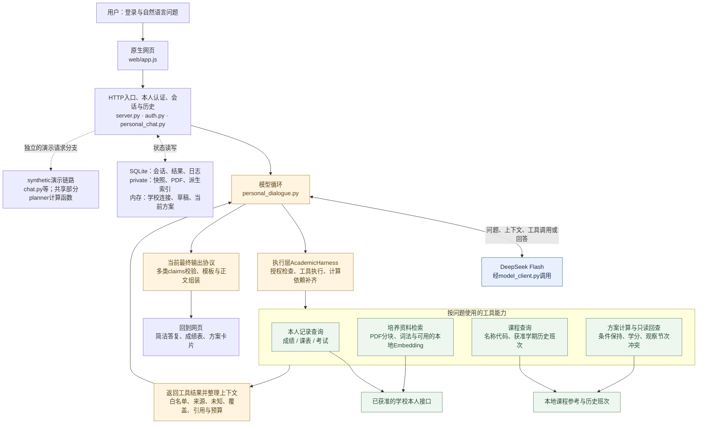
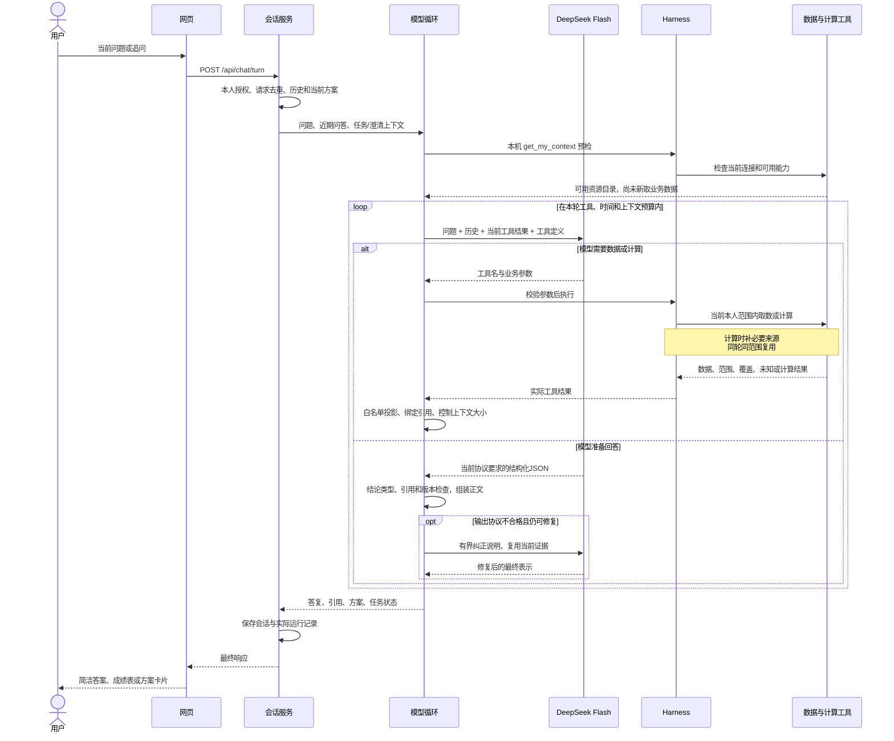
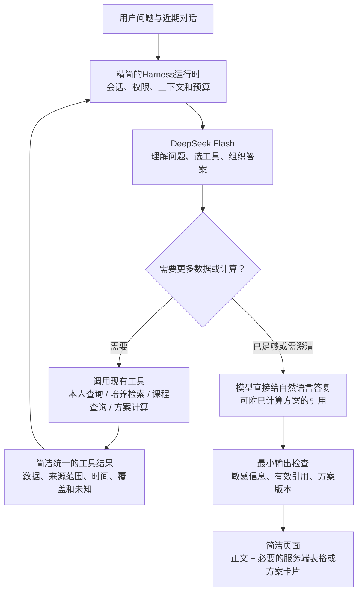

# 浙大教务助手：当前架构与简化建议

后续状态：本文保留v30审查时的架构与建议；职责收敛已在磁盘v31实施。最新架构与Mermaid图请读[职责收敛后的项目架构](项目架构_职责收敛后_20261021.md)，18875仍运行v29，尚未切换新后端。

日期：2026-10-21。依据：当前工作区源码、开发进度第74、90—92节及已有验证回执。本文描述当前实现，并单独给出简化建议；建议尚未实施。

运行状态：18875仍由PID29363运行v29；磁盘包含尚未启用的v30及全部未提交改动。本轮未重启、未调用学校或DeepSeek、未修改业务代码。下方当前架构图按磁盘代码核对，v30仅增加解释事实整理与输出组装，不改变主体连接关系。

## 1. 判断：对话控制层偏复杂，基础设施可以继续沿用

用户需要的核心确实可以概括为：**问题和对话历史 → DeepSeek决定需要哪些数据 → Harness执行取数或计算 → DeepSeek结合结果回答。** Harness应帮助模型完成任务，避免用大量中文句式规则和回答模板代替模型理解与表达。

目前项目已经有这个主循环，但在外面叠加了较重的回答协议、准备状态、规则匹配与修复分支。复杂性主要集中在这些控制逻辑，而非部署架构：当前是一个本机Python进程、原生HTML/CSS/JS、SQLite和私有文件，没有引入多Agent、消息队列或独立向量数据库。

源码规模只是定位线索，不代表这些代码都可删除。当前`course_assistant/`有42个Python文件、20,403行（含空行和注释，含学校适配、解析及演示分支）。主要集中点如下：

| 位置 | 当前事实 | 影响与判断 |
| --- | --- | --- |
| `academic_harness.py` | 125行；负责一次工具执行、当前轮来源回执和计算依赖 | 执行层本身较小，可保留。项目里所说的整个Harness运行时，还包含其他文件的模型循环与上下文管理 |
| `personal_dialogue.py` | 1,985行；`run`456行、`_project`403行 | 工具循环、上下文裁剪、输出协议、语义特例、修复都在同一处，修改影响面大 |
| 同文件`SYSTEM` | 基础指令10,439字符，另加动态历史、能力、工具定义与修复说明 | 指令需要分清必要契约和历史个案；长度本身不能证明答案质量，但增加模型遵循多套格式的负担 |
| 同文件`_final` | 自由结论、成绩摘要、准备检查、课程方案使用不同结构；部分文本由服务端生成 | 有数据却不能直接解释，模型还要先选正确的回答类型。v30追问回放实际出现了analysis结构错误 |
| `course_plan_policy.py` | 733行，包含否定、转述、保留、硬软条件与修改原话的正则规则 | 条件保持必须保留，但继续为每种中文表达补规则不易维护；旧案例已出现解释要求被当成硬条件 |
| `server.py`及`chat.py` | 学校本人链路与synthetic演示链路并存；学校启动也构造演示夹具及`ChatService`，本人服务复用其模型对象 | 增加阅读和初始化耦合。它们并非每轮同时执行，也不能据此直接删除共享计算与输入依赖 |

## 2. 当前整体架构

同一个本地Python服务内部有多个模块，图中的方框不代表独立服务或网络跳转。DeepSeek是外部模型；学校数据只经现有本人连接读取。工具框表示按需调用及结果返回，数据来源边表示读取方向；存储框汇总多处状态职责，不表示只有入口会读写它。

图中虚线表示依赖或旁路，不表示本人每轮都会走它。演示链路实际复用的是`planner.py`等通用计算函数，并非调用本人方案状态；学校主入口不会使用mock身份读取真实资料。当前主链路的方案状态保存在学校连接内存中，会话答复及引用另存SQLite，不能将二者当成同一种持久化。公开教务术语与上轮运行诊断在对话循环本地处理，不经过学校取数。

“我的教务”等辅助页面可通过`/api/school/*`直接调用同一学校适配器，不必经过模型。聊天页通过`/api/chat/turn`发送问题，以`/api/chat/progress`约800毫秒轮询等待状态；后端接收模型的SSE流，但浏览器当前用的是HTTP轮询。底层实际推理与日志保留，v28页面仍只显示简洁状态和核心答案。

## 3. 当前一次提问怎样运行

这个循环由DeepSeek决定需要什么数据。它不是固定先抓取所有后台数据，也不是每个问题都必须排课。三个常见例子：

| 用户的问题 | 合理的数据动作 | 模型负责的部分 |
| --- | --- | --- |
| “这个学期成绩怎么样？” | 在学期明确时读取对应成绩；必要汇总由工具计算 | 选择关注点、结合问题解释，不把简单均值叫GPA |
| “A和C换了哪门课？” | 只读当前保存方案，保留具体课程和节次 | 直接比较与解释，不重新读学校或计算 |
| “周五必须空，其他不变” | 读取当前条件，提交有界修改，继承其余条件并调用计算器 | 理解本轮修改、解释结果和取舍，不自行改学分或解锁 |

当前提供给模型的上下文分为四部分：当前问题；最多六轮、总24KB的近期问答；上轮任务/待澄清信息与当前方案提示；本轮工具返回的相关数据。旧问答只供理解指代，不作为最新学校事实。原工具包和推理不整包跨轮发送。

培养检索是一个可选工具：按轮取得本人PDF，按内容和身份检查后复用或生成本地派生索引，再返回相关原文。它不意味着所有成绩问答都要走向量检索。课程名/代码与获准历史班次走本地参考路径。计算分支只核现有数据能支持的学分和观察节次，不产生正式选课资格或培养认定。

## 4. 建议收敛后的主链路

下面是**建议目标，尚未实施**。保留现有数据适配和计算模块，重点缩小对话控制协议；不增加框架或第二套Agent。

这里的“Harness运行时”是对现有职责的收敛，不是再新增一个类包住现有所有层。DeepSeek负责理解、选择、推理和表达；程序负责可靠执行。具体分工如下：

| 交给DeepSeek | 继续由程序负责 |
| --- | --- |
| 理解当前问题、历史指代与话题切换 | 本人认证、数据授权和已获准来源范围 |
| 选择需要查询的课程、学期与工具；不明确时澄清 | 工具参数类型/范围校验、缺项提示和分页完整性 |
| 根据实际成绩、培养原文与方案组织解释 | 保留原值、未知与来源时间；旧资料不能冒充最新 |
| 给出课程选择理由和方案取舍 | 学分汇总、冲突检查、锁定/硬条件和版本保护 |
| 把回答写得简洁、有用 | 不发送凭据；服务端只呈现真正算出的方案和表格 |

**第一优先级：简化最终回答协议。** 普通答复统一为自然语言正文及可选来源引用；表格/方案由工具结果和服务端绑定。模型不必再为S/P/T等来源学习不同的`claim`写法，也不必选择后端应该拼接哪些段落。保留来源ID有效性与方案版本检查，但不能把引用存在当作正文语义已核验。先在既有成绩说明、保存方案解释上收敛，再接生成/调整；避免一次改动所有入口。

**第二优先级：收敛工具结果和修复。** 工具结果统一外层含义，例如`status / data / source / coverage / unknowns`，内部保留各领域必要字段；同一层处理出站白名单与总预算。`prepare/check`尽量作为计算工具内部实现，保留用户明确问“还缺什么”时的只读能力，减少让模型安排准备步骤。参数错误和最终输出错误使用一套有界反馈，不再针对每种来源追加长篇修复模板。仍保留工具执行和最终输出两个真正不同的校验边界。

**第三优先级：减少中文句式控制。** 让模型提取本轮增量条件，服务端默认继承旧条件，只应用本轮明确提交并校验通过的字段；缺少明确依据的解锁、放宽或范围变化先澄清。逐步替换个案正则，不能先删掉现有条件保护，再期待模型始终记住。近期问答、当前方案和一个必要的待澄清状态通常已足以支持常用续问，不再增加通用任务图。

**演示分支后置整理。** 当前学校运行初始化仍依赖原inputs清单和演示夹具；先拆开模型实例创建与演示初始化的依赖，再评估隔离旁路。`planner.py`等代码确有共享调用，不能按文件名批量删除。既有原始输入、失败证据和本人私有资料继续保留。

## 5. 为什么不能只靠更换提示词或全部放给模型

上一轮真实案例已经证明：模型拿到了两节课的事实，仍可能说成“半天”；v30固定资料回放中又出现“上午”和完成状态解释过强。这说明必要数据和引用检查不自动保证语言准确。另一方面，复杂输出协议也会额外引起格式失败，并迫使开发者不断加模板。

简化方向应当同时减少这两种负担：把关键数据整理清楚，允许模型直接表达；把授权、计算、条件继承这些确实需要程序保证的部分留在程序里。自由回答增加后，语义质量仍需核对少量真实常用问题，不能宣称代码已逐句证明答案，也不再为每句错误新增一种回答协议。

## 6. 源码阅读入口与本轮验证范围

| 阅读顺序 | 源码与关键入口 |
| --- | --- |
| 网页与HTTP | `web/app.js`的`sendAgentTurn / pollAgentProgress / renderAssistant`；`server.py`的`Application / post / make_handler` |
| 本人一轮对话 | `personal_chat.py`的`turn / _conversation_history` |
| 模型的真正循环 | `personal_dialogue.py`的`run / _project / _final`；`model_client.py`的`complete_stream_with_metadata` |
| 工具执行 | `academic_harness.py`的`execute`；`school_accounts.py`的`personal_chat_live_tool` |
| 结构数据与培养资料 | `student_source_client.py`、`student_source_parsers.py`、`personal_observations.py`、`student_plan_acquisition.py`、`personal_evidence.py`、`semantic_retrieval.py` |
| 方案与条件 | `personal_course_plans.py`、`course_plan_policy.py`、`current_term_recommendation.py`、`planner.py` |
| 状态和记录 | `storage.py`、`chat_runs.py`、`chat_progress.py`、`personal_drafts.py` |

本轮仅源码审查、图文整理和文档验证，没有重跑业务测试、发起模型/学校调用或新的用户体验验收。既有v29/v30工程与回放结论仍按原回执分别理解。运行服务及未提交业务代码保持原状；后续重构尚未实施。

三张图均由本机已有Mermaid CLI渲染核对，另提供可缩放预览和可复制源码；导出源与本文代码块保持一致。

| 图 | 预览 | Mermaid源码 |
| --- | --- | --- |
| 当前整体架构 | [SVG](diagrams/current_architecture_20261021.svg) | [MMD](diagrams/current_architecture_20261021.mmd) |
| 当前提问时序 | [SVG](diagrams/request_flow_20261021.svg) | [MMD](diagrams/request_flow_20261021.mmd) |
| 建议简化目标 | [SVG](diagrams/simplified_architecture_20261021.svg) | [MMD](diagrams/simplified_architecture_20261021.mmd) |
