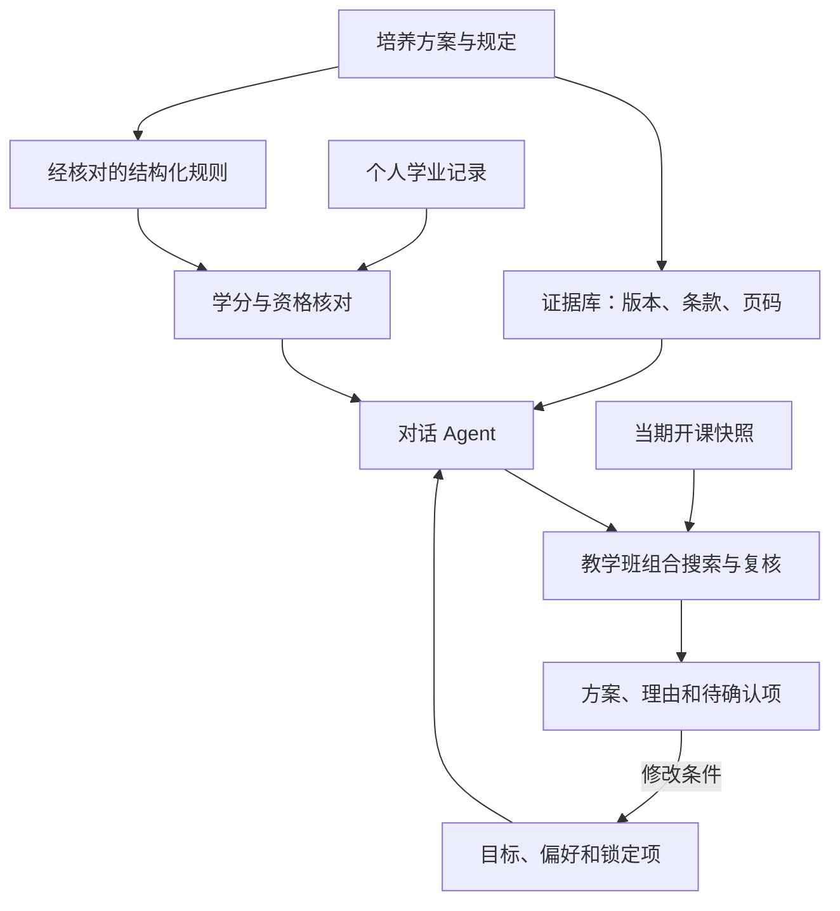

# 基于 RAG 与约束校验的大学生个性化选课辅助系统：分析结论

版本：v1  
整理日期：2026-10-09（Asia/Shanghai）  
用途：浙江大学《大数据信息系统分析与设计》课程项目的初步分析与后续开发依据。

本文整理上一轮已经形成的分析结论。功能、架构和验收内容属于设计建议；“当前状态”描述已完成工作，不代表系统已经实现。原始PDF、网页依据及其适用范围见 [SOURCE_INDEX.md](SOURCE_INDEX.md)，开发接续说明见 [CODEX_HANDOFF.md](CODEX_HANDOFF.md)。所有PDF页码均为阅读器中的物理页码，从1开始。

## 1. 项目定位与当前状态

建议项目题目为：**《基于 RAG 与约束校验的大学生个性化选课辅助系统设计》**。

系统理解学生的选课需求，核对其适用培养要求和学业进度，再结合当期开课信息，形成有依据、可调整的选课方案。学生可以询问规则、查看未完成要求、比较方案，并通过对话修改偏好或锁定教学班。

### 1.1 已取得的材料

| 材料 | 当前数量或状态 | 可支持的工作 |
| --- | --- | --- |
| 课程课件 | 1份，331页 | 提取课程方法与项目报告安排 |
| 培养方案 | 3份，均为2026级上传样本 | 课程定义、要求结构、跨专业差异分析 |
| 真实培养方案课程样本 | 19条：商务12、材料4、新闻3 | 课程身份匹配与来源追溯；并非全量目录 |
| 候选培养规则 | 23条：商务15、材料4、新闻4 | 规则建模与人工核对；并非完整毕业审核规则 |
| 来源差异及待补证据 | 12项 | 处理规则冲突和外部政策依赖 |
| 拟议导入实体 | 11类 | 数据接入字段设计；不是学校API定义 |
| 个人真实学业记录 | 尚未取得 | 暂不能计算当前用户真实的完成情况 |
| 当期真实教学班 | 已取得0条 | 暂不能生成真实当期课表或判断余量 |
| 可运行应用、插件、数据库及自动化测试 | 尚未开发 | 由后续Codex开发阶段实现 |

上轮产物为 [11页初步设计文档](artifacts/选课助手初步设计_v1.docx) 和 [原始数据样本ZIP](artifacts/选课助手数据样本_v1.zip)。其字节内容在本交接包中保留，数据ZIP的展开副本位于 [data](data/README.txt)。

### 1.2 浏览器接入的实际结果

2026-10-09，本次云浏览器会话访问用户提供的培养方案和选课入口后跳转至登录页；继续使用页面上的浙江大学统一身份认证入口时，认证页返回502，刷新一次后仍未成功。未完成登录，未获取当期教学班、教师、时间、容量或余量。这是本次会话的访问结果，不说明该网站长期不可访问。

交接文件不保存登录口令、Cookie或会话信息。后续应在可用且经授权的访问环境中验证页面，或由用户提供页面导出数据。浏览器导入适配目前只完成方案设计。

## 2. 用户问题、角色与产品输出

### 2.1 四个主要问题

| 学生的问题 | 系统应完成的工作 |
| --- | --- |
| 我还缺哪些课程或要求？ | 核对培养方案与已通过、在修、待认定等记录 |
| 哪些课适合接下来修？ | 综合未完成要求、兴趣、建议修读顺序和个人计划 |
| 本学期能组成可行课表吗？ | 对接实际教学班，检查资格、周次、时间和已选课程 |
| 为什么这样推荐？修改条件会怎样？ | 展示依据、要求贡献和取舍，支持多轮调整 |

学生负责确认个人资料、提出条件和比较方案；项目管理员维护方案、核对规则、处理导入错误；学校选课系统提供实际选课结果。项目管理员的数据核对不能替代学校对特殊修读、免修或学分认定的批准。

### 2.2 推荐方案应呈现的信息

- 课程及具体教学班，以及所使用的学期和数据快照。
- 预计修读学分，对哪些培养要求有贡献。
- 周课表、冲突检查结果、必须保留的课程。
- 对兴趣和时间偏好的满足情况，以及取舍理由。
- 推荐依据的文件、页码或条款。
- 数据更新时间、导入覆盖范围和待确认事项。

例如“优先补专业选修，偏向AI，尽量周五没课，保留已经选好的体育课”可以拆成：规划目标、兴趣偏好、可调整时间偏好和锁定项。对话中已经确认的条件需要结构化保存，后续修改时继续生效。

## 3. 从真实培养方案得到的设计依据

### 3.1 先确定适用方案，再进行检索

三份附件均为**2026级培养方案**，不能自动套用于所有在校学生，也不能从网址中的身份参数推断当前用户的专业、年级或适用规则。应按专业、入学年、培养类型、版本、方向和修读路径确定适用方案。

| 项目 | 新闻学 | 材料科学与工程 | 商务大数据分析 |
| --- | ---: | ---: | ---: |
| 最低毕业学分 | 138+8 | 149+8 | 168+8 |
| 通识课程 | 44 | 68.5 | 60.5 |
| 专业基础 | 4 | 2.5 | 12 |
| 专业课程 | 75 | 63 | 80.5 |
| 个性修读总类 | 15 | 15 | 15 |
| 示例课程数 | 3 | 4 | 12 |

新闻学个性修读的进阶路径另列16学分，需结合下文的来源核对事项理解。商务方案完整名称为“商务大数据分析（信息管理与信息系统-统计学）”。表中各主要模块是方案层级数值，不能替代对个人适用条件的核对。

依据：[新闻学第1、3—8页](sources/journalism_2026.pdf)、[材料第1—6页](sources/materials_2026.pdf)、[商务第1、3—7页](sources/business_analytics_2026.pdf)。

### 3.2 课程身份与任选组

材料方案第3页的计算机通识要求，是在以下课程中任选一门：

| 课程号 | 名称 | 学分 |
| --- | --- | ---: |
| CS1002G | C程序设计基础 | 3 |
| CS1006G | Python程序设计 | 3 |

该要求可表达为“允许课程集合内至少完成一门”。若学生已经通过CS1006G，可以满足该项；另一门能否计入其他板块，应依据正式归属或互认规则。

商务方案第3页列出的是CS1001G《C程序设计基础及实验》，4学分。名称接近不能自动决定课程互认；课程号应作为匹配依据，替代关系单独保存。依据：[材料第3页](sources/materials_2026.pdf)、[商务第3页](sources/business_analytics_2026.pdf)。

### 3.3 学分、门数、学时和记点分账

三份方案的“+8”均对应第二课堂4学分、第三课堂2学分、第四课堂2学分。相关活动还涉及记点和基础必修类记点等条件；记点不能直接当成学分相加。

其他认定型要求包括美育2学分、劳动教育32学时、创新创业2学分、心理健康2学分等。系统需记录认定状态和依据，不能机械叠加到毕业学分总量之外；劳动教育的单位为学时。

通识条件同时包含学分和门数。例如新闻学通识选修10.5学分，还要求至少1门通识核心、至少1门博雅技艺，以及适用于人文社科学生的科技创新/生命探索课程门数要求。原文允许的某些条件可以由同一课程同时覆盖，但实际获得学分只计一次。

依据：[新闻学第5、8—9页](sources/journalism_2026.pdf)、[材料第4、8—9页](sources/materials_2026.pdf)、[商务第4、6—7页](sources/business_analytics_2026.pdf)。外部认定课程清单未随本次材料完整提供，不能仅按课程名称推断认定结果。

### 3.4 分层与路径要求

外语L1、L2、L3分别对应6、4.5、3学分。学生层级未知时，返回待补充信息；免修或差额如何处理，需要相应办法。依据：[新闻学第4页](sources/journalism_2026.pdf)、[材料第3页](sources/materials_2026.pdf)、[商务第3页](sources/business_analytics_2026.pdf)。

新闻学专业方向分为国际新闻与传播、数字新闻，不能把两个方向的要求全部叠加。个性修读也有不同路径，自主修读路径中的条件不能直接套到所有路径。例如自主模块要求的跨院课程，涉及开课学院、课程类别及是否在本专业方案内等联合条件。依据：[新闻学第6—8页](sources/journalism_2026.pdf)。

### 3.5 来源差异和未知信息

| 事项 | 已知证据 | 处理方式 |
| --- | --- | --- |
| 新闻学个性修读15/16 | 第7页总类15，本专业进阶模块16 | 保留层级或表述差异，核验路径要求，不直接判错 |
| 新闻学CS1243G性质 | 第4页位于通识必修计算机部分，第10页指导计划标为选修 | 保存两处证据，归属待确认 |
| 新闻学末尾图表 | 第14—15页部分名称与正文不同 | 核对版本或替代关系，不自行决定哪页失效 |
| 商务双学位绩点要求 | 第1页提到相关要求，未给数值阈值与完整课程集合 | 阈值和适用集合保持未知 |
| 外部认定与政策清单 | 培养方案多处引用其他办法 | 记录依赖，补齐前不宣布满足 |

依据：[新闻学相关页](sources/journalism_2026.pdf)、[商务第1页](sources/business_analytics_2026.pdf)。完整待核对清单见 [source_issues.json](data/source_issues.json)。

### 3.6 建议学期与实际开课分开

培养方案课程表使用“建议学年学期”。该字段用于学业规划，不证明某课在当前目标学期实际开设，也不提供教师、班号、周次、余量或强制先修关系。名称中的Ⅰ/Ⅱ、示意图先后顺序和建议学期都不能独立成为硬性先修依据。

数据中应分别保存 `suggested_term` 与实际开课学期。所有实际教学属性必须由相应开课来源补充。

## 4. RAG、规则计算、课表搜索和Agent的分工

| 组件 | 负责工作 | 输出 |
| --- | --- | --- |
| RAG检索 | 在适用方案内查条款、课程说明与政策 | 文件、版本、页码、证据片段 |
| 规则引擎 | 计算学分、门数、任选组、认定与资格 | 满足、不满足、待确认及原因 |
| 课表搜索 | 从教学班候选中寻找满足条件的组合 | 可行方案、冲突、偏好满足程度 |
| 对话Agent | 理解需求、处理歧义、调用工具、解释结果 | 连贯交互与可调整方案 |
| 统一复核 | 对完整方案重算必须条件与数据一致性 | 最终校验结果与待确认事项 |

### 4.1 培养方案入库

识别章节层级、表头、课程号、跨页表格、附注和图形；每条证据保留专业、入学年、版本、章节、文件和页码。先根据明确资料确定适用方案，再在该范围内检索，不能只用语义相似度选择学生适用的方案。

模型可以生成规则候选，但数字、单位、集合、适用条件及例外需要核对。使用受限结构化表达式，不执行从文档或模型文本中取出的任意代码。现有23条候选均保留 `human_review_required=true`、`enforce_automatically=false`；程序演示应使用独立且显式标注的测试规则或记录经过核对的启用流程。

### 4.2 必须条件和偏好

必须条件包括经核实的资格与先修限制、实际时间冲突、用户确认的固定安排和锁定项。偏好可以包括尽量避免早八、周五尽量空闲、兴趣方向和课时分布。先满足必须条件，再比较偏好；多轮对话允许用户明确调整偏好的强度。

毕业必修不意味着都必须在当前学期完成。学期政策另行按版本和适用对象保存。例如2026级新生第一学年秋冬通知给出一般30学分上限，竺可桢学院及双学位学生允许增加5学分；不能推广至所有学生和学期。学校预置和已选课程建议作为初始保留项，后续变化需明确展示影响。依据：[2026级新生第一学年秋冬选课通知](https://zdbk.zju.edu.cn/jwglxt/xtgl/xwck_ckLoginNews.html?xwbh=569D011381027E3FE06329B3CA0A448F)。

### 4.3 搜索与复核

每次生成方案固定培养规则版本、学业记录版本和开课快照。先过滤资格，再逐步加入候选教学班、检查时段冲突，最后按偏好比较并完整复核。一个教学班可以有多个Meeting；若存在已核实的讲授/实验联选规则，应按组合处理。

时间冲突同时检查学期范围、周次集合、星期和节次；跨校区缓冲按明确配置处理，不预设未经验证的交通时间。容量和余量属于带时间戳的观察值，推荐本身不保证占位或最终中选。

首版可用带剪枝的回溯搜索。候选规模增长后可评估OR-Tools等约束求解工具，官方排班示例可供实现参考：[OR-Tools排班](https://developers.google.com/optimization/scheduling/employee_scheduling)。具体技术栈尚未锁定。

### 4.4 无解与未知状态

- 若条件已证实不可兼容，列出具体冲突和可调整的个人条件，不能静默删除锁定项。
- 若只导入部分教学班或搜索达到上限，表述为“当前范围内未找到方案”，不能声称全局无解。
- 资格、时间或认定信息缺失时，返回待确认；未知值不能自动视为满足。

## 5. 业务流程、数据模型与状态

### 5.1 主流程

1. 确认专业、入学年、培养类型、方案版本与目标学期。
2. 导入学业记录，核对课程号、修读状态和认定信息。
3. 分要求计算已完成、进行中和待确认内容。
4. 导入当期教学班，展示快照时间和覆盖范围。
5. 通过对话形成目标、必须条件、偏好和锁定项。
6. 在条件允许时生成2—3套方案，解释要求贡献与取舍。
7. 支持锁定、排除、修改条件和保存新版本。
8. 学生在官方系统完成选课后，导入正式结果并核对。

### 5.2 核心实体

| 对象 | 主要内容 | 关键关系 |
| --- | --- | --- |
| 培养方案 | 专业、入学年、版本、来源 | 一份方案关联多条培养要求 |
| 培养要求 | 类型、条件、单位、出处、审核状态 | 约束课程集合、标签或认定事项 |
| Course课程 | 课程号、名称、学分 | 一门课程对应多个教学班 |
| Section教学班 | 学期、班号、教师、开放对象 | 包含多个Meeting |
| Meeting时段 | 分学期、周次、星期、节次、地点 | 用于实际时间冲突判断 |
| 学业记录 | 已通过、未通过、在修、重修、认定 | 保留修读次数与来源 |
| 学分归属/认定 | 模块分配、条件覆盖、认定状态 | 防止学分重复累计 |
| 学生资料和偏好 | 适用方案、层级、路径、目标、锁定 | 影响规则适用与方案排序 |
| 志愿组/志愿项 | 轮次、分组、顺序、备选班、状态 | 与最终上课组合分开 |
| 数据快照 | 来源、时间、学期、筛选和完整性 | 固定推荐使用的数据范围 |
| 推荐方案 | 条件、班级集合、校验结果、版本 | 支持调整与历史追溯 |

上述为领域模型。`import_data_dictionary.json`的11类实体是首批导入字段设计，名称与领域模型存在概念层面的对应，不构成已执行的DDL或完整数据库模式。实际编码时应统一命名和迁移规则；个人选课状态属于“学生—教学班”的关系，不是所有学生共用的Section属性。

### 5.3 志愿、正式课表和已获学分

浙江大学公开操作手册区分多志愿、待定和已选结果。备选志愿组中的多个教学班不能当成同时上课；正式课表按可能同时生效的教学班检查冲突。原始页面状态应保留，归一状态映射需验证。依据：[选课操作手册第6、8页](https://zdbk.zju.edu.cn/jwglxt/zjdxFilemgr/file_download.html?uid=569CF3B93BFFD98CE0632AB3CA0A55C6)。

已通过或正式认定的记录进入已完成账本；在修进入进行中账本；推荐与志愿属于计划状态。保存方案不占名额，正式选中也不立即变为已获得学分。

推荐状态可设计为草案、基于快照已校验、已保存、需刷新、官方结果已确认。界面应显示状态对应的数据时间和依据。

## 6. 浏览器导入与内部工具

### 6.1 导入方式

培养方案直接从PDF接入；个人记录和教学班优先接受用户导出的结构化文件。浏览器插件的建议流程是：用户打开有权访问的页面并主动点击导入，插件读取已加载信息，展示预览、缺失字段和覆盖范围，再保存结构化快照。

Chrome的activeTab支持由用户主动操作触发的临时当前页权限，内容脚本可读取DOM并向扩展传递信息，见 [activeTab](https://developer.chrome.com/docs/extensions/develop/concepts/activeTab) 与 [Content scripts](https://developer.chrome.com/docs/extensions/develop/concepts/content-scripts)。学校当前页面字段、分页和DOM适配尚未验证，插件尚未实现。

公开手册提示课程列表初始显示10门，需继续加载更多。后续采集要核对分页、滚动加载和教学班展开，不能把当前页标为完整开课数据。依据：[选课操作手册第2页](https://zdbk.zju.edu.cn/jwglxt/zjdxFilemgr/file_download.html?uid=569CF3B93BFFD98CE0632AB3CA0A55C6)。

### 6.2 教学班字段

| 字段组 | 建议采集内容 |
| --- | --- |
| 定位 | 学年学期、课程号、教学班号 |
| 属性 | 名称、学分、类别、教师 |
| 时间 | 分学期、周次、星期、起止节次、校区地点 |
| 条件 | 页面明确显示的对象限制、先修、联选或冲突说明 |
| 容量 | 显示的容量、已选数或余量、采集时间 |
| 范围 | 筛选条件、分页/滚动范围、记录数、完整性 |

缺失值保持为空并记录原因。“未知余量”与“余量为0”不同，未显示先修也不能直接推断无先修限制。

### 6.3 Agent内部函数建议

| 工具 | 输入 | 输出 |
| --- | --- | --- |
| audit_progress | 方案版本、个人资料、学业记录版本 | 已完成、剩余、待确认要求 |
| find_sections | 目标学期、课程集合、快照 | 候选班、范围、排除原因 |
| generate_plans | 候选班、必须条件、偏好、锁定项 | 多个方案及搜索状态 |
| validate_plan | 完整班级集合与数据版本 | 逐项校验和依据 |
| explain_plan | 方案、校验结果、检索证据 | 推荐理由、取舍和待核对项 |

这些是本项目拟议函数，不表示学校已经提供同名API。初期固定工具流程即可承载任务；模型不能自行把候选规则改为已审核，也不能将推荐状态改成官方中选。

## 7. 真实课程演示案例

示例角色主动选择2026级材料科学与工程方案，提出：“我对AI和计算材料感兴趣，想规划专业模块课程，看看还需要补多少学分。”这不代表已经确定当前用户的专业或年级。

| 课程号 | 课程名称 | 学分 | 建议修读 |
| --- | --- | ---: | --- |
| MSE3123M | 基于机器学习的材料设计 | 3 | 三年级冬学期 |
| MSE3124M | 多尺度材料模拟 | 2 | 三年级春学期 |

材料方案第5页规定模块需修满8学分，可在列出的模块课程池中选修；第6页上述两门合计5学分。假设没有其他合格模块学分计入，还差至少3学分。依据：[材料第5—6页](sources/materials_2026.pdf)。

示例回答：

> 培养方案中有两门与你的兴趣相关的课程，合计5学分，可以作为计算材料方向的规划候选。若你没有其他已完成的模块课程，距离8学分要求还差至少3学分。两门的建议修读时间分别为冬、春学期；目标学期是否开课，以及具体教学班和时间，需要当期开课信息确认。

学生随后提出“尽量周五没课，保留已选课程”，系统将其保存为偏好和锁定项；取得教学班后生成方案。若再修改为“周五必须空出来”，应调整约束强度并重新复核。没有真实班级时只展示课程方向和依据；用于验证算法的合成班级必须另存并明确标注synthetic。

## 8. MVP范围、实施顺序与验收

### 8.1 首版范围

首轮聚焦一个专业、一个方案版本和一个目标学期，另外两份方案用于隔离与差异测试。材料专业样本可作为技术演示的起点；真实使用前仍须确认学生适用方案。

技术栈尚未决定。可以评估Python后端、关系数据库和简单Web界面；若后续工作区已有项目，优先与已有技术和结构保持一致。向量检索、复杂Agent框架和高级求解器按效果需要逐步加入。

| 阶段 | 工作 | 完成标志 |
| --- | --- | --- |
| 需求与规则 | 调研选课流程、确认范围、核对候选 | 需求说明与可追溯规则清单 |
| 数据与计算 | 导入、实体关系、学分与时间校验 | 有限样本可以人工复算 |
| 对话与推荐 | 检索、固定工具流程、锁定与修改 | 走通推荐、解释和调整 |
| 验证与展示 | 执行验收、修正问题、整理截图 | 演示、数据、报告一致 |

真实网页适配与个人记录接入待访问条件具备后进行，独立的本地建模和算法开发可先推进。

### 8.2 八项验收设计

以下是待实现和验证的目标，不是已通过的系统测试结果。

| 编号 | 场景 | 预期 |
| --- | --- | --- |
| 01 | 专业/方案切换与近名课程 | 使用正确规则，无依据不互抵 |
| 02 | 已通过、挂科、在修、重修、待认定、重复导入 | 状态正确，已获学分不重复，导入幂等 |
| 03 | 多标签、门数、学时、记点 | 允许的条件覆盖保留，实际学分不重复 |
| 04 | 单双周、分学期、多Meeting、同课多班 | 仅实际重叠判冲突，可选择可行班 |
| 05 | 只有建议学期、先修未知或来源冲突 | 显示待确认和出处，不生成虚构事实 |
| 06 | 多轮锁定与偏好升级 | 保留既有条件，重新校验并解释变化 |
| 07 | 条件不可兼容与搜索/数据不足 | 区分已证实冲突和当前范围未找到 |
| 08 | 备选志愿、预置课程、余量刷新与正式中选 | 状态分离，保留预置项，以官方结果确认 |

测试保存输入、规则版本、快照、用户条件、结果和关键界面证据；模拟班级用人工核对建立期望。尚未测得准确率、响应耗时、节省时间等指标，不预先宣称。

## 9. 与课程作业的对应

课件包含小组信息系统设计报告和阶段性分析安排。第6页涉及需求与痛点、商业计划、业务流与数据流、用例与类关系及动态视图；第170—173页涉及技术、经济、社会可行性；第226页列出需求获取方法；第331页串联角色、用例、动态与数据设计。依据：[课程课件](sources/course_slides.pdf)。

| 课程内容 | 本项目产物 |
| --- | --- |
| 需求分析 | 学生查方案、查开课、排课和调整的现行流程、访谈和优先级 |
| 可行性/商业计划 | 目标用户、替代方式、成本、维护责任与试用假设 |
| 业务流程图 | 学生、管理员、学校系统的任务与异常分支 |
| 数据流程图 | 方案、学业记录、开课快照进入核对与推荐的流向 |
| 用例图及说明 | 导入、查看进度、设置条件、生成、修改、同步结果 |
| 类图/ER图 | 方案、要求、课程、班级、时段、修读记录、推荐之间的关系 |
| 时序图 | Agent调用检索、学业核对、教学班搜索和复核 |
| 状态图 | 草案、已校验、需刷新、官方确认等状态变化 |

真实访谈、效果评价、实现截图和系统测试需在开发过程中补齐。课件中的历史排期不能直接用作本学期截止日期；报告字数、代码硬性要求、分组和当前提交安排未从材料中获得清晰统一的规定，应以教师当期要求为准。

## 10. 下一步开发结论

优先走通一个完整任务：**导入样例资料，核对培养要求，给出能补足缺口的课程候选，再依据对话条件调整教学班组合。**

已有材料可以支持本地数据建模、规则解释和检索开发。当前学生适用信息、真实学业记录、目标学期与实际教学班仍需补齐。原始样本作为可追溯输入保留，模拟数据、开发验证结果和正式来源应有明确标识。

接手开发时先阅读 [CODEX_HANDOFF.md](CODEX_HANDOFF.md)，按其中的第一阶段任务推进；文件与来源校验信息见 [MANIFEST.json](MANIFEST.json)。
